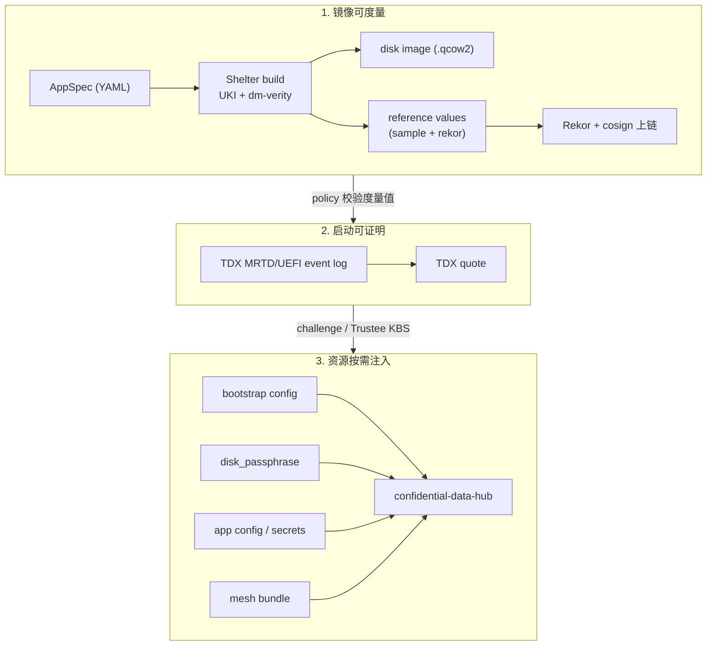

# Confidential Agent

Confidential Agent 是一套面向"AI Agent + 机密计算"的端到端工程化工具链。它把一份声明式的 `AppSpec`（YAML），编译成一台运行在机密虚拟机里的、**全盘加密 + 远程证明 + 受策略约束** 的 Agent 实例，并在主机侧通过 **TNG (Trusted Network Gateway) RATS-TLS** 接入它。

适合的人：
- 想把一个 Agent（OpenClaw、Hermes、自研 LangChain/MCP Server …）一键放进 TEE 跑起来的开发者。
- 需要把模型推理、对话上下文、密钥放进 **云厂商和运维都看不到** 的执行域里的安全敏感场景。
- 要求镜像可度量、启动可证明、密钥按需注入的合规交付方。

---

## 目录

- [Confidential Agent](#confidential-agent)
  - [目录](#目录)
  - [核心特性](#核心特性)
  - [整体架构](#整体架构)
    - [三层信任链](#三层信任链)
  - [快速开始 (Quick Start)](#快速开始-quick-start)
  - [常用扩展场景](#常用扩展场景)
  - [仓库结构](#仓库结构)
  - [深入文档](#深入文档)

---

## 核心特性

| 能力 | 说明 |
|---|---|
| 🔐 **TDX 全盘加密** | Guest 可写层使用远程证明后取得的磁盘密钥加密；密钥只落 Guest tmpfs，每次启动都重新取得，不写入镜像或持久盘。 |
| 📜 **声明式 AppSpec** | 一份 `confidential-agent/v1` YAML 描述服务、镜像、部署、证明、密钥、资源 6 个维度，CLI 自动驱动构建/部署/销毁。 |
| 🛰 **远程证明模式** | `sample` 模式（开发自验）与 `rekor` 模式（基于 Sigstore Rekor + cosign 的供应链透明日志）。生产推荐 `rekor + required=true`。 |
| 🗝 **Challenge / Trustee** | 同一度量镜像支持临时 challenge 注入或独立、持久的 Trustee KBS；Trustee URL 只在部署时注入，重启不要求本地 CLI 在线。 |
| 🌐 **TNG RATS-TLS Mesh** | 多个 Confidential Agent 实例之间、以及主机 `connect` 子命令到 Guest 的连接，全部走带远程证明的 RATS-TLS（attest + TLS）。 |
| 🛡 **运行时策略 PEP** | 内置 `cai-pep`（Policy Enforcement Point），把 Agent 的 `exec` 工具调用强制隔离到只读、无网、限资源的 Docker sandbox，并按 path/command 模式拒绝。 |
| ☁️ **云资源全自动化** | 通过 [Shelter](https://github.com/inclavare-containers/shelter) + Terraform 自动完成 OSS 上传、自定义镜像、ECS 实例、安全组规则、镜像挂载等阿里云资源编排。 |

---

## 整体架构

### 三层信任链



每一层都对应仓库中的具体组件：

| 层 | 组件 | 代码入口 |
|---|---|---|
| 镜像构建 | `shelter` crate 渲染 Shelter YAML，由外部 `shelter` 二进制产出 UKI 镜像和 reference value | [`shelter/src/lib.rs`](shelter/src/lib.rs) |
| Host 控制面 | `confidential-agent` CLI，负责 build / deploy / inject / mesh / connect / status / destroy | [`cli/src/app/commands.rs`](cli/src/app/commands.rs) |
| Guest 控制面 | `confidential-agentd`，运行在 initrd 与 rootfs 两个阶段，负责拉密钥、写资源、配置 TNG | [`daemon/src/app.rs`](daemon/src/app.rs) |
| Guest 数据面 | TNG 做 RATS-TLS 网关；Trustiflux 做证明协议 | `examples/openclaw/install-openclaw.sh`, [`shelter/src/lib.rs`](shelter/src/lib.rs) |
| Agent 沙箱 | `cai-pep` 把 Agent 的 `exec` 工具下到 read-only/no-net Docker sandbox，并对外暴露 `attest` 子命令 | [`cai-pep/src/main.rs`](cai-pep/src/main.rs) |

---

## 快速开始 (Quick Start)

只安装宿主机控制面与原生工具时，推荐从 [v0.3.0 Release](https://github.com/inclavare-containers/confidential-agent/releases/tag/v0.3.0) 下载 `install-rpm.sh`，运行 `sudo bash install-rpm.sh --version 0.3.0`。它会校验并安装 `cagent` 与配套 `shelter` RPM（支持 Alibaba Cloud Linux 3 `x86_64`），无需编译 Rust 源码；本地 `confidential-agent` CLI 从不在宿主机自动安装任何应用客户端，详见 [RPM 安装与预构建镜像流程](docs/rpm.md) 和 [宿主机依赖](docs/host-dependencies.md)。

### 一键部署（One-Click）

`one-click/install.sh deploy` 默认采用 **CPU OpenClaw 官方预构建共享镜像**并开启 Web / TUI 接入。传入 `--image-source build` 可本地构建镜像。脚本按选定的 `--harness` 和 `--access` 安装所需的本地客户端。

- **原生网络服务（经 TNG `connect` 隧道接入）**：OpenClaw Gateway（`web+tui` / `web` / `tui`）、Hermes HTTP API（`http`）、Codex 带鉴权 WebSocket CLI（`ws`）、OpenCode Web/attach（`web+attach` / `web` / `attach`）、DSH 带鉴权 Web（`web`）。
- **认证管理 SSH 接入**：Claude Code（`claude-code`）、Qoder（`qodercli`）、Pi（`pi`）通过远程证明下发的实例级密钥执行 `confidential-agent ssh <id> --tty -- cai-agent`（上述原生网络服务也可通过 `--access ssh` 切换为 SSH CLI）。

默认值面向 Alibaba Cloud Linux 3 部署机：

| 参数 | 默认值 |
|---|---|
| Image Source | `prebuilt`（官方预构建共享镜像；可选 `build` 本地构建） |
| Harness / Access | `openclaw` / `web+tui` |
| Model | `qwen4-max`（未显式指定模型时的正常默认值） |
| Region / Zone | `cn-beijing` / `cn-beijing-i` |
| Instance Type / Disk | `ecs.g9i.xlarge` / `200G` |
| Attestation | `rekor` |
| State Dir | `$HOME/.confidential-agent` |

百炼 API 非交互部署最佳实践示例（显式使用 `--bailian-model qwen3.7-max` 覆盖默认模型 `qwen4-max`）：

```bash
export ALICLOUD_ACCESS_KEY="<your-ak>"
export ALICLOUD_SECRET_KEY="<your-sk>"
export DASHSCOPE_API_KEY="<your-bailian-key>"

set -euo pipefail
INSTALL_URL="https://raw.githubusercontent.com/inclavare-containers/confidential-agent/one-click/one-click/install.sh"
INSTALL_SCRIPT="$(mktemp)"
curl -fL --connect-timeout 10 --max-time 90 \
  "https://github.jobcher.com/gh/${INSTALL_URL}" -o "$INSTALL_SCRIPT" || \
curl -fL --connect-timeout 10 --max-time 90 \
  "$INSTALL_URL" -o "$INSTALL_SCRIPT"
sh "$INSTALL_SCRIPT" deploy \
  --non-interactive \
  --yes \
  --region cn-beijing \
  --zone-id cn-beijing-i \
  --instance-type ecs.g9i.xlarge \
  --disk-gb 200 \
  --bailian-model qwen3.7-max
```

官方 GitHub Release 提供不可变 OCI 引用和 `image-release.json` 的可信 SHA-256 摘要。默认通过 `ghcr.1ms.run` 传输 OCI 产物，设置 `CA_GHCR_MIRROR=ghcr.io` 可直连官方仓库。运行时仍使用 TDX 和 Rekor 参考值完成远程证明。

交互式部署（逐步选择 harness、接入方式、模型、是否启用钉钉 `--enable-dingtalk` 以及 operator 访问 CIDR；直接执行 `sh "$INSTALL_SCRIPT"` 即可）：

```bash
sh "$INSTALL_SCRIPT"
```

在百炼/CPU OpenClaw 场景下，传入实例级 `--disable-pep` 可关闭该实例的 `exec` 工具策略沙箱控制，同时完整保留 TDX 远程证明与 `cai-pep attest` 能力。CIDR 默认限制为部署机公网出口 `/32`（仅支持 IPv4），非交互可通过 `--allowed-cidr` 传入自定义 CIDR，脚本仍会自动探测部署机出口写入 `deployer` peering；请勿在无保护场景随意暴露 `0.0.0.0/0`。更多双场景细节见 [OpenClaw one-click 最佳实践](docs/openclaw-one-click-best-practice/README.md)。

只安装宿主机控制面组件时，运行：

```bash
sh "$INSTALL_SCRIPT" install-only
```

本地 vLLM / GPU TEE 一键部署示例（另有独立安全推理脚本 [`one-click/install-vllm-inference.sh`](docs/secure-llm-inference-one-click.md)）：

```bash
export ALICLOUD_ACCESS_KEY="<your-ak>"
export ALICLOUD_SECRET_KEY="<your-sk>"

set -euo pipefail
INSTALL_URL="https://raw.githubusercontent.com/inclavare-containers/confidential-agent/master/one-click/install-openclaw-vllm.sh"
INSTALL_SCRIPT="$(mktemp)"
PROXY_URL="${CA_GITHUB_PROXY_URL-https://gh-proxy.org/}"
FIRST_URL="${PROXY_URL:+${PROXY_URL%/}/}${INSTALL_URL}"
SECOND_URL="$INSTALL_URL"
if [[ "${CA_GITHUB_PROXY_FIRST:-1}" == 0 ]]; then
  SECOND_URL="$FIRST_URL"
  FIRST_URL="$INSTALL_URL"
fi
if ! curl -fL --connect-timeout 10 --max-time 90 "$FIRST_URL" -o "$INSTALL_SCRIPT" ||
   [[ "$(head -c 2 "$INSTALL_SCRIPT")" != '#!' ]]; then
  curl -fL --connect-timeout 10 --max-time 90 "$SECOND_URL" -o "$INSTALL_SCRIPT"
fi
[[ "$(head -c 2 "$INSTALL_SCRIPT")" == '#!' ]]
sh "$INSTALL_SCRIPT" \
  --non-interactive \
  --yes \
  --region cn-beijing \
  --zone-id cn-beijing-l \
  --instance-type ecs.gn8v-tee.4xlarge \
  --disk-gb 512
```

部署完成后，OpenClaw 场景会输出本地隧道地址与令牌（保存在 `$HOME/.confidential-agent/one-click/secrets/gateway.token`）：

```text
web:        http://127.0.0.1:<port>/openclaw
ws/api:     ws://127.0.0.1:<port>
token:      <generated-or-provided-token>
ready_json: /root/.confidential-agent/one-click/connect.json
```

### 手动 CLI 分场景速查

使用 `confidential-agent` CLI 手动控制每一步时（完整步骤见 [RPM 与预构建镜像流程](docs/rpm.md) 与 [OpenClaw CLI 分步部署示例](docs/openclaw-cli-step-by-step.md)），构建端使用 `init --stage build`，云镜像导入显式使用 `image publish`（不设单独的 `import` 子命令），实例端直接按具体应用执行 `init <app>`。按手头实际持有的产物选择对应入口：

1. **从零构建共享镜像**。执行 `confidential-agent init --stage build`，进入生成的 `confidential-agent-init/allinone-builder/`，运行 `confidential-agent build --spec build.yaml`、`confidential-agent image export allinone-builder --output image-release.json` 和 `confidential-agent image publish allinone-builder --spec build.yaml --region cn-beijing`。`image export` 输出描述文件的可信摘要。
2. **本机已完成构建**：直接执行 `image export` 与 `image publish`，无需重跑 `build`。
3. **按官方不可变 OCI 引用拉取并导入 ECS**：从官方 Release `image-index.json` 读取 `oci_reference`（`@sha256:...`）和可信 `release_digest`，运行 `confidential-agent image publish --artifact "$OCI_REF" --image-release image-release.json --release-digest "$RELEASE_DIGEST" --region cn-beijing --output published.json`。
4. **预构建产物已下载到本地**：运行 `confidential-agent image publish --artifact ./artifact-dir --image-release image-release.json --release-digest "$RELEASE_DIGEST" --region cn-beijing --output published.json` 校验本地大文件并导入 ECS。
5. **当前地域已有可用 ECS 镜像 ID**：直接执行 `confidential-agent init <app> --image-release image-release.json --release-digest "$RELEASE_DIGEST" --image-id m-xxxx --service-id <id>`（同一 `--state-dir` 已 `image publish` 时可省略 `--image-id`），随后运行 `confidential-agent deploy --spec <dir>/instance.yaml`。
6. **同一云镜像再起新实例**：更换新的 `--service-id` 执行 `confidential-agent init <app> ...` 后直接 `deploy`，可快速拉起同种或不同 `<app>`（`openclaw`、`hermes`、`codex`、`opencode`、`dsh`、`claude-code`、`qodercli`、`pi`）的独立实例。

### 实时状态 TUI

Host 控制面的实时总览使用：

```bash
confidential-agent tui
# 只看一个服务；daemon 每 5 秒刷新，TEE evidence 每 2 分钟重新校验
confidential-agent tui --service openclaw --refresh 5 --attestation-refresh 120
```

TUI 持续刷新本地 service state 与 Guest `:8088/status`，并自动通过 `attestation-challenge-client` 收集新 evidence、校验 EAR。远程认证面板直接展示 TEE、默认 policy 的判定、BOOTX64.EFI 的 UKI SHA-384 实测值与期望值、匹配结果，以及 Rekor URL、artifact 和本地 upload entry；Agents 表展示首选地址、Mesh ports 和 Connect ports，Service Network 面板展示所选服务的公网/私网地址及全部 service、connect、mesh、MCP 端口。`--attestation-refresh 0` 可关闭自动校验，界面内仍可按 `v` 手动校验。常用键为 `j/k` 或方向键选择、`/` 过滤、`:` 命令模式、`r` 刷新、`?` 帮助、`q` 退出。

界面刻意区分这些含义：`Evidence VERIFIED` 表示本次新证据通过默认 appraisal policy；`UKI MATCH` 表示 evidence 中的 UKI 度量与配置的参考值一致；Rekor entry 来自本地构建 upload provenance，不冒充一次新的在线查询；`Mesh/TNG READY` 只表示本信任域 TNG 配置已就绪，不表示已经建立过业务连接。

清理云资源（仅销毁实例运行资源，保留已导入的共享云镜像）：

```bash
sh "$INSTALL_SCRIPT" cleanup \
  --state-dir "$HOME/.confidential-agent"
```

---

## 常用扩展场景

| 场景 | 入口 |
|---|---|
| **GPU TEE（OpenClaw + vLLM / 安全推理）** | `one-click/install-openclaw-vllm.sh` 与 `one-click/install-vllm-inference.sh`；手动模板见 `examples/openclaw-vllm/` 与 `examples/vllm-inference/`（推荐 `ecs.gn8v-tee.4xlarge`）。 |
| **最小 MCP Server** | `examples/mcp/mcp-demo.yaml`，最薄的一个 spec，可作为自定义应用模板。 |
| **预构建镜像导入 / 多实例同镜像复用** | 通过 `confidential-agent image publish --artifact <OCI引用或本地产物> --image-release image-release.json --release-digest sha256:... --region cn-beijing`（或本地构建后 `image export` + `image publish`）导入阿里云自定义镜像，再用 `init <app> --image-release ... --release-digest ... --service-id <id>` 为不同应用或新实例复用同一云镜像；云镜像退役使用 `image unpublish` / `image prune`。 |
| **多实例 Mesh** | 在不同的 spec 文件里使用相同的 `connect` 端口集合分别 `deploy`，CLI 会自动维护 `mesh-bundle.json` 并把对端公网 CIDR 注入安全组。 |
| **管理 SSH 与 Debug SSH** | `release` 镜像通过 `service.ssh: true` 下发每实例独立的远程证明 SSH 密钥（`confidential-agent ssh <id>`）；开发排障也可使用 `deploy.image_variant: debug` + `build.variants.debug.enabled: true`，入向访问由 `peering add --role operator --cidr ...` 控制。 |

---

## 仓库结构

```
confidential-agent/
├── Cargo.toml             # workspace
├── core/                  # 共享数据结构 (AppSpec / BootstrapConfig / MeshBundle / DaemonStatus)
├── shelter/               # 把 AppSpec 渲染成 Shelter build/runtime YAML 的纯函数库
├── cli/                   # confidential-agent (host 控制面)
├── daemon/                # confidential-agentd (guest 控制面 + initrd-fetch)
├── cai-pep/               # Policy Enforcement Point，运行时 sandbox + attest helper
├── one-click/             # 一键部署入口（共享预构建 CPU / OpenClaw-vLLM / 安全 vLLM 推理）
├── tools/
│   ├── policies/          # Trustee/OPA rego（生产 + dev）
│   └── e2e/               # 端到端测试 runner、case 模板与探针
├── cagent.spec            # 原生工具与 CLI 的 RPM
├── packaging/             # 源码准备、固定工具下载、预构建镜像发布与 RPM 打包
├── hack/                  # 配套 Shelter RPM 与官方预构建镜像元数据解析器
└── examples/
    ├── allinone/          # 8 合 1 共享预构建镜像（OpenClaw / Hermes / Codex / OpenCode / DSH / Claude / Qoder / Pi）
    ├── openclaw/          # 独立 OpenClaw + cai-pep 示例
    ├── openclaw-vllm/     # OpenClaw + vLLM + NVIDIA GPU TEE
    ├── vllm-inference/    # 加密模型 + vLLM 安全推理服务
    └── mcp/               # 最小 MCP Server 示例
```

---

## 深入文档

- [docs/rpm.md](docs/rpm.md) — `cagent` RPM 安装、预构建镜像信任模型与 6 种手动场景命令
- [docs/host-dependencies.md](docs/host-dependencies.md) — 宿主机原生工具依赖与客户端按需安装边界
- [docs/openclaw-one-click-best-practice/README.md](docs/openclaw-one-click-best-practice/README.md) — OpenClaw 一键部署最佳实践（百炼 API 预构建镜像与本地 vLLM 双场景）
- [docs/secure-llm-inference-one-click.md](docs/secure-llm-inference-one-click.md) — 基于 `gn8v-tee` 异构机密计算实例的一键安全大模型推理指南
- [docs/openclaw-cli-step-by-step.md](docs/openclaw-cli-step-by-step.md) — 不走 `one-click` 的 OpenClaw CLI 分步部署示例
- [docs/architecture.md](docs/architecture.md) — 控制流与数据流详解（含序列图）
- [docs/spec.md](docs/spec.md) — `confidential-agent/v1` AppSpec 完整字段参考
- [docs/trustee.md](docs/trustee.md) — Trustee 全局配置、策略/资源同步、重启和销毁语义
- [docs/a2a.md](docs/a2a.md) — 跨组织/跨用户 A2A：背景、架构、信任模型、step-by-step 上手与排错
- [docs/cmaas.md](docs/cmaas.md) — CMaaS MCP Gateway 身份校验、审计链与 TEE 证据绑定
