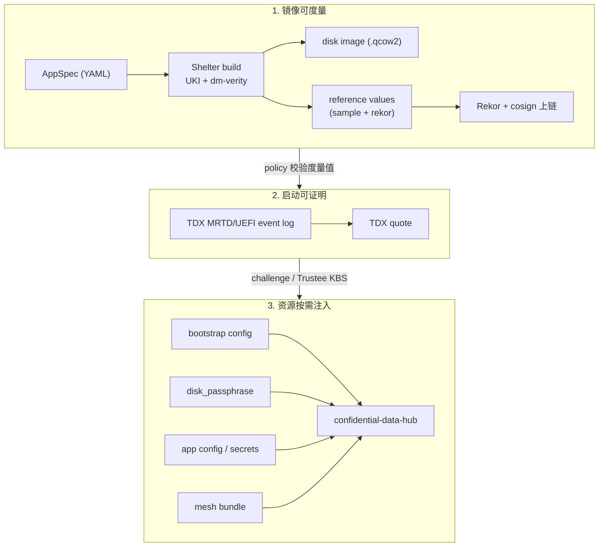

# Confidential Agent

Confidential Agent 是一套面向"AI Agent + 机密计算"的端到端工程化工具链。它把一份声明式的 `AppSpec`（YAML），编译成一台运行在机密虚拟机里的、**全盘加密 + 远程证明 + 受策略约束** 的 Agent 实例，并在主机侧通过 **TNG (Trusted Network Gateway) RATS-TLS** 接入它。

适合的人：
- 想把一个 Agent（OpenClaw、Hermes、自研 LangChain/MCP Server …）一键放进 TEE 跑起来的开发者。
- 需要把模型推理、对话上下文、密钥放进 **云厂商和运维都看不到** 的执行域里的安全敏感场景。
- 要求镜像可度量、启动可证明、密钥按需注入的合规交付方。

---

## 目录

- [Confidential Agent](#confidential-agent)
  - [目录](#目录)
  - [核心特性](#核心特性)
  - [整体架构](#整体架构)
    - [三层信任链](#三层信任链)
  - [快速开始 (Quick Start)](#快速开始-quick-start)
  - [常用扩展场景](#常用扩展场景)
  - [仓库结构](#仓库结构)
  - [深入文档](#深入文档)

---

## 核心特性

| 能力 | 说明 |
|---|---|
| 🔐 **TDX 全盘加密** | Guest 可写层使用远程证明后取得的磁盘密钥加密；密钥只落 Guest tmpfs，每次启动都重新取得，不写入镜像或持久盘。 |
| 📜 **声明式 AppSpec** | 一份 `confidential-agent/v1` YAML 描述服务、镜像、部署、证明、密钥、资源 6 个维度，CLI 自动驱动构建/部署/销毁。 |
| 🛰 **远程证明模式** | `sample` 模式（开发自验）与 `rekor` 模式（基于 Sigstore Rekor + cosign 的供应链透明日志）。生产推荐 `rekor + required=true`。 |
| 🗝 **Challenge / Trustee** | 同一度量镜像支持临时 challenge 注入或独立、持久的 Trustee KBS；Trustee URL 只在部署时注入，重启不要求本地 CLI 在线。 |
| 🌐 **TNG RATS-TLS Mesh** | 多个 Confidential Agent 实例之间、以及主机 `connect` 子命令到 Guest 的连接，全部走带远程证明的 RATS-TLS（attest + TLS）。 |
| 🛡 **运行时策略 PEP** | 内置 `cai-pep`（Policy Enforcement Point），把 Agent 的 `exec` 工具调用强制隔离到只读、无网、限资源的 Docker sandbox，并按 path/command 模式拒绝。 |
| ☁️ **云资源全自动化** | 通过 [Shelter](https://github.com/inclavare-containers/shelter) + Terraform 自动完成 OSS 上传、自定义镜像、ECS 实例、安全组规则、镜像挂载等阿里云资源编排。 |

---

## 整体架构

### 三层信任链



每一层都对应仓库中的具体组件：

| 层 | 组件 | 代码入口 |
|---|---|---|
| 镜像构建 | `shelter` crate 渲染 Shelter YAML，由外部 `shelter` 二进制产出 UKI 镜像和 reference value | [`shelter/src/lib.rs`](shelter/src/lib.rs) |
| Host 控制面 | `confidential-agent` CLI，负责 build / deploy / inject / mesh / connect / status / destroy | [`cli/src/app/commands.rs`](cli/src/app/commands.rs) |
| Guest 控制面 | `confidential-agentd`，运行在 initrd 与 rootfs 两个阶段，负责拉密钥、写资源、配置 TNG | [`daemon/src/app.rs`](daemon/src/app.rs) |
| Guest 数据面 | TNG 做 RATS-TLS 网关；Trustiflux 做证明协议 | `examples/openclaw/install-openclaw.sh`, [`shelter/src/lib.rs`](shelter/src/lib.rs) |
| Agent 沙箱 | `cai-pep` 把 Agent 的 `exec` 工具下到 read-only/no-net Docker sandbox，并对外暴露 `attest` 子命令 | [`cai-pep/src/main.rs`](cai-pep/src/main.rs) |

---

## 快速开始

在 Alibaba Cloud Linux 3 x86_64 部署机安装已校验的 CA/Shelter RPM 配套包：

```bash
curl -fSL https://raw.githubusercontent.com/inclavare-containers/confidential-agent/master/one-click/install.sh -o /tmp/install-cagent.sh
sh /tmp/install-cagent.sh
```

安装脚本只安装软件。`cagent init` 生成项目；`cagent up` 复用同一套初始化、构建、部署和连接逻辑。云凭证读取环境变量或 `~/.aliyun/config.json`，交互模式缺少凭证时隐藏输入并保存到该文件。模型 API key 可通过 `DASHSCOPE_API_KEY` 提供或交互输入，不需要放进命令行。

**免构建使用共享镜像**：从发布者取得 `image-release.json` 和独立认可的 `publisher.pem`。各实例独立选择 Harness、模型和服务 ID。

```bash
cagent up allinone --stage deploy --service-id my-codex --harness codex   --image-release ./image-release.json --trusted-key ./publisher.pem   --output-dir ./projects
```

all-in-one 镜像面向共享镜像、云市场和免构建部署。`examples/<harness>` 提供开发者自定义构建模板；镜像发布者可使用 `init allinone --stage build`，详见 [RPM 与镜像发布流程](docs/rpm.md)。

**从源码模板构建独立应用**：

```bash
cagent up openclaw --output-dir ./projects
# GPU TEE 上的本地模型与 OpenClaw：
cagent up openclaw-vllm --output-dir ./gpu-projects
# 已有 AppSpec 可直接使用，不再重复初始化：
cagent up --spec ./projects/openclaw/openclaw.yaml
```

首次运行会构建本地镜像并部署；已构建镜像直接部署；`deployed`/`activating` 状态继续资源交付；`active` 实例复用既有基础设施。中断的基础设施操作保留原错误和状态，按 `status`/`destroy` 流程处理。指定 `--no-connect` 可只完成部署。

默认放行检测到的部署机出口 `/32`；可用 `--deployer-cidr` 明确指定，`--allowed-cidr` 增加操作员网段。该值在部署记录中保存，后续 `peering apply` 不依赖原 shell 环境。

```bash
cagent status --live
cagent tui --refresh 5
cagent cleanup my-codex
cagent cleanup --all --dry-run
# 确认要销毁当前 state-dir 中的全部实例时：
cagent cleanup --all
```

`cleanup` 按实际状态枚举实例，包括非默认 Harness；停止 `up` 创建的连接，再调用正常的 `destroy`。保留发布镜像和本地记录。`up` 的连接元数据与日志位于 `<state-dir>/services/<service>/connect-ready.json` 和相邻日志文件。

`cai-pep` 的 OpenClaw 工具调用拦截是可选 PoC；其他 Harness 使用其 `attest` 证明工具，不安装执行 Hook。详细说明见 [示例索引](examples/README.md)和 [CLI 分步流程](docs/openclaw-cli-step-by-step.md)。

## 常用扩展场景

| 场景 | 入口 |
|---|---|
| **GPU TEE（vLLM + H20）** | CLI: `cagent up openclaw-vllm`；手动路径: `examples/openclaw-vllm/`，用 `ecs.gn8v-tee.4xlarge`，spec 里追加 NVIDIA CC 驱动安装脚本。 |
| **最小 MCP Server** | `examples/mcp/mcp-demo.yaml`，最薄的一个 spec，可作为模板。 |
| **镜像预发布 / 多次部署复用** | build 后运行 `confidential-agent image publish <service> --spec <path>`，把 qcow2 导入为阿里云自定义镜像；匹配时 `deploy` 会复用该 image，清理由 `image unpublish` / `image prune` 管理。 |
| **多实例 Mesh** | 在不同的 spec 文件里使用相同的 `connect` 端口集合分别 `deploy`，CLI 会自动维护 `mesh-bundle.json` 并把对端公网 CIDR 注入安全组。 |
| **Debug SSH** | spec 里把 `deploy.image_variant: debug` + `build.variants.debug.enabled: true`，CLI 会自动生成 ed25519 密钥对；入向访问由 `peering add --role operator --cidr ...` 控制。 |

---

## 仓库结构

```
confidential-agent/
├── Cargo.toml             # workspace
├── core/                  # 共享数据结构 (AppSpec / BootstrapConfig / MeshBundle / DaemonStatus)
├── shelter/               # 把 AppSpec 渲染成 Shelter build YAML 的纯函数库
├── cli/                   # confidential-agent (host 控制面)
├── daemon/                # confidential-agentd (guest 控制面 + initrd-fetch)
├── gateway/               # cai-gateway：mesh 调用身份、MCP 代理和审计
├── common/                # 共享 Node/GPU 安装库和证明 Skill
├── cai-pep/               # Policy Enforcement Point，运行时 sandbox + attest helper
├── tools/
│   ├── policies/          # Trustee/OPA rego（生产 + dev）
│   └── e2e/               # 端到端测试 runner、case 模板与探针
├── cagent.spec            # 原生工具与 CLI 的 RPM
├── packaging/             # 源码准备、固定工具下载与 RPM 打包
├── hack/                  # Shelter Release RPM 校验清单与下载工具
└── examples/
    ├── openclaw/          # OpenClaw + cai-pep（推荐起步）
    ├── openclaw-vllm/     # OpenClaw + vLLM + NVIDIA TEE
    └── mcp/               # 最小 MCP Server 示例
```

---

## 深入文档

- [docs/rpm.md](docs/rpm.md) — cagent RPM 打包、安装与 all-in-one 构建部署对话流程

- [docs/architecture.md](docs/architecture.md) — 控制流与数据流详解（含序列图）
- [docs/spec.md](docs/spec.md) — `confidential-agent/v1` AppSpec 完整字段参考
- [docs/trustee.md](docs/trustee.md) — Trustee 全局配置、策略/资源同步、重启和销毁语义
- [docs/openclaw-cli-step-by-step.md](docs/openclaw-cli-step-by-step.md) — 不走 one-click 的 OpenClaw CLI 分步部署场景
- [docs/a2a.md](docs/a2a.md) — 跨组织/跨用户 A2A：背景、架构、信任模型、step-by-step 上手与排错
