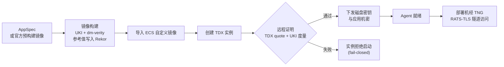

# Confidential Agent

Confidential Agent（CA）把 AI Agent 放进阿里云 Intel TDX 机密虚拟机运行。镜像可度量，启动可证明，机密在远程证明通过后才下发。

- **对使用者**：一条命令把 OpenClaw、Hermes、Codex、Claude Code 等 Agent 部署到 TDX 实例。对话、记忆、API Key 和模型权重都留在 TEE 内，云平台和运维人员看不到明文。
- **对开发者**：用一份声明式 YAML（AppSpec）描述自己的 Agent，CA 负责构建加密镜像、创建云资源、远程证明、注入机密和建立可信隧道。

> 第一次接触这些术语？先读 [核心概念与术语](docs/concepts.md)，五分钟即可读完。

## 它能保护什么

| 能力 | 说明 |
|---|---|
| 全盘加密 | 根文件系统只读并受 dm-verity 保护。可写层加密，密钥每次启动都经远程证明重新取得，不写入镜像或持久盘。 |
| 远程证明 | 校验 TDX 硬件证据和 UKI 度量值，参考值可发布到 Sigstore Rekor 透明日志，供第三方审计。 |
| 机密按需下发 | 磁盘口令、模型 API Key、应用配置只在证明通过后注入。支持临时注入（challenge）和独立密钥服务（Trustee）两种模式。 |
| 可信访问通道 | 部署机到实例、实例到实例的连接都经 TNG 完成远程证明后再加密传输。 |
| 工具调用沙箱 | `cai-pep` 把 OpenClaw 的 `exec` 工具调用放进无网络、只读的容器，并拒绝高危命令。 |
| 云资源自动化 | 自动创建和清理 ECS、VPC、安全组、OSS 中转对象和自定义镜像。 |

## 选择你的路径

| 我想… | 从这里开始 |
|---|---|
| 最快体验：部署一个机密 OpenClaw（或其他 Agent） | 下方 [快速开始](#快速开始) → [一键部署指南](docs/guides/one-click.md) |
| 在 GPU TEE 上用本地 vLLM 跑 OpenClaw | [OpenClaw 最佳实践](docs/guides/openclaw-best-practice/README.md) |
| 部署加密模型的安全推理服务 | [安全大模型推理](docs/guides/secure-llm-inference.md) |
| 逐步掌控每个环节（不用一键脚本） | [手动部署](docs/guides/manual-deployment.md) |
| 把自己的 Agent 打包进 TEE | [打包自定义 Agent](docs/guides/custom-agent.md) + [AppSpec 参考](docs/reference/appspec.md) |
| 理解内部原理、参与开发 | [架构设计](docs/design/architecture.md) + [开发者指南](docs/development/README.md) |

完整文档导航见 [docs/README.md](docs/README.md)。

## 快速开始

下面在一台 **Alibaba Cloud Linux 3（x86_64）** 部署机上，用官方预构建镜像部署一个机密 OpenClaw，模型使用阿里云百炼。其他平台见 [安装](docs/install.md)。

**前提**：阿里云 AccessKey（具备 ECS、VPC、OSS、自定义镜像权限），以及百炼 DashScope API Key。

```bash
export ALICLOUD_ACCESS_KEY="<your-ak>"
export ALICLOUD_SECRET_KEY="<your-sk>"
export DASHSCOPE_API_KEY="<your-bailian-key>"

# 下载一键脚本：先直连 GitHub，失败时再经第三方代理 gh-proxy.org（注意事项见 docs/install.md 第 7 节）
INSTALL_URL="https://raw.githubusercontent.com/inclavare-containers/confidential-agent/one-click/one-click/install.sh"
INSTALL_SCRIPT="$(mktemp)"
curl -fL --connect-timeout 10 --max-time 90 "$INSTALL_URL" -o "$INSTALL_SCRIPT" ||
  curl -fL --connect-timeout 10 --max-time 90 "https://gh-proxy.org/${INSTALL_URL}" -o "$INSTALL_SCRIPT"

# 交互式部署：依次询问镜像来源、Agent 类型、接入方式、模型和凭据，回车使用默认值
sh "$INSTALL_SCRIPT"
```

脚本会安装 CLI，导入官方镜像，创建 TDX 实例，完成远程证明并注入配置，最后在部署机本地开启隧道，输出类似：

```text
Web: http://127.0.0.1:18789/openclaw/#token=<gateway-token>
TUI: openclaw tui --url ws://127.0.0.1:18789 --token "<gateway-token>"
```

在部署机浏览器打开摘要中的 `Web` 地址即可使用。需要手动填写令牌时，默认从 `~/.confidential-agent/one-click/secrets/cpu-openclaw.token` 读取。端口以部署摘要为准。浏览器在另一台电脑上时，先执行 `ssh -N -L 18789:127.0.0.1:18789 root@<部署机IP>`。

常用后续操作：

```bash
confidential-agent status --live      # 查看实例与 Guest 状态
confidential-agent tui                # 实时面板：远程证明结果、度量值、端口
sh "$INSTALL_SCRIPT" continue         # 部署中断后续跑
sh "$INSTALL_SCRIPT" cleanup          # 销毁实例（保留已导入的共享镜像）
```

非交互部署、其他 7 种 Agent、自定义模型端点和全部参数见 [一键部署指南](docs/guides/one-click.md)。

## 工作原理（简版）



每一环的组件、数据流和时序见 [架构设计](docs/design/architecture.md)。

## 仓库结构

```text
confidential-agent/
├── cli/          # confidential-agent：部署机 CLI（构建、部署、注入、隧道、运维）
├── daemon/       # confidential-agentd：Guest 守护进程（initrd 取密、资源应用、TNG 配置、状态）
├── gateway/      # cai-gateway：mesh 服务身份校验与 MCP 审计网关（Guest 内）
├── cai-pep/      # cai-pep：工具调用策略沙箱与远程证明辅助命令（Guest 内）
├── core/         # 共享数据结构：AppSpec、bootstrap、mesh bundle、AgentCard、Trustee 等
├── shelter/      # 把 AppSpec 渲染为 Shelter 构建/运行配置的纯函数库
├── one-click/    # 一键部署脚本（CPU 共享镜像 / OpenClaw+vLLM / 安全推理）
├── examples/     # AppSpec 示例：allinone、openclaw、hermes-agent、codex、claude-code、mcp、cmaas、vLLM 等
├── packaging/    # RPM / 部署 ZIP 打包与发布脚本
├── hack/         # Shelter RPM 与官方预构建镜像的下载、校验辅助脚本
├── tools/        # e2e 测试、Trustee 安装脚本、默认证明策略（rego）
└── docs/         # 文档
```

## 许可证

[Apache-2.0](LICENSE)
