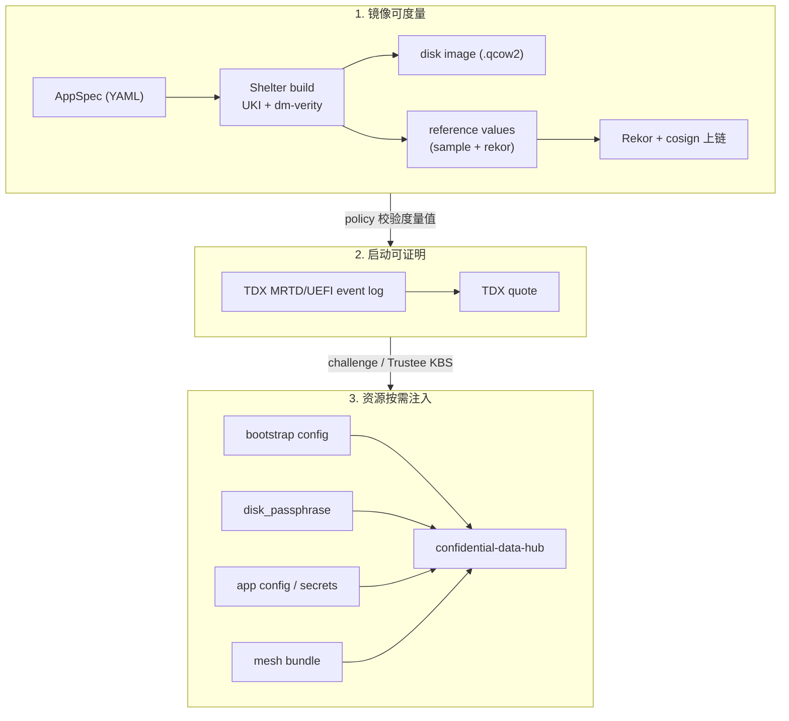

# Confidential Agent

Confidential Agent 是一套面向"AI Agent + 机密计算"的端到端工程化工具链。它把一份声明式的 `AppSpec`（YAML），编译成一台运行在机密虚拟机里的、**全盘加密 + 远程证明 + 受策略约束** 的 Agent 实例，并在主机侧通过 **TNG (Trusted Network Gateway) RATS-TLS** 接入它。

适合的人：
- 想把一个 Agent（OpenClaw、Hermes、自研 LangChain/MCP Server …）一键放进 TEE 跑起来的开发者。
- 需要把模型推理、对话上下文、密钥放进 **云厂商和运维都看不到** 的执行域里的安全敏感场景。
- 要求镜像可度量、启动可证明、密钥按需注入的合规交付方。

---

## 目录

- [Confidential Agent](#confidential-agent)
  - [目录](#目录)
  - [核心特性](#核心特性)
  - [整体架构](#整体架构)
    - [三层信任链](#三层信任链)
  - [快速开始 (Quick Start)](#快速开始-quick-start)
  - [常用扩展场景](#常用扩展场景)
  - [仓库结构](#仓库结构)
  - [深入文档](#深入文档)

---

## 核心特性

| 能力 | 说明 |
|---|---|
| 🔐 **TDX 全盘加密** | Guest 可写层使用远程证明后取得的磁盘密钥加密；密钥只落 Guest tmpfs，每次启动都重新取得，不写入镜像或持久盘。 |
| 📜 **声明式 AppSpec** | 一份 `confidential-agent/v1` YAML 描述服务、镜像、部署、证明、密钥、资源 6 个维度，CLI 自动驱动构建/部署/销毁。 |
| 🛰 **远程证明模式** | `sample` 模式（开发自验）与 `rekor` 模式（基于 Sigstore Rekor + cosign 的供应链透明日志）。生产推荐 `rekor + required=true`。 |
| 🗝 **Challenge / Trustee** | 同一度量镜像支持临时 challenge 注入或独立、持久的 Trustee KBS；Trustee URL 只在部署时注入，重启不要求本地 CLI 在线。 |
| 🌐 **TNG RATS-TLS Mesh** | 多个 Confidential Agent 实例之间、以及主机 `connect` 子命令到 Guest 的连接，全部走带远程证明的 RATS-TLS（attest + TLS）。 |
| 🛡 **运行时策略 PEP** | 内置 `cai-pep`（Policy Enforcement Point），把 Agent 的 `exec` 工具调用强制隔离到只读、无网、限资源的 Docker sandbox，并按 path/command 模式拒绝。 |
| ☁️ **云资源全自动化** | 通过 [Shelter](https://github.com/inclavare-containers/shelter) + Terraform 自动完成 OSS 上传、自定义镜像、ECS 实例、安全组规则、镜像挂载等阿里云资源编排。 |

---

## 整体架构

### 三层信任链



每一层都对应仓库中的具体组件：

| 层 | 组件 | 代码入口 |
|---|---|---|
| 镜像构建 | `shelter` crate 渲染 Shelter YAML，由外部 `shelter` 二进制产出 UKI 镜像和 reference value | [`shelter/src/lib.rs`](shelter/src/lib.rs) |
| Host 控制面 | `confidential-agent` CLI，负责 build / deploy / inject / mesh / connect / status / destroy | [`cli/src/app/commands.rs`](cli/src/app/commands.rs) |
| Guest 控制面 | `confidential-agentd`，运行在 initrd 与 rootfs 两个阶段，负责拉密钥、写资源、配置 TNG | [`daemon/src/app.rs`](daemon/src/app.rs) |
| Guest 数据面 | TNG 做 RATS-TLS 网关；Trustiflux 做证明协议 | `examples/openclaw/install-openclaw.sh`, [`shelter/src/lib.rs`](shelter/src/lib.rs) |
| Agent 沙箱 | `cai-pep` 把 Agent 的 `exec` 工具下到 read-only/no-net Docker sandbox，并对外暴露 `attest` 子命令 | [`cai-pep/src/main.rs`](cai-pep/src/main.rs) |

---

## 快速开始 (Quick Start)

只安装原生工具时，推荐从 [v0.2.0 Release](https://github.com/inclavare-containers/confidential-agent/releases/tag/v0.2.0) 下载 `install-rpm.sh`，运行 `sudo bash install-rpm.sh --version 0.2.0`。它安装 cagent 和配套 Shelter RPM，无需编译 CA；支持 Alibaba Cloud Linux 3 x86_64，详见 [RPM 安装说明](docs/rpm.md)。

完整构建部署可使用 one-click installer。它会在本机安装依赖、下载并校验清单固定的 Shelter RPM、构建当前源码、生成 OpenClaw 配置、交互式选择 operator CIDR，然后通过 Shelter 在阿里云上创建一台 TDX/GPU TEE ECS。需要逐步控制每个 CLI 动作时，参考 [OpenClaw CLI 分步部署示例](docs/openclaw-cli-step-by-step.md)；需要百炼 API 与本地 vLLM 双场景文档时，参考 [OpenClaw one-click 最佳实践](docs/openclaw-one-click-best-practice/README.md)。

```bash
set -euo pipefail
INSTALL_URL="https://raw.githubusercontent.com/inclavare-containers/confidential-agent/master/one-click/install.sh"
INSTALL_SCRIPT="$(mktemp)"
PROXY_URL="${CA_GITHUB_PROXY_URL-https://gh-proxy.org/}"
FIRST_URL="${PROXY_URL:+${PROXY_URL%/}/}${INSTALL_URL}"
SECOND_URL="$INSTALL_URL"
if [[ "${CA_GITHUB_PROXY_FIRST:-1}" == 0 ]]; then
  SECOND_URL="$FIRST_URL"
  FIRST_URL="$INSTALL_URL"
fi
if ! curl -fL --connect-timeout 10 --max-time 90 "$FIRST_URL" -o "$INSTALL_SCRIPT" ||
   [[ "$(head -c 2 "$INSTALL_SCRIPT")" != '#!' ]]; then
  curl -fL --connect-timeout 10 --max-time 90 "$SECOND_URL" -o "$INSTALL_SCRIPT"
fi
[[ "$(head -c 2 "$INSTALL_SCRIPT")" == '#!' ]]
sh "$INSTALL_SCRIPT"
```

在 Alibaba Cloud Linux 3 上，脚本会优先通过系统源安装 `cargo`/`rust`，并为 Cargo 写入 Aliyun crates mirror。默认不会走 rustup；只有显式传入 `--allow-rustup` 时，系统源工具链不可用才会 fallback 到 rustup。

默认值面向 Alibaba Cloud Linux 3 测试环境；OpenClaw full deploy 当前建议从 alinux3 部署机执行。

| 参数 | 默认值 |
|---|---|
| Region | `cn-beijing` |
| Zone | `cn-beijing-i` |
| Instance Type | `ecs.g9i.xlarge` |
| Disk | `200G` |
| Attestation | `rekor` |
| State Dir | `$HOME/.confidential-agent` |

脚本会交互式询问缺失的阿里云凭证、百炼 API Key、是否启用钉钉，以及 operator access CIDR。启用钉钉时，镜像会安装并构建 `soimy/openclaw-channel-dingtalk`，再写入 `dingtalk` channel 配置。脚本也会在部署机安装同版本 Node.js/OpenClaw CLI，并把 `confidential-agent` 安装到 PATH。CIDR 默认使用当前部署机公网 IP `/32`，仅支持 IPv4；也可以选择自定义 CIDR 列表，或选择 `0.0.0.0/0`。选择 `0.0.0.0/0` 时脚本会先提示这会把控制面、状态、debug SSH 和 connect 入口暴露给所有 IPv4 来源，且默认 OpenClaw 配置禁用 device auth、仅靠 gateway token 鉴权，0.0.0.0/0 模式下务必妥善保管 token。非交互传入的 `--allowed-cidr` 可用于你的浏览器或运维出口，支持逗号分隔、加引号的空格分隔，或重复传入；脚本仍会额外探测部署机出口 IP 并加入 `deployer` peering，避免资源注入和 connect 被安全组挡住。百炼 API 非交互部署示例：

```bash
export ALICLOUD_ACCESS_KEY="<your-ak>"
export ALICLOUD_SECRET_KEY="<your-sk>"
export DASHSCOPE_API_KEY="<your-bailian-key>"

set -euo pipefail
INSTALL_URL="https://raw.githubusercontent.com/inclavare-containers/confidential-agent/master/one-click/install.sh"
INSTALL_SCRIPT="$(mktemp)"
PROXY_URL="${CA_GITHUB_PROXY_URL-https://gh-proxy.org/}"
FIRST_URL="${PROXY_URL:+${PROXY_URL%/}/}${INSTALL_URL}"
SECOND_URL="$INSTALL_URL"
if [[ "${CA_GITHUB_PROXY_FIRST:-1}" == 0 ]]; then
  SECOND_URL="$FIRST_URL"
  FIRST_URL="$INSTALL_URL"
fi
if ! curl -fL --connect-timeout 10 --max-time 90 "$FIRST_URL" -o "$INSTALL_SCRIPT" ||
   [[ "$(head -c 2 "$INSTALL_SCRIPT")" != '#!' ]]; then
  curl -fL --connect-timeout 10 --max-time 90 "$SECOND_URL" -o "$INSTALL_SCRIPT"
fi
[[ "$(head -c 2 "$INSTALL_SCRIPT")" == '#!' ]]
sh "$INSTALL_SCRIPT" \
  --non-interactive \
  --region cn-beijing \
  --zone-id cn-beijing-i \
  --instance-type ecs.g9i.xlarge
```

本地 vLLM/GPU TEE 部署示例：

```bash
export ALICLOUD_ACCESS_KEY="<your-ak>"
export ALICLOUD_SECRET_KEY="<your-sk>"

set -euo pipefail
INSTALL_URL="https://raw.githubusercontent.com/inclavare-containers/confidential-agent/master/one-click/install-openclaw-vllm.sh"
INSTALL_SCRIPT="$(mktemp)"
PROXY_URL="${CA_GITHUB_PROXY_URL-https://gh-proxy.org/}"
FIRST_URL="${PROXY_URL:+${PROXY_URL%/}/}${INSTALL_URL}"
SECOND_URL="$INSTALL_URL"
if [[ "${CA_GITHUB_PROXY_FIRST:-1}" == 0 ]]; then
  SECOND_URL="$FIRST_URL"
  FIRST_URL="$INSTALL_URL"
fi
if ! curl -fL --connect-timeout 10 --max-time 90 "$FIRST_URL" -o "$INSTALL_SCRIPT" ||
   [[ "$(head -c 2 "$INSTALL_SCRIPT")" != '#!' ]]; then
  curl -fL --connect-timeout 10 --max-time 90 "$SECOND_URL" -o "$INSTALL_SCRIPT"
fi
[[ "$(head -c 2 "$INSTALL_SCRIPT")" == '#!' ]]
sh "$INSTALL_SCRIPT" \
  --non-interactive \
  --yes \
  --region cn-beijing \
  --zone-id cn-beijing-l \
  --instance-type ecs.gn8v-tee.4xlarge \
  --disk-gb 512
```

如果只想安装 host 侧组件，不创建云资源：

```bash
set -euo pipefail
INSTALL_URL="https://raw.githubusercontent.com/inclavare-containers/confidential-agent/master/one-click/install.sh"
INSTALL_SCRIPT="$(mktemp)"
PROXY_URL="${CA_GITHUB_PROXY_URL-https://gh-proxy.org/}"
FIRST_URL="${PROXY_URL:+${PROXY_URL%/}/}${INSTALL_URL}"
SECOND_URL="$INSTALL_URL"
if [[ "${CA_GITHUB_PROXY_FIRST:-1}" == 0 ]]; then
  SECOND_URL="$FIRST_URL"
  FIRST_URL="$INSTALL_URL"
fi
if ! curl -fL --connect-timeout 10 --max-time 90 "$FIRST_URL" -o "$INSTALL_SCRIPT" ||
   [[ "$(head -c 2 "$INSTALL_SCRIPT")" != '#!' ]]; then
  curl -fL --connect-timeout 10 --max-time 90 "$SECOND_URL" -o "$INSTALL_SCRIPT"
fi
[[ "$(head -c 2 "$INSTALL_SCRIPT")" == '#!' ]]
sh "$INSTALL_SCRIPT" install-only
```

升级 host 组件前，请等待正在运行的构建、部署和连接操作结束，升级期间不要启动新操作。安装器在替换 Shelter RPM 前检查已安装的 Shelter 可执行文件是否仍被进程使用；若存在活动进程，会保留原包并报出对应 PID。相同版本的重复安装会复用已验证的 RPM。

部署完成后，脚本会输出本地 connect 地址：

```text
web:    http://127.0.0.1:<port>/openclaw
ws/api: ws://127.0.0.1:<port>
token:  <generated-or-provided-token>
```

生成的 gateway token 会保存在 `$HOME/.confidential-agent/one-click/secrets/gateway.token`，后续重跑会复用同一个 token。部署完成后可以直接运行 `confidential-agent status --live`、`confidential-agent connect` 和 `openclaw tui --url ws://127.0.0.1:<port> --token <token>`。

### 实时状态 TUI

Host 控制面的实时总览使用：

```bash
confidential-agent tui
# 只看一个服务；daemon 每 5 秒刷新，TEE evidence 每 2 分钟重新校验
confidential-agent tui --service openclaw --refresh 5 --attestation-refresh 120
```

TUI 持续刷新本地 service state 与 Guest `:8088/status`，并自动通过 `attestation-challenge-client` 收集新 evidence、校验 EAR。远程认证面板直接展示 TEE、默认 policy 的判定、BOOTX64.EFI 的 UKI SHA-384 实测值与期望值、匹配结果，以及 Rekor URL、artifact 和本地 upload entry；Agents 表展示首选地址、Mesh ports 和 Connect ports，Service Network 面板展示所选服务的公网/私网地址及全部 service、connect、mesh、MCP 端口。`--attestation-refresh 0` 可关闭自动校验，界面内仍可按 `v` 手动校验。常用键为 `j/k` 或方向键选择、`/` 过滤、`:` 命令模式、`r` 刷新、`?` 帮助、`q` 退出。

界面刻意区分这些含义：`Evidence VERIFIED` 表示本次新证据通过默认 appraisal policy；`UKI MATCH` 表示 evidence 中的 UKI 度量与配置的参考值一致；Rekor entry 来自本地构建 upload provenance，不冒充一次新的在线查询；`Mesh/TNG READY` 只表示本信任域 TNG 配置已就绪，不表示已经建立过业务连接。

清理云资源：

```bash
set -euo pipefail
INSTALL_URL="https://raw.githubusercontent.com/inclavare-containers/confidential-agent/master/one-click/install.sh"
INSTALL_SCRIPT="$(mktemp)"
PROXY_URL="${CA_GITHUB_PROXY_URL-https://gh-proxy.org/}"
FIRST_URL="${PROXY_URL:+${PROXY_URL%/}/}${INSTALL_URL}"
SECOND_URL="$INSTALL_URL"
if [[ "${CA_GITHUB_PROXY_FIRST:-1}" == 0 ]]; then
  SECOND_URL="$FIRST_URL"
  FIRST_URL="$INSTALL_URL"
fi
if ! curl -fL --connect-timeout 10 --max-time 90 "$FIRST_URL" -o "$INSTALL_SCRIPT" ||
   [[ "$(head -c 2 "$INSTALL_SCRIPT")" != '#!' ]]; then
  curl -fL --connect-timeout 10 --max-time 90 "$SECOND_URL" -o "$INSTALL_SCRIPT"
fi
[[ "$(head -c 2 "$INSTALL_SCRIPT")" == '#!' ]]
sh "$INSTALL_SCRIPT" cleanup \
  --state-dir "$HOME/.confidential-agent"
```

---

## 常用扩展场景

| 场景 | 入口 |
|---|---|
| **GPU TEE（vLLM + H20）** | one-click: `one-click/install-openclaw-vllm.sh`；手动路径: `examples/openclaw-vllm/`，用 `ecs.gn8v-tee.4xlarge`，spec 里追加 NVIDIA CC 驱动安装脚本。 |
| **最小 MCP Server** | `examples/mcp/mcp-demo.yaml`，最薄的一个 spec，可作为模板。 |
| **镜像预发布 / 多次部署复用** | build 后运行 `confidential-agent image publish <service> --spec <path>`，把 qcow2 导入为阿里云自定义镜像；匹配时 `deploy` 会复用该 image，清理由 `image unpublish` / `image prune` 管理。 |
| **多实例 Mesh** | 在不同的 spec 文件里使用相同的 `connect` 端口集合分别 `deploy`，CLI 会自动维护 `mesh-bundle.json` 并把对端公网 CIDR 注入安全组。 |
| **Debug SSH** | spec 里把 `deploy.image_variant: debug` + `build.variants.debug.enabled: true`，CLI 会自动生成 ed25519 密钥对；入向访问由 `peering add --role operator --cidr ...` 控制。 |

---

## 仓库结构

```
confidential-agent/
├── Cargo.toml             # workspace
├── core/                  # 共享数据结构 (AppSpec / BootstrapConfig / MeshBundle / DaemonStatus)
├── shelter/               # 把 AppSpec 渲染成 Shelter build YAML 的纯函数库
├── cli/                   # confidential-agent (host 控制面)
├── daemon/                # confidential-agentd (guest 控制面 + initrd-fetch)
├── cai-pep/               # Policy Enforcement Point，运行时 sandbox + attest helper
├── tools/
│   ├── policies/          # Trustee/OPA rego（生产 + dev）
│   └── e2e/               # 端到端测试 runner、case 模板与探针
├── cagent.spec            # 原生工具与 CLI 的 RPM
├── packaging/             # 源码准备、固定工具下载与 RPM 打包
├── hack/                  # 当前 CA 兼容补丁版 Shelter RPM
└── examples/
    ├── openclaw/          # OpenClaw + cai-pep（推荐起步）
    ├── openclaw-vllm/     # OpenClaw + vLLM + NVIDIA TEE
    └── mcp/               # 最小 MCP Server 示例
```

---

## 深入文档

- [docs/rpm.md](docs/rpm.md) — cagent RPM 打包、安装与 all-in-one 构建部署对话流程

- [docs/architecture.md](docs/architecture.md) — 控制流与数据流详解（含序列图）
- [docs/spec.md](docs/spec.md) — `confidential-agent/v1` AppSpec 完整字段参考
- [docs/trustee.md](docs/trustee.md) — Trustee 全局配置、策略/资源同步、重启和销毁语义
- [docs/openclaw-cli-step-by-step.md](docs/openclaw-cli-step-by-step.md) — 不走 one-click 的 OpenClaw CLI 分步部署场景
- [docs/a2a.md](docs/a2a.md) — 跨组织/跨用户 A2A：背景、架构、信任模型、step-by-step 上手与排错
