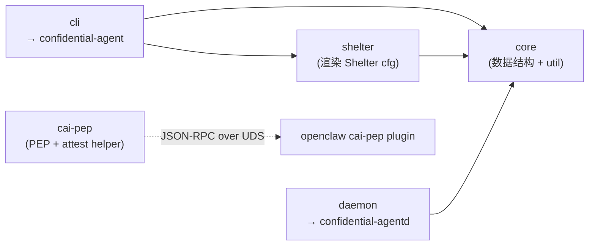
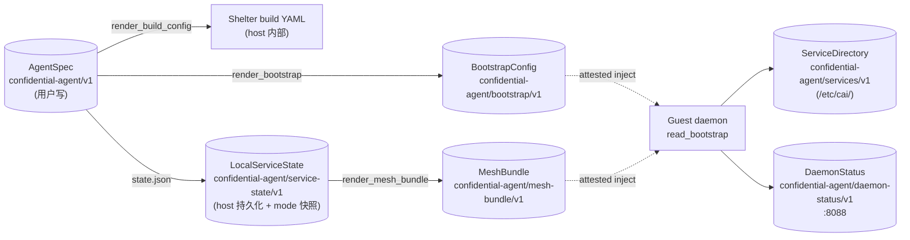
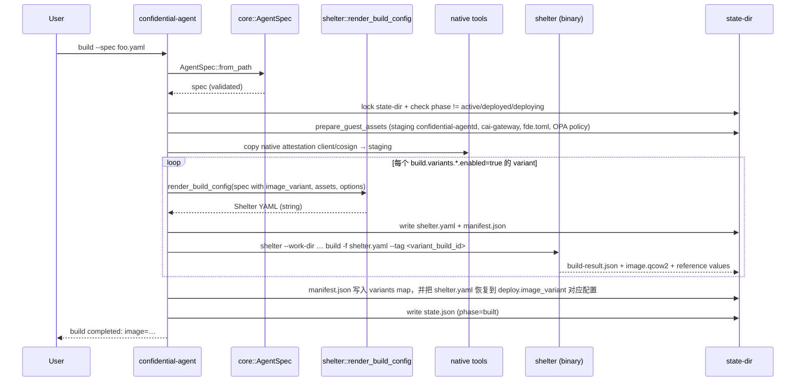
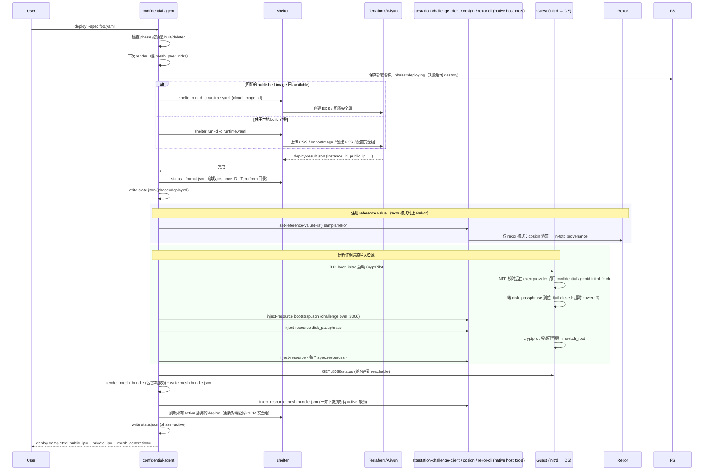
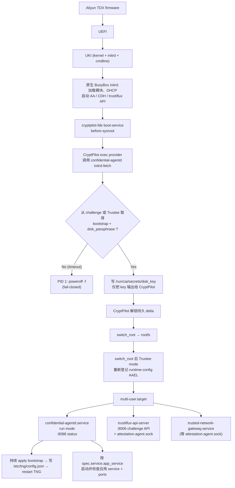
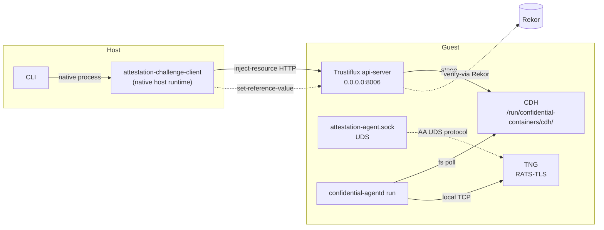
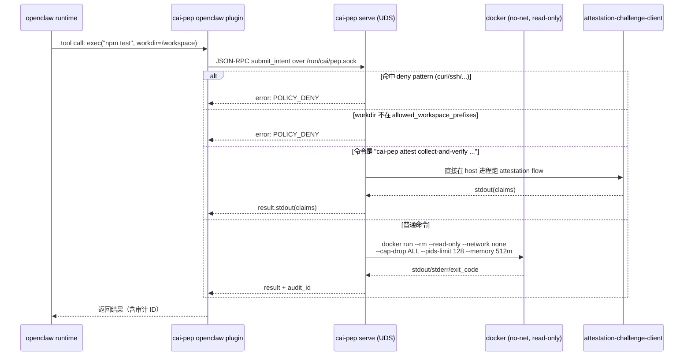

# 架构与数据流

---

## 1. 工作空间布局

5 个 crate，单一 workspace（[`Cargo.toml`](../Cargo.toml)）。



| Crate | 输出 | 跑在哪 | 主要职责 |
|---|---|---|---|
| `core` | lib | 共享 | `AgentSpec`、所有 schema、sha256/Rekor 工具 |
| `shelter` | lib | host | 把 `AgentSpec` + `GuestAssets` 渲染成 Shelter YAML |
| `cli` | `confidential-agent` 二进制 | host | 控制面：build / deploy / connect / status / destroy |
| `daemon` | `confidential-agentd` 二进制 | guest | initrd-fetch + 持久 daemon + 状态 HTTP |
| `cai-pep` | `cai-pep` 二进制 | guest | Unix socket 上的 PEP，沙箱内执行 Agent 工具调用 |

---

## 2. 三个核心 schema 与流转方向



每个 schema 都有显式的版本字符串校验（参考 [`core/src/schema.rs`](../core/src/schema.rs) 的常量集合），跨版本不一致会**直接拒绝**。

---

## 3. `build` 子命令的端到端流程



关键点：
- **镜像构建**：CA 统一通过 Shelter 原生构建器构建 rootfs，使用 UKI、cryptpilot FDE 和加密持久 delta。原生 initramfs 通过 `initrd.binaries` 从 rootfs 收集 `/usr/local/bin/confidential-agentd`、`/usr/bin/confidential-data-hub` 及其 ELF 依赖；不再生成 dracut module。构建前检查 `shelter plan` 确认这些程序进入 early-boot plan。
- **TNG 严格 pin**：cagent RPM 依赖 Alinux3 仓库的 `trusted-network-gateway-2.9.2-1.al8`；Guest 显式安装相同版本的官方 RPM，并设置 `security.tng: false` 避免 Shelter 自动加入其他版本，随后 [`guest_setup_script`](../cli/src/app.rs) 同时校验 RPM NEVRA 与 `tng --version`，版本不符时 build 直接失败。仓库不再携带或覆盖 TNG 二进制；从旧版升级时必须重新 build Guest 镜像，不能用 `E2E_SKIP_BUILD=1` 复用 2.6 产物验证升级。
- **多 variant 构建**：一次 `build` 会构建所有 enabled variants；当前 state 的 `build_id` 指向 `deploy.image_variant`，完整结果保存在 manifest 的 `variants` map。
- **build_id 时间戳化**：`<image_name>-<variant>-<run_id>`，run_id 精确到毫秒，防止重复 build 互相覆盖。

---

## 4. `deploy` 端到端流程

下图是 challenge 分支。Trustee 分支复用相同 build 产物，但在创建基础设施前先把 boot 资源同步到独立 KBS，并把 canonical Trustee runtime JSON 作为 ECS user-data；Guest 自己证明和拉取资源，不执行远程 `inject-resource`。完整时序见 [`trustee.md`](trustee.md)。



Shelter 构建使用主线支持的显式 `version: 1` 配置，保留 V2 尚不能完整表达的 `initrd.binaries`、Rekor 和容器挂载配置。构建命令为 `build -f shelter.yaml --tag <image-tag>`；部署不改写这份构建快照，而是单独生成 `version: 2` 的 `shelter-runtime.yaml`，只包含运行目标。

部署目标使用 `trust: verified`、`attestation: disabled`，并在 provider options 中明确设置 `cc_mode: tdx`、`attestation_authority: external`。Shelter 负责创建 TDX 实例，证据验证与密钥释放由下面的 CA challenge/Trustee 流程负责。CLI 通过 `run <image-tag> -d -c shelter-runtime.yaml --target deploy --name <resource_name>` 复用已构建镜像；共享签名镜像通过同一 `run -d --release … -c …` 接口部署。`inspect <name> --format json` 读取实际 instance ID 和 Terraform 目录，`network update <name> -c … --target deploy` 只更新受管实例网络，`rm -f <name>` 删除实例；部署身份与 build ID 分开保存。

challenge 注入采用 `inject-resource` over `http://<ip>:8006`，对应代码 [`cli/src/app/tools.rs::challenge_inject`](../cli/src/app/tools.rs)。每个资源会先尝试 direct 网络，失败后 fallback 走 host 的代理环境变量。Trustee mode 不依赖 operator 到 Guest `:8006` 的入站连通性。

`image publish` 会把 build 产物预先导入为阿里云自定义镜像，并把 provider、region、variant、build id、镜像 hash 与 image id 记录在本地 state。`deploy` 只在这些字段匹配且发布状态为 `available` 时复用该 image；`destroy` 负责运行资源，published image 的删除由 `image unpublish` 或 `image prune` 管理。

---

## 5. Guest 启动顺序（initrd → multi-user）



关键 systemd unit 与依赖关系来自三处：
- daemon 嵌入的 rootfs unit 文本：[`agentd_service_unit`](../cli/src/app.rs)。initrd 不再创建独立 secret-fetch unit；[`cryptpilot_fde_config`](../cli/src/app.rs) 的 `exec` provider 在 CryptPilot 校时后直接调用 `confidential-agentd initrd-fetch`。
- 原生构建中的 setup script：[`guest_setup_script`](../cli/src/app/guest_assets.rs) 校验官方 TNG 2.9.2 RPM，并保持发行版 TNG unit 禁用，由 daemon 在资源与路由就绪后管理进程。Builtin AS 配置使用 `attestation_policy`，显式选择 `background_check`、`coco` 和RATS-TLS 复用（`rats_tls.multiplex: true`）；mesh、A2A 和客户端保持相同传输模式。`libtdx-verify` 由 Alinux3 软件源安装，供 `attestation-challenge-client` 使用。
- 每个示例自己的 `install-*.sh`，例如 [`examples/openclaw/install-openclaw.sh`](../examples/openclaw/install-openclaw.sh) 注册 `cai-openclaw-gateway.service`；spec 的 `service.app_service` 决定 daemon 是否把该 unit 纳入 `app_ready` 判定。

---

## 6. Mesh Bundle：跨实例可信寻址

`MeshBundle` 是「所有 active 服务彼此都能信任地连到对方」的单一事实源。每个服务的 `ports` 是 Guest 内真实业务端口，可为空表示 client-only/job；`connect` 是 host connect / A2A 单向 RA 子集；`mesh_ports = ports - connect` 是双向 RA confidential-only 数据面。

结构（来自 [`core/src/schema.rs`](../core/src/schema.rs)）：

```jsonc
{
  "schema": "confidential-agent/mesh-bundle/v1",
  "generation": 7,
  "updated_at": 1714000000,
  "services": {
    "openclaw":      { "phase": "active", "public_ip": "1.2.3.4",  "private_ip": "10.0.0.8", "ports": [18789, 18800], "connect": [18789] },
    "openclaw-vllm": { "phase": "active", "public_ip": "5.6.7.8",  "private_ip": "10.0.0.9", "ports": [3001], "connect": [] },
    "job-agent":     { "phase": "active", "public_ip": "5.6.7.9",  "private_ip": "10.0.0.10", "ports": [], "connect": [] }
  },
  "reference_values":      { "openclaw": ..., "openclaw-vllm": ... },   // sample 模式
  "rekor_reference_values":{ "openclaw": ..., "openclaw-vllm": ... }    // rekor 模式
}
```

下发链路：
1. CLI [`render_mesh_bundle`](../cli/src/app/workflows.rs) 生成 → host 持久化为 `<state-dir>/mesh-bundle.json`。
2. 对每个 active service 按部署时写入的 mode 快照和 Trustee state membership 分流，不重新读取可变 AppSpec：challenge 使用 `attestation-challenge-client inject-resource`，Trustee 上传到该 service 的 KBS namespace；两份 durable state 不一致时 fail closed。
3. Guest daemon [`sync_mesh`](../daemon/src/app.rs) 读到后：
   - 写 `/var/cache/confidential-agent/mesh-bundle.json`（持久化）；
   - 写 `/etc/cai/service-directory.json`（包含对端 `connect` 与 `mesh_ports`，每个端口标记 `mode=connect|mesh`，应用读这个文件做服务发现；无端口 peer 不会作为被调用目标出现）；
   - 渲染并写 `/etc/tng/config.json`，让本地 TNG 对本服务的 `connect` 端口只做服务端 attestation，对本服务的 `mesh_ports` 同时验证调用方 attestation；访问对端 `connect` 端口时只验证对端服务端 attestation，访问对端 `mesh_ports` 时同时携带本服务 attestation；
   - 只为本服务 `mesh_ports` 配置 `cai-gateway`：raw mesh 端口只做 service identity，`service.mcp_ports` 端口才做 MCP parse/audit/virtual tools；
   - 如果配置 hash 变了，`systemctl restart trusted-network-gateway.service`。

mesh-bundle 是按 active service 集合滚动生成的。新 service deploy 时 generation 会推进，已有 service 可能先收到包含新 RV 的 bundle，再等新 service 自身 ingress 完成重启；e2e 成功路径应等待 daemon `:8088/status` 的 `mesh_generation` 更新且 `mesh_ready=true` 后再断言双向 RA 生效。

> 重点：`connect` 和 A2A 是单向 RA，不经过 gateway，也不携带 gateway client identity；同 state-dir `mesh_ports` 是双向 RA confidential-only。gateway 只覆盖 `mesh_ports`，其中只有 `service.mcp_ports` 做 MCP parse/audit/virtual tools。

---

## 7. 远程证明通道一览



- 同一个 `attestation-challenge-client` 既负责 reference value 注册，也负责 resource inject。Trustiflux 收到 inject 请求会先做远程证明（quote → policy → claims），通过后才把资源写到 CDH。
- 默认 OPA policy：[`tools/policies/trustee-opa-default.rego`](../tools/policies/trustee-opa-default.rego)。它做的是 EAR (AR4SI) 评估，硬件、配置、文件系统、可执行 4 个维度都要绿灯。
- 本地开发可换成 [`tools/policies/trustee-opa-local-dev.rego`](../tools/policies/trustee-opa-local-dev.rego)，会把 hardware/configuration/file_system/executables 全部置 2，方便 QEMU 自验。

---

## 8. PEP（Policy Enforcement Point）数据流



完整 PepConfig 字段见 [`cai-pep/src/main.rs`](../cai-pep/src/main.rs)。生产配置示例：[`examples/openclaw/files/cai-pep-default-policy.json`](../examples/openclaw/files/cai-pep-default-policy.json)。

为什么要给 `cai-pep attest` 开后门？因为 `attestation-challenge-client` 必须能访问 host 的 `/dev/tdx_guest` 和 `localhost:8006` 才能拿到 quote，普通 sandbox 显然不能给它这些权限——所以让 PEP 自己识别这条命令，受控地、绕过 sandbox 直接执行。Skill 模板 [`tdx-remote-attestation.SKILL.md`](../examples/openclaw/files/tdx-remote-attestation.SKILL.md) 讲了这个机制。

---

## 9. 端口约定速查

| 端口 | 监听者 | 用途 | 安全组规则名 |
|---|---|---|---|
| 22  | sshd（仅 debug） | Debug SSH | `ssh_22_peer_<cidr>` |
| 8006 | trustiflux-api-server | 远程证明 + 资源注入 API | `control_8006_peer_<cidr>` |
| 8088 | confidential-agentd | 只读 daemon status HTTP | `status_8088_peer_<cidr>` |
| 8089 | confidential-agentd | A2A AgentCard discovery HTTP | `agent_card_8089_peer_<cidr>` |
| 50000 | TNG control | 本地控制面 | (loopback only) |
| 39000+i | TNG egress | 应用本地 capture/listen | (loopback only) |
| `service.connect[]` | 用户应用 | host connect / A2A 经 RATS-TLS 接入，单向 RA；不经过 gateway，不携带 gateway client identity | `connect_<port>_peer_<cidr>` |
| `service.ports[] - service.connect[]` (`mesh_ports`) | 用户应用（gateway 透明覆盖） | confidential-only mesh 数据面，双向 RA；raw mesh 只做 service identity | `mesh_<port>_peer_<cidr>` |
| `service.mcp_ports[]` | 用户应用（gateway 透明覆盖） | `mesh_ports` 子集；额外做 MCP parse/audit/virtual tools | 复用 `mesh_<port>_peer_<cidr>` |

---

## 10. 失败模式与可观测性

| 现象 | 多半的原因 | 建议做法 |
|---|---|---|
| `confidential-agent build` 报 TNG RPM/version 不匹配 | Alinux3 源解析到的 Guest TNG 不是 `2.9.2-1.al8`，或宿主机 TNG 不是 2.9.2 | 确认 `alinux3-plus` 中仍有目标 NEVRA，并安装 cagent RPM 声明的 TNG 版本 |
| Shelter deploy 完了，但 `inject-resource` 一直 timeout | 安全组 8006 没放通；或 `peerings.yaml` 的 `control` scope 不包含 host | 检查 `confidential-agent peering list` 并运行 `peering apply` |
| daemon phase 长期停在 `waiting-resources` | 某个 `required=true` 资源缺失或 sha256 不对 | `confidential-agent status --live --json` 看 `applied_resources` |
| daemon phase 停在 `starting-mesh` | TNG 未启动；通常因为 attestation-agent.sock 还没 ready | `journalctl -u trusted-network-gateway` |
| 需要持续观察 daemon、TEE policy、UKI/Rekor、服务地址和 Mesh/Connect 端口 | 一次性 `status --live` 不便对比状态变化 | 运行 `confidential-agent tui`；按 `v` 可立即重新校验所选 agent 的远程 evidence |
| `connect` 报 `mesh bundle has no reference values` | 还没 deploy 过 / sample_rv 文件被手删 | 重新 `deploy` 或 `mesh sync` |
| Rekor 注册失败 | 网络到不了 `rekor_url`、cosign 签名失败 | 检查原生工具安装、 cosign 公私钥、SLSA generator 与 Rekor 可达性 |
| initrd 阶段 Guest 直接关机 | initrd-fetch 在 `CA_SECRET_WAIT_TIMEOUT_SEC` 超时 | 这是设计的 fail-closed；challenge 检查 inject-resource，Trustee 检查 IMDSv2 user-data、AAEL 和 KBS 可达性 |

---

## 11. 与其它工具的边界

Confidential Agent 并不复刻这些上游能力，而是把它们粘合在一起：

| 上游 | 角色 |
|---|---|
| [Shelter](https://github.com/inclavare-containers/shelter) | 实际生产 UKI 镜像、编排 Aliyun（Terraform alicloud provider）、产生 sample reference value 与 SLSA provenance |
| [TNG (Trusted Network Gateway)](https://github.com/inclavare-containers/tng) | RATS-TLS 数据面，attest+TLS 一体的双向认证 |
| [Trustiflux / CDH / Attestation Agent](https://github.com/confidential-containers) | Guest 内的远程证明协议端点 |
| [cryptpilot](https://github.com/openanolis/cryptpilot) | initrd 阶段做 dm-crypt 解锁，受 fde.toml 配置 |
| [Sigstore Cosign + Rekor](https://docs.sigstore.dev) | reference value 的供应链透明日志 |

Confidential Agent 自己写的部分集中在：**用户视角的 spec、可复现且可销毁的 host 状态机、跨实例 mesh、PEP**。所有不属于这几块的事都交给上游负责。


镜像清理和实例操作使用 `<state-dir>/operation-locks/<service>` 中的稳定锁文件，删除业务目录不会移除锁本身。发布进度只在短暂的 state 事务中重新读取并更新 publication 字段，不以长时网络操作之前的整份快照覆盖并发 mesh 更新。云镜像操作另持共享/排他 image lease。上传/导入状态、退休意图、资源所有权、导入快照和 OSS 中转对象清理分别记录；跨工作区发现同一镜像不自动授予删除权限。

实例 `activating` 表示已加入待完成的配置拓扑，mesh 协议仍以 `active` 表示成员资格；宿主机应用就绪阶段与该协议字段独立。只有所有副本 readiness 验证通过后，实例管理状态才提交为 `active`。销毁先持久化 `destroying`，失败保留精确的 Terraform 目录和资源标识用于重试。
