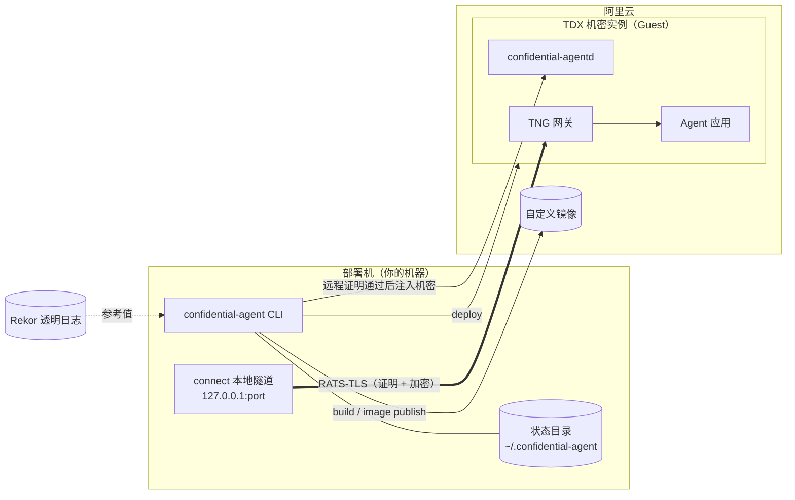

# 核心概念与术语

第一次接触 Confidential Agent（下文简称 CA）时，建议先读完本页。其他文档默认读者已经了解这里的术语。

## 一句话理解 CA

你在**部署机**上用 `confidential-agent` CLI（别名 `cagent`）声明“要跑什么 Agent、开放哪些端口、注入哪些配置”。CA 会完成以下工作：

1. 把 Agent 打包成一个**可度量的机密虚拟机镜像**；
2. 在阿里云上创建 **Intel TDX 机密实例**；
3. 先**验证实例确实运行着这个镜像**（远程证明），再把磁盘密钥、API Key 等机密下发进去；
4. 在部署机本地开一条**经过远程证明的加密隧道**，让你用浏览器或客户端访问实例里的 Agent。

云平台、宿主机运维人员都看不到实例内存、磁盘和隧道里的明文。

## 角色与位置

| 术语 | 含义 |
|---|---|
| **部署机**（host、控制端） | 运行 `confidential-agent` CLI 的机器。可以是任意受支持的 Linux/macOS，不需要是 TDX 机器。负责构建、部署、注入、建立隧道。 |
| **实例 / Guest** | 由 CA 创建的阿里云 TDX ECS 虚拟机，Agent 实际运行在这里。文档中的 “Guest 内” 指这台虚拟机内部。 |
| **服务（service）** | CA 管理的最小单位，由 AppSpec 中的 `service.id` 标识。一个服务通常对应一台实例；开启多副本时对应一组共享身份的实例。 |
| **状态目录（state-dir）** | 部署机上保存 CA 全部本地状态的目录，默认 `~/.confidential-agent`，可用全局参数 `--state-dir` 指定。磁盘口令、Terraform 状态、peering、A2A 配置等都在这里。**请像保管私钥一样保管它。** |
| **operator（运维方）** | 部署、管理实例的人或机器，对应 `peering` 的 `operator` 角色。 |
| **peer（对端）** | 另一个管理域中需要调用你的 Agent 的服务，对应 `peering` 的 `peer` 角色。 |

## 描述与构建

| 术语 | 含义 |
|---|---|
| **AppSpec** | 一份 `schema: confidential-agent/v1` 的 YAML，声明服务、镜像构建、部署位置、远程证明方式和运行时资源。是 CLI 的主要输入。字段参考见 [AppSpec 参考](reference/appspec.md)。源码中的类型名为 `AgentSpec`。 |
| **Shelter** | CA 依赖的上游镜像构建与云部署工具（[inclavare-containers/shelter](https://github.com/inclavare-containers/shelter)）。CA 把 AppSpec 渲染成 Shelter 配置，由 Shelter 调用 mkosi 构建镜像、调用 Terraform 创建云资源。 |
| **UKI** | Unified Kernel Image。内核、initrd 和启动参数打包成一个可度量文件，它的 SHA-384 就是远程证明时比对的核心度量值。 |
| **dm-verity / 全盘加密** | 根文件系统只读并受 dm-verity 完整性保护；可写层由 CryptPilot（LUKS2）加密，密钥只在远程证明通过后下发。 |
| **镜像变体（variant）** | `release`：生产镜像，没有构建期 SSH 后门。`debug`：开发排障镜像，内置构建期 SSH 公钥。 |
| **共享预构建镜像（allinone）** | 官方发布的 CPU/TDX 镜像，内置 OpenClaw、Hermes、Codex、OpenCode、DSH、Claude Code、QoderCLI、Pi 八种 Agent。每个实例在部署时选择启用其中一种。见 [examples/allinone](../examples/allinone/README.md)。 |
| **`image-release.json` / `release_digest`** | 镜像的发布描述文件及其整个文件的 SHA-256。`release_digest` 来自官方 GitHub Release 的 `image-index.json`，或本机 `image export` 的输出。CA 用它确认拿到的镜像产物没有被替换。 |
| **发布（publish）** | 把镜像产物上传 OSS 并导入为某个阿里云账号、某个地域的 ECS 自定义镜像（`image publish`）。导入一次后，同账号同地域的新实例可直接复用。 |

## 远程证明与机密下发

| 术语 | 含义 |
|---|---|
| **远程证明（RA, Remote Attestation）** | 实例用 TDX 硬件生成一份签名证据（quote），证明“我是真实的 TDX 虚拟机，启动的正是某个度量值的 UKI”。验证方核对证据后才信任它。 |
| **参考值（RV, Reference Value）** | 验证时用来比对的期望度量值。CA 支持两种来源：`sample`（构建时本地生成，适合开发自测）和 `rekor`（发布到 Sigstore Rekor 透明日志，适合生产与第三方审计）。 |
| **Rekor** | Sigstore 的公开透明日志。CA 把镜像的 SLSA provenance 签名后写入 Rekor，任何人都能查询和审计。 |
| **challenge 模式** | 默认的机密下发方式。部署机上的 CLI 直接向实例的 `:8006` 端口发起证明并注入机密。实例**重启后需要部署机再次注入**。 |
| **Trustee 模式** | 机密预先存放在一个独立运行的 Trustee（KBS）服务里，实例每次启动自己完成证明并取回机密，**重启时不需要部署机在线**。见 [Trustee 模式](guides/trustee.md)。 |
| **资源（resources）** | AppSpec 中声明、需要在远程证明后注入实例的文件，例如应用配置、API Key。它们不会进入镜像。 |
| **fail-closed** | 取不到机密就拒绝继续：例如实例在 initrd 阶段超时未拿到磁盘密钥，会直接关机，而不是以未加密或降级状态启动。 |

## 网络与访问

| 术语 | 含义 |
|---|---|
| **TNG** | Trusted Network Gateway。在连接建立时完成远程证明并加密流量的网关（RATS-TLS 或 OHTTP）。CA 在部署机和每个实例上都使用 TNG。 |
| **`connect`** | 部署机通过 `confidential-agent connect` 建立的本地隧道：本地 `127.0.0.1:<port>` → TNG → 实例业务端口。**单向证明**：部署机验证实例。也指 AppSpec 中允许这样访问的端口集合 `service.connect`。 |
| **mesh** | 同一个状态目录下多个服务之间的互访网络。**双向证明**：调用双方都必须是通过证明的 TDX 实例。mesh 端口 = `service.ports` 减去 `service.connect`。 |
| **peering** | 入向网络授权，保存在 `<state-dir>/peerings.yaml`。决定哪些 CIDR 能访问实例的哪些端口（scope）。修改后需 `peering apply` 才会更新云上安全组。 |
| **A2A / AgentCard** | 跨管理域的 Agent 互调。服务在 `:8089` 发布 AgentCard，对端通过它发现并经 TNG 调用你。见 [A2A 指南](guides/a2a.md)。 |
| **管理 SSH** | `service.ssh: true` 时，CA 为每个实例生成独立的 SSH 密钥，并通过远程证明下发，`confidential-agent ssh <id>` 使用它登录。与 debug 镜像的构建期 SSH 是两套机制。 |

## Guest 内组件

| 组件 | 作用 |
|---|---|
| `confidential-agentd` | Guest 守护进程。initrd 阶段取回磁盘密钥；启动后持续应用资源、配置 TNG、上报状态（`:8088`）、发布 AgentCard（`:8089`）。 |
| `cai-gateway` | mesh 端口前的网关，负责服务身份校验；对 MCP 端口额外做调用审计和虚拟工具注入。见 [MCP 网关](design/mcp-gateway.md)。 |
| `cai-pep` | 策略执行点（Policy Enforcement Point）。把 OpenClaw 的 `exec` 工具调用放进无网络、只读的容器沙箱执行，并拒绝高危命令；同时提供 `cai-pep attest` 证明辅助命令。 |
| Trustiflux / AA / CDH | 上游远程证明组件：api-server 在 `:8006` 提供证明与注入接口，Attestation Agent（AA）生成证据，Confidential Data Hub（CDH）暂存注入的机密。 |
| CryptPilot | 在 initrd 中解锁加密可写层。 |

## 常见缩写

| 缩写 | 全称 |
|---|---|
| TEE | Trusted Execution Environment，可信执行环境 |
| TDX | Intel Trust Domain Extensions |
| KBS | Key Broker Service（Trustee 的密钥服务） |
| EAR | EAT Attestation Result，证明结果格式 |
| AAEL | Attestation Agent Event Log |
| PEP | Policy Enforcement Point |
| MCP | Model Context Protocol |
| OHTTP | Oblivious HTTP，基于 HPKE 的信封加密 |
