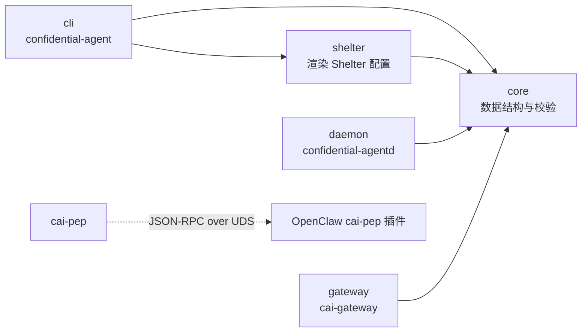
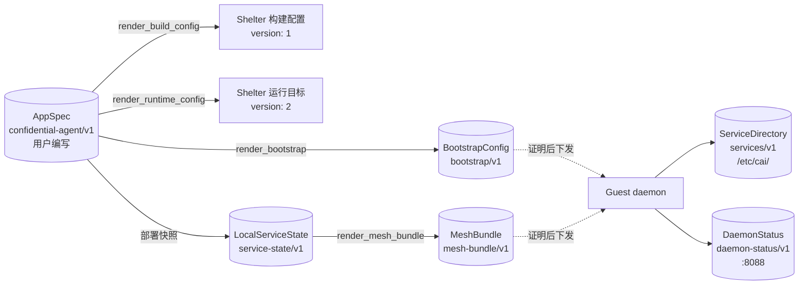
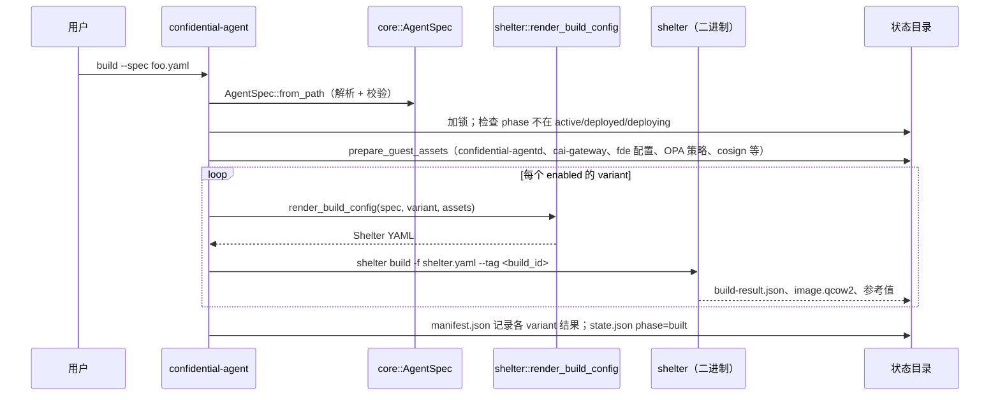
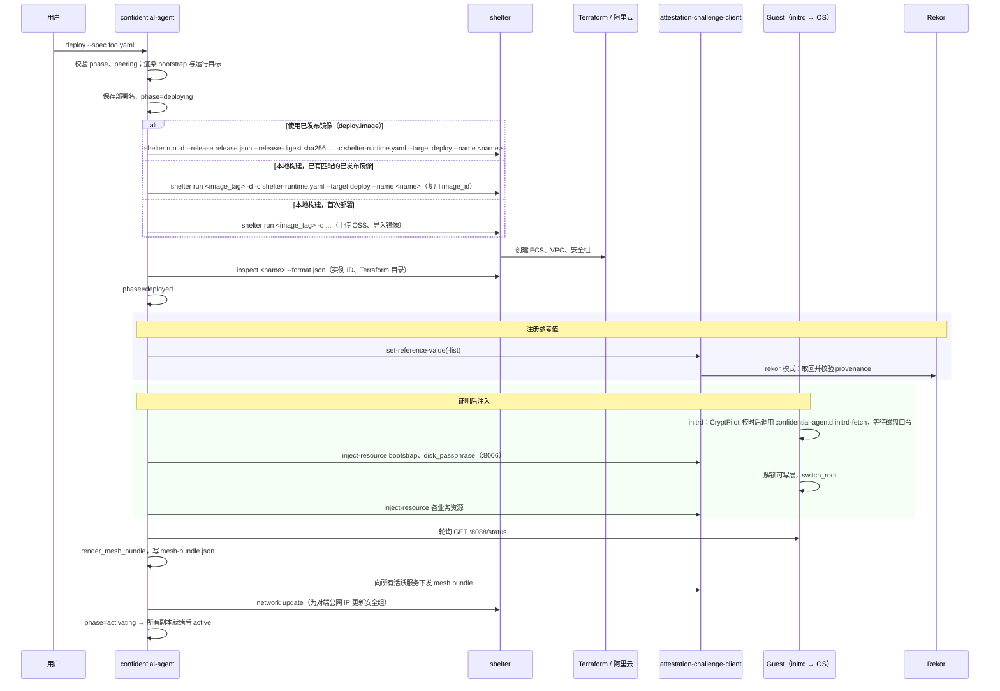
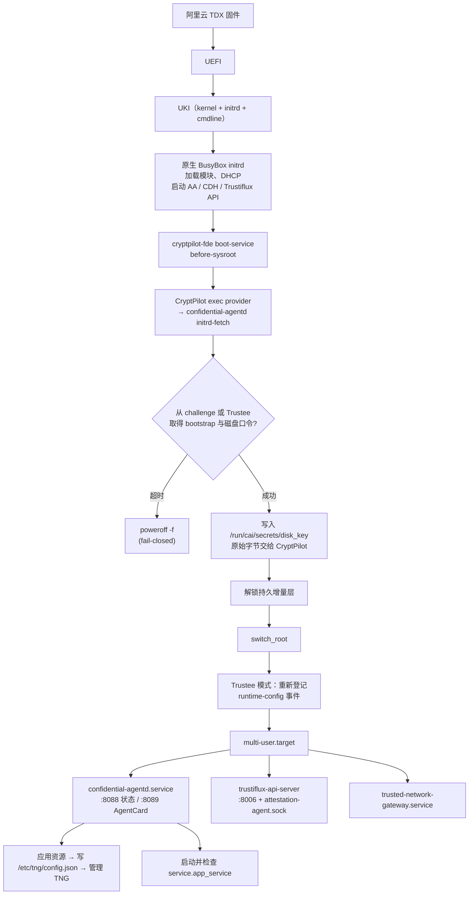
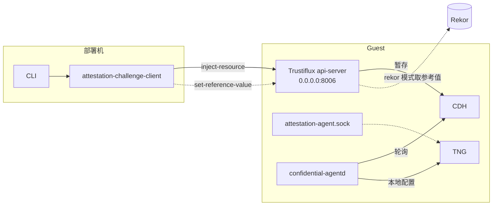
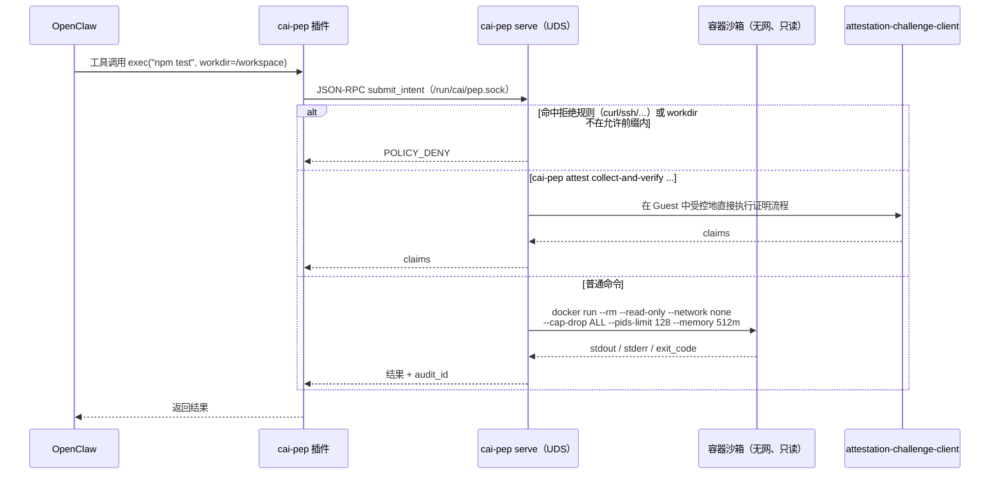

# 架构设计

本文面向贡献者，说明 CA 的组件划分、核心数据结构、关键流程和设计约束。使用层面的说明见 [文档导航](../README.md)，术语见 [核心概念](../concepts.md)。

## 1. 总体结构

CA 自己实现的部分集中在四块：**面向用户的声明式 AppSpec、可复现且可销毁的部署机状态机、跨实例 mesh，以及 Guest 内的网关与策略执行**。镜像构建、云资源编排、远程证明协议、网络加密都交给上游组件：

| 上游 | 在 CA 中的角色 |
|---|---|
| [Shelter](https://github.com/inclavare-containers/shelter) | 用 mkosi 构建 UKI 镜像，通过 Terraform 编排阿里云资源，生成 sample 参考值与 SLSA provenance |
| [TNG](https://github.com/inclavare-containers/tng) | RATS-TLS / OHTTP 数据面，连接建立时完成证明与加密 |
| [Trustiflux / Attestation Agent / CDH](https://github.com/confidential-containers) | Guest 内的远程证明端点与机密暂存 |
| [CryptPilot](https://github.com/openanolis/cryptpilot) | initrd 阶段解锁加密可写层 |
| [Sigstore cosign + Rekor](https://docs.sigstore.dev) | 参考值的签名与透明日志 |
| [Trustee](https://github.com/confidential-containers/trustee) | 可选的独立 KBS / AS / RVPS |

### 1.1 Crate 划分

workspace（[`Cargo.toml`](../../Cargo.toml)）包含 6 个 crate：



| Crate | 包名 | 产物 | 运行位置 | 职责 |
|---|---|---|---|---|
| `core` | `confidential-agent-core` | lib | 共享 | AppSpec（`AgentSpec`）、各类 schema、mesh、peering、AgentCard、Trustee 数据结构与校验 |
| `shelter` | `confidential-agent-shelter` | lib | 部署机 | 纯函数：把 AppSpec 与 Guest 资产渲染为 Shelter 构建配置和运行目标配置 |
| `cli` | `confidential-agent-cli` | `confidential-agent` | 部署机 | 控制面：init / build / image / deploy / inject / connect / status / destroy 等 |
| `daemon` | `confidential-agentd` | `confidential-agentd` | Guest | initrd 取密（`initrd-fetch`）+ 常驻守护进程：应用资源、配置 TNG、状态 HTTP、AgentCard |
| `gateway` | `cai-gateway` | `cai-gateway` | Guest | mesh 端口前的服务身份校验，MCP 端口的审计与虚拟工具 |
| `cai-pep` | `cai-pep` | `cai-pep` | Guest | Unix socket 上的策略执行点；`attest` 子命令采集并校验证据 |

`cli` 有 `full`（默认）和非 `full` 两种编译特性，后者即仅部署版，不包含本地构建能力。

## 2. 核心数据结构

所有 schema 都带显式版本字符串，读取时严格比对，版本不一致直接拒绝（常量见 [`core/src/schema.rs`](../../core/src/schema.rs)）。



| Schema | 类型 | 生成者 | 消费者 |
|---|---|---|---|
| `confidential-agent/v1` | `AgentSpec` | 用户 | CLI |
| `confidential-agent/service-state/v1` | `LocalServiceState` | CLI | CLI（status、mesh、destroy） |
| `confidential-agent/bootstrap/v1` | `BootstrapConfig` | CLI [`render_bootstrap`](../../cli/src/app.rs) | Guest daemon |
| `confidential-agent/mesh-bundle/v1` | `MeshBundle` | CLI [`render_mesh_bundle`](../../cli/src/app/workflows.rs) | Guest daemon |
| `confidential-agent/services/v1` | `ServiceDirectory` | Guest daemon | Guest 内 TNG 与应用 |
| `confidential-agent/daemon-status/v1` | `DaemonStatus` | Guest daemon `:8088` | CLI `status --live`、`tui` |
| `confidential-agent/image-runtime/v1` | 镜像运行时契约 | 构建者（`build.runtime_contract`） | CLI 部署前校验 |
| `confidential-agent/trustee-runtime/v1` | Trustee 运行时配置 | CLI，作为 ECS user-data | Guest `initrd-fetch` |

派生文件不要手写。手动编辑状态文件时，schema 字符串必须完全一致。

## 3. `build` 流程



要点：

- **镜像形态**：统一由 Shelter 原生构建器生成 rootfs，使用 UKI、CryptPilot 全盘加密和加密的持久增量层。原生 initramfs 通过 `initrd.binaries` 从 rootfs 收集 `confidential-agentd`、`confidential-data-hub` 及其 ELF 依赖，不再生成 dracut 模块。构建前会用 `shelter builder plan` 确认这些程序进入了 early-boot 计划。
- **TNG 版本固定**：cagent RPM 依赖 AliLinux 3 源中的 `trusted-network-gateway-2.9.2-1.al8`。Guest 显式安装同一版本并设置 `security.tng: false`，避免 Shelter 自动引入其他版本；[`guest_setup_script`](../../cli/src/app.rs) 同时校验 RPM NEVRA 和 `tng --version`，不符时构建失败。仓库不携带 TNG 二进制。
- **多变体**：一次 `build` 构建所有 enabled 变体。`state.json` 中的 `build_id` 指向 `deploy.image_variant` 对应的变体，完整结果在 `manifest.json` 的 `variants` 中。
- **build_id**：`<image_name>-<variant>-<run_id>`，`run_id` 精确到毫秒，避免重复构建互相覆盖。
- **Shelter 配置版本**：构建使用显式 `version: 1` 配置，保留 V2 还不能完整表达的 `initrd.binaries`、Rekor 和容器挂载。`build.resize` → `output.disk_size`，`build.qcow2_compression` → `output.qcow2_compression`，`build.cleanup` → 顶层 `cleanup`，CryptPilot → `security.disk.engine: cryptpilot` 与 `security.disk.cryptpilot.*`。
- 构建阶段**不读取** `peerings.yaml`，也不渲染部署目标或安全组。

## 4. `deploy` 流程

下图为 challenge 模式。Trustee 模式复用相同的构建产物，但在创建基础设施前把启动资源同步到 KBS，并把运行时 JSON 作为 ECS user-data；Guest 自行证明和取密，不执行远程 `inject-resource`。见 [Trustee 模式](../guides/trustee.md#6-部署时发生了什么)。



**Shelter 运行目标**：部署不修改构建快照，而是由 [`render_runtime_config`](../../shelter/src/lib.rs) 单独生成 `version: 2` 的 `shelter-runtime.yaml`：

```yaml
version: 2
default_target: deploy
targets:
  deploy:
    provider: terraform-alicloud
    trust: verified
    attestation: disabled            # Shelter 不做证明
    provider_options:
      name: openclaw-20260429201011  # sanitize(service.id) + "-" + run_id
      backend: terraform
      cloud: alicloud
      region: cn-beijing
      zone_id: cn-beijing-i
      instance_type: ecs.g9i.xlarge
      disk_size: 32
      cc_mode: tdx
      attestation_authority: external  # 证明与取密由 CA 负责
      security_group:
        rules: []                    # 由 peerings 与服务端口生成，见 security_group_rules
      tags:
        confidential-agent-service: <id>
        confidential-agent-image-variant: <variant>
```

Shelter 负责创建 TDX 实例，证据验证和密钥释放由 CA 的 challenge/Trustee 流程完成。`inspect` 读取实例 ID 和 Terraform 目录，`network update` 只更新受管实例的网络，`rm -f` 删除实例。部署名与 build ID 分开保存。

**challenge 注入**：[`challenge_inject`](../../cli/src/app/tools.rs) 通过 `attestation-challenge-client inject-resource` 访问 `http://<ip>:8006`。每个资源先尝试直连，失败后回退到部署机的代理环境变量。

**镜像发布**：`image publish` 显式完成导入（没有单独的 `import` 子命令），按 `manifest_digest`、阿里云账号和地域记录 `image_id`；`deploy` 自动匹配或用 `--image-id` 显式复用。上传端点由 `CA_IMAGE_OSS_ENDPOINT` 决定。

**部署端预检查**：使用已发布镜像时，CA 在创建任何云资源之前校验镜像运行时契约：Guest/bootstrap 协议能力、rootfs 完整性、由 CA 远程证明取密的可写层加密、最小磁盘、`app_service`，以及是否支持实例级管理 SSH。

## 5. Guest 启动链



相关 systemd 配置来自三处：

- 守护进程的 rootfs unit：[`agentd_service_unit`](../../cli/src/app.rs)。initrd 中没有单独的取密 unit，由 [`cryptpilot_fde_config`](../../cli/src/app.rs) 的 `exec` provider 在 CryptPilot 校时后直接调用 `confidential-agentd initrd-fetch`（Guest 有效截止时间 210 秒）。
- 构建期 setup 脚本：[`guest_setup_script`](../../cli/src/app.rs) 校验 TNG RPM，并保持发行版 TNG unit 禁用，由守护进程在资源与路由就绪后管理 TNG。内置 Attestation Service 配置显式选择 `background_check`、`coco` 和 RATS-TLS 复用（`rats_tls.multiplex: true`），mesh、A2A 和客户端使用相同的传输模式。`libtdx-verify` 由 AliLinux 3 源安装，供 `attestation-challenge-client` 使用。
- 各示例自己的安装脚本，例如 [`examples/openclaw/install-openclaw.sh`](../../examples/openclaw/install-openclaw.sh) 注册 `cai-openclaw-gateway.service`；AppSpec 的 `service.app_service` 决定守护进程是否把它纳入 `app_ready` 判断。

**资源应用**：守护进程在写入资源前停止 `app_service`，把 provider 暂存区中的资源原子复制到目标路径，并强制校验 sha256、权限、属主（[`apply_resource_once`](../../daemon/src/app.rs)），成功后再启动 `app_service`。`app_ready` 判断会从实例主网卡地址（只有 mesh 端口时为 `127.0.0.1`）探测 `service.ports`。

**管理恢复模式**：Guest 持久化的守护进程状态不可读时，进入 `management-recovery`：停止业务和 mesh 服务，保留已记录的端点预留，只安装通过哈希校验的实例管理凭据，以便运维通过管理 SSH 恢复。此时 `app_ready` 和 `mesh_ready` 均报告未就绪。

## 6. Mesh：同状态目录内的可信寻址

`MeshBundle` 是“所有活跃服务彼此可信地找到并连接对方”的唯一事实来源。端口语义：`ports` 是 Guest 内真实业务端口（可为空，表示 client/job）；`connect` 是对部署机和 A2A 开放的单向证明子集；`mesh_ports = ports - connect` 是双向证明、仅限机密服务访问的数据面。

```jsonc
{
  "schema": "confidential-agent/mesh-bundle/v1",
  "generation": 7,
  "updated_at": 1714000000,
  "services": {
    "openclaw":      { "phase": "active", "public_ip": "1.2.3.4", "private_ip": "10.0.0.8",  "ports": [18789, 18800], "connect": [18789] },
    "openclaw-vllm": { "phase": "active", "public_ip": "5.6.7.8", "private_ip": "10.0.0.9",  "ports": [3001], "connect": [] },
    "job-agent":     { "phase": "active", "public_ip": "5.6.7.9", "private_ip": "10.0.0.10", "ports": [], "connect": [] }
  },
  "reference_values":       { "...": "sample 模式" },
  "rekor_reference_values": { "...": "rekor 模式" }
}
```

下发链路：

1. CLI [`render_mesh_bundle`](../../cli/src/app/workflows.rs) 生成，并保存为 `<state-dir>/mesh-bundle.json`；
2. 对每个活跃服务，按**部署时的 mode 快照**和 Trustee 状态分流（不重新读取 AppSpec）：challenge 用 `inject-resource`，Trustee 上传到该服务的 KBS 命名空间；两份状态不一致时 fail closed；
3. Guest [`sync_mesh`](../../daemon/src/app.rs) 收到后：
   - 持久化到 `/var/cache/confidential-agent/mesh-bundle.json`；
   - 写 `/etc/cai/service-directory.json`，列出对端的 connect 和 mesh 端口（每个端口标记 `mode=connect|mesh`），应用通过它做服务发现；没有端口的 peer 不会作为调用目标出现；
   - 渲染 `/etc/tng/config.json`：本服务 connect 端口只做服务端证明，mesh 端口同时验证调用方；访问对端 connect 端口时只验证对端，访问对端 mesh 端口时同时出示本服务证据；
   - 仅为本服务 mesh 端口配置 `cai-gateway`：普通 mesh 端口只做服务身份校验，`mcp_ports` 才做 MCP 解析、审计和虚拟工具；
   - 配置摘要变化时重启 TNG。

mesh bundle 随活跃服务集合滚动更新。新服务部署时 `generation` 递增，已有服务可能先收到包含新参考值的 bundle，再等新服务自己的入口就绪。测试双向证明时，应等待各服务 `:8088/status` 的 `mesh_generation` 更新且 `mesh_ready=true` 后再断言。

同一状态目录下的服务可以使用相同端口号：每个 peer 在调用方本地获得独立的客户端端点。这要求所有 mesh 成员的镜像具备 `mesh-client-ports-v2` 能力。

## 7. 远程证明通道



- 同一个 `attestation-challenge-client` 负责参考值注册和资源注入。Trustiflux 收到注入请求时先完成证明（quote → 策略 → claims），通过后才写入 CDH。
- 默认策略 [`tools/policies/trustee-opa-default.rego`](../../tools/policies/trustee-opa-default.rego) 对 EAR（AR4SI）做评估，硬件、配置、文件系统、可执行文件四个维度都必须通过。challenge 与 Trustee 使用同一份策略。
- 本地开发可换用 [`tools/policies/trustee-opa-local-dev.rego`](../../tools/policies/trustee-opa-local-dev.rego)，它把四个维度都置为通过，便于在 QEMU 中自测。**不要用于生产。**

## 8. PEP 数据流



`cai-pep attest` 之所以绕过沙箱执行，是因为取 quote 需要访问 `/dev/tdx_guest` 和 `localhost:8006`，普通沙箱不能提供这些权限；PEP 只对这一条命令做受控放行。机制说明见 [`tdx-remote-attestation.SKILL.md`](../../examples/openclaw/files/tdx-remote-attestation.SKILL.md)。完整配置字段见 [`cai-pep/src/main.rs`](../../cai-pep/src/main.rs)，默认策略见 [`cai-pep-default-policy.json`](../../examples/openclaw/files/cai-pep-default-policy.json)。镜像中容器运行时由 Podman 提供。

## 9. 端口约定

| 端口 | 监听者 | 用途 | 安全组规则 |
|---|---|---|---|
| 22 | sshd（debug 镜像或 `service.ssh: true`） | 调试 / 管理 SSH | `ssh_22_peer_<cidr>` |
| 8006 | trustiflux-api-server | 远程证明与资源注入 | `control_8006_peer_<cidr>` |
| 8088 | confidential-agentd | 只读状态 HTTP（`/status`、`/health`） | `status_8088_peer_<cidr>` |
| 8089 | confidential-agentd | AgentCard（`/.well-known/agent-card.json`） | `agent_card_8089_peer_<cidr>` |
| 50000 | TNG 控制面 | 本地控制 | 仅 loopback |
| 39000+i | TNG egress | 应用本地访问对端的入口 | 仅 loopback |
| `service.connect[]` | 应用 | connect / A2A，单向证明，不经过 gateway | `connect_<port>_peer_<cidr>` |
| `ports - connect` | 应用（gateway 透明接管） | mesh 数据面，双向证明 | `mesh_<port>_peer_<cidr>` |
| `service.mcp_ports[]` | 应用（gateway 透明接管） | mesh 端口子集，额外 MCP 审计 | 复用 `mesh_<port>_peer_<cidr>` |

安全组规则由 [`security_group_rules`](../../shelter/src/lib.rs) 生成，来源见 [AppSpec 参考 · 安全组规则](../reference/appspec.md#41-安全组规则)。

## 10. 状态与并发

- **实例状态机**：`deploying → deployed → activating → active`，销毁为 `destroying → deleted`。`activating` 表示已加入待完成的配置拓扑（mesh 协议中仍以 `active` 表示成员资格）；所有副本就绪验证通过后才提交为 `active`。销毁先持久化 `destroying`，失败时保留精确的 Terraform 目录和资源标识以便重试。
- **部署快照**：部署时把 attestation mode、部署机 CIDR（`CA_DEPLOYER_CIDR`）、资源摘要、磁盘口令和实例身份写入快照。`deploy --resume` 先用原 AppSpec 路径、摘要及冻结的输入校验本次请求，再使用保存的部署快照。mesh 和 A2A 同步直接使用已保存的部署状态。
- **锁**：镜像清理和实例操作使用 `<state-dir>/operation-locks/<service>` 中的稳定锁文件，删除业务目录不会删除锁。同一服务的 build/deploy/inject/destroy 互斥；云镜像操作另持共享或排他的 image lease。
- **发布台账**：发布进度只在短暂的状态事务中重新读取并更新 publication 字段，不会用长时间网络操作之前的整份快照覆盖并发的 mesh 更新。上传/导入状态、退役意图、资源所有权、导入快照和 OSS 中转对象清理分别记录；导入请求使用持久化 ClientToken，响应丢失时复用同一请求身份。跨工作区发现的同一镜像不会自动获得删除权限。

## 11. 扩展阅读

- [MCP 网关与 CMaaS](mcp-gateway.md)
- [Trustee 模式](../guides/trustee.md)
- [A2A 跨组织协作](../guides/a2a.md)
- [开发者指南](../development/README.md)
