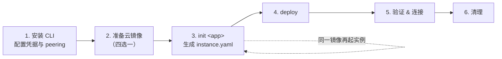

# 手动部署

本文不使用一键脚本，而是直接调用 `confidential-agent` CLI 完成每一步：准备镜像、初始化实例、部署、验证、连接和清理。适合需要接入自动化流水线、或想清楚了解每个环节的读者。

示例以官方共享镜像中的 OpenClaw 为例，其他 Agent 只需替换 `init` 的应用名。

## 流程概览



三个关键命令的分工：

| 命令 | 作用 |
|---|---|
| `init --stage build` | 生成共享镜像的**构建**配置（`build.yaml`），只在需要自己构建镜像时使用 |
| `image publish` | 把镜像产物上传并导入为当前账号、指定地域的 **ECS 自定义镜像**（CLI 没有单独的 `import` 子命令） |
| `init <app>` | 基于已发布镜像，生成某个应用**实例**的部署配置（`instance.yaml` 及其密钥文件） |

## 1. 准备

按 [安装](../install.md) 装好 CLI，并准备 Python 3.11 和 `jq`，供后续读取官方镜像元数据。

全功能 RPM 使用系统安装目录，按下面的方式设置工具路径。

```bash
CA_SHARE=/usr/share/cagent
export PATH="/usr/libexec/cagent/bin:$PATH"
```

如果使用仅部署 ZIP，先进入含 `one-click.sh` 的解压目录，再设置工具路径。

```bash
CA_BUNDLE="$PWD"
CA_SHARE="$CA_BUNDLE/share/cagent"
export CA_TOOLS_DIR="$CA_BUNDLE/bin"
export PATH="$CA_TOOLS_DIR:$PATH"
```

下面的命令在同一个 shell 中配置凭据和 peering。

```bash
export ALICLOUD_ACCESS_KEY="<YOUR_ACCESS_KEY>"
export ALICLOUD_SECRET_KEY="<YOUR_SECRET_KEY>"
export DASHSCOPE_API_KEY="<YOUR_DASHSCOPE_API_KEY>"

# 允许部署机访问实例的管理端口（远程证明注入、状态查询、SSH、connect）
OPERATOR_CIDR="$(curl -fsSL https://ipinfo.io/ip)/32"
confidential-agent peering add --role operator --cidr "$OPERATOR_CIDR" --label ops
```

`deploy` 会检查是否存在包含 `control` 和 `status` 权限的 operator peering。peering 只影响部署和运行，构建镜像不读取它。peering 的含义见 [运维手册 · 网络授权](operations.md#网络授权peering)。

## 2. 准备云镜像

根据你手上已有的东西选一条路径。每条路径结束时都应得到三个变量：

- `IMAGE_RELEASE`：镜像描述文件 `image-release.json` 的路径
- `RELEASE_DIGEST`：该文件整体的 SHA-256（`sha256:<64 位十六进制>`），用来确认描述文件没被替换
- `IMAGE_ID`：当前地域可用的 ECS 镜像 ID（可省略，见下文）

| 你手上已有 | 走哪条路径 |
|---|---|
| 什么都没有，想用官方镜像 | [A. 下载官方预构建镜像并导入](#路径-a下载官方预构建镜像并导入) |
| 已下载或离线拷贝了官方产物目录 | [B. 导入本地产物](#路径-b导入本地产物) |
| 当前地域已有可用的 ECS 镜像 ID | [C. 直接使用已有镜像](#路径-c直接使用已有镜像) |
| 需要修改镜像内软件 | [D. 从源码构建共享镜像](#路径-d从源码构建共享镜像) |

### 路径 A：下载官方预构建镜像并导入

```bash
DOWNLOAD="$(python3.11 "$CA_SHARE/hack/download-release-image.py" --output-dir ./prebuilt --format json)"
ARTIFACT="$(jq -er '.artifact' <<<"$DOWNLOAD")"
IMAGE_RELEASE="$(jq -er '.image_release' <<<"$DOWNLOAD")"
RELEASE_DIGEST="$(jq -er '.release_digest' <<<"$DOWNLOAD")"

confidential-agent image publish \
  --artifact "$ARTIFACT" \
  --image-release "$IMAGE_RELEASE" \
  --release-digest "$RELEASE_DIGEST" \
  --region cn-beijing \
  --output ./published.json

IMAGE_ID="$(jq -er '.image_id' ./published.json)"
```

下载器从官方 Release 读取可信摘要，先直连 `ghcr.io` 下载产物，失败时切换到 `ghcr.1ms.run`，支持断点续传。不加 `--format json` 时，下载器会直接打印需要执行的 `image publish` 命令。部署机装有 QEMU 和 NBD 时，可给下载器或 `image publish` 加 `--verify-disk`，额外检查磁盘结构和启动材料。

### 路径 B：导入本地产物

本地已有 Shelter 产物目录（包含 `artifact-manifest.json` 和磁盘镜像）时，先从官方 Release 取得描述文件和可信摘要，再导入：

```bash
python3.11 "$CA_SHARE/hack/fetch-release-image.py" --output-dir ./prebuilt
IMAGE_RELEASE="./prebuilt/image-release.json"
RELEASE_DIGEST="$(jq -er '.release_digest' ./prebuilt/image-index.json)"

confidential-agent image publish \
  --artifact ./local-shelter-artifact \
  --image-release "$IMAGE_RELEASE" \
  --release-digest "$RELEASE_DIGEST" \
  --region cn-beijing \
  --output ./published.json

IMAGE_ID="$(jq -er '.image_id' ./published.json)"
```

`--artifact` 可以指向产物目录，也可以指向其中的 `artifact-manifest.json`。CLI 会核对产物清单、磁盘摘要和大小，与描述文件一致才导入。

### 路径 C：直接使用已有镜像

当前地域已经有可用的自定义镜像、共享镜像或云市场镜像时，只需准备与该镜像对应的描述文件和摘要：

```bash
python3.11 "$CA_SHARE/hack/fetch-release-image.py" --output-dir ./prebuilt
IMAGE_RELEASE="./prebuilt/image-release.json"
RELEASE_DIGEST="$(jq -er '.release_digest' ./prebuilt/image-index.json)"
IMAGE_ID="m-xxxxxxxxxxxxxxxxxxxx"
```

使用自己构建的镜像时，把 `IMAGE_RELEASE` 和 `RELEASE_DIGEST` 换成本机 `image export` 的结果。

### 路径 D：从源码构建共享镜像

需要全功能版。镜像构建不需要任何模型 API Key。

```bash
# 生成构建目录 ~/cagent-work/allinone-builder/（含 build.yaml、安装脚本和 NEXT_STEPS.md）
confidential-agent init --stage build --non-interactive --reference-values rekor --output-dir ~/cagent-work
BUILD_SPEC=~/cagent-work/allinone-builder/build.yaml

confidential-agent spec validate --spec "$BUILD_SPEC"
confidential-agent build --spec "$BUILD_SPEC"

# 导出可移植的镜像描述（不含私钥或云镜像 ID），输出中包含 release_digest
IMAGE_RELEASE=./image-release.json
confidential-agent image export allinone-builder --output "$IMAGE_RELEASE"
RELEASE_DIGEST="sha256:$(sha256sum "$IMAGE_RELEASE" | awk '{print $1}')"

# 上传并导入为 ECS 自定义镜像
confidential-agent image publish allinone-builder --spec "$BUILD_SPEC" --region cn-beijing --output ./published.json
IMAGE_ID="$(jq -er '.image_id' ./published.json)"
```

本机已经构建过时，跳过 `build`，直接从 `image export` 开始。镜像内容和构建细节见 [examples/allinone](../../examples/allinone/README.md)。

**关于 `IMAGE_ID`**：如果镜像是在同一个 `--state-dir` 下通过 `image publish` 导入到当前账号和地域的，后续 `init` 可以省略 `--image-id`，CA 会按镜像的 `manifest_digest`、账号和地域自动找到它。

## 3. 初始化实例并部署

```bash
export GATEWAY_TOKEN="$(openssl rand -hex 20)"   # OpenClaw 应用层访问令牌，不填会自动生成

confidential-agent init openclaw \
  --non-interactive \
  --image-release "$IMAGE_RELEASE" \
  --release-digest "$RELEASE_DIGEST" \
  --image-id "$IMAGE_ID" \
  --service-id openclaw-01 \
  --gateway-token "$GATEWAY_TOKEN" \
  --region cn-beijing --zone-id cn-beijing-i --instance-type ecs.g9i.xlarge \
  --output-dir ~/cagent-work

confidential-agent spec validate --spec ~/cagent-work/openclaw-01/instance.yaml
confidential-agent deploy --spec ~/cagent-work/openclaw-01/instance.yaml
```

`init <app>` 会在 `~/cagent-work/<service-id>/` 下生成 `instance.yaml`、`image-release.json`、`secrets/` 和 `NEXT_STEPS.md`。`secrets/` 中的文件会作为资源，在远程证明通过后注入实例。

可用的应用名：`openclaw`、`hermes`、`codex`、`opencode`、`dsh`、`claude-code`、`qodercli`、`pi`（共享 CPU 镜像），以及 `openclaw-vllm`、`vllm-inference`（GPU 专用镜像，需本地构建）。常用选项：

| 选项 | 说明 |
|---|---|
| `--model` | 模型名，默认 `qwen4-max`（也读取 `DASHSCOPE_MODEL`） |
| `--harness-mode` | 覆盖运行模式：`gateway`（OpenClaw/Hermes）、`app-server`（Codex）、`web`（OpenCode/DSH）、`cli`（改为 SSH 使用） |
| `--disable-pep` | 仅 OpenClaw：关闭该实例的 `exec` 策略沙箱，保留远程证明 |
| `--enable-dingtalk` | 仅 OpenClaw：启用钉钉，需要 `DINGTALK_BOT_CLIENT_ID` / `DINGTALK_BOT_CLIENT_SECRET` |
| `--replicas N` | 网络服务部署 N 个共享身份的副本（CPU 网络服务用 NLB，`vllm-inference` 用 ALB + OHTTP） |
| `--reference-values` | `rekor`（推荐）或 `sample` |

完整选项：`confidential-agent init --help`。

**同一镜像再起实例**：换一个 `--service-id` 再执行 `init` 和 `deploy` 即可，无需重新构建或导入。每个实例都有独立的磁盘口令、网关身份、SSH 密钥和业务配置。

```bash
confidential-agent init hermes --non-interactive \
  --image-release "$IMAGE_RELEASE" --release-digest "$RELEASE_DIGEST" --image-id "$IMAGE_ID" \
  --service-id hermes-01 --region cn-beijing --output-dir ~/cagent-work
confidential-agent deploy --spec ~/cagent-work/hermes-01/instance.yaml
```

**部署中断**：基础设施已创建（状态 `deployed`/`activating`）但资源注入未完成时，用 `confidential-agent deploy --resume --spec <同一个 instance.yaml>` 续跑。基础设施创建本身中断时，状态停在 `deploying`；这时先 `destroy` 再重新部署。

## 4. 验证

```bash
confidential-agent status --live                 # 实例阶段、Guest 守护进程状态、应用是否就绪
confidential-agent tui                           # 实时面板：证明判定、UKI 实测值 vs 期望值、Rekor、端口
confidential-agent report --include-a2a --json --out ./attestation-report.json
```

各字段含义见 [运维手册 · 查看状态与证明结果](operations.md#查看状态与证明结果)。

## 5. 连接

```bash
confidential-agent connect start --service openclaw-01 --ready-json ./connect-ready.json --log-file ./connect.log
jq '.client_endpoints' ./connect-ready.json      # 查看实际映射的本地地址，默认 127.0.0.1:18789
```

- 浏览器：打开 `http://127.0.0.1:18789/openclaw`，输入 `GATEWAY_TOKEN`。
- OpenClaw TUI（需自行安装匹配版本的 `openclaw` CLI）：`openclaw tui --url ws://127.0.0.1:18789 --token "$GATEWAY_TOKEN"`。
- SSH 类 Agent（Claude Code、QoderCLI、Pi）：`confidential-agent ssh <service-id> --tty -- cai-agent`。

用完后停止隧道：

```bash
confidential-agent connect stop --ready-json ./connect-ready.json
```

本地 CLI 永远不会在部署机上自动安装应用客户端。

## 6. 清理

```bash
confidential-agent destroy openclaw-01   # 删除实例的 ECS、VPC、安全组等，保留共享镜像
confidential-agent forget openclaw-01    # 可选：删除该实例的本地记录
confidential-agent image list            # 查看已发布镜像的账号、地域和 ID
```

确认镜像不再被任何实例使用后，再退役云镜像：

```bash
# 本地构建的镜像：按构建服务名
confidential-agent image unpublish allinone-builder --region cn-beijing

# 通过 --artifact 导入的镜像：按 manifest 摘要
MANIFEST_DIGEST="$(jq -er '.manifest_digest' ./published.json)"
confidential-agent image unpublish "$MANIFEST_DIGEST" --region cn-beijing --image-id "$(jq -er '.image_id' ./published.json)"
```

曾通过 `image export --image-id` 写入描述映射的镜像，需要加 `--force` 才能退役。各清理命令的删除范围见 [运维手册 · 清理资源](operations.md#清理资源)。

## 下一步

- 与其他组织的 Agent 互相调用：[A2A 指南](a2a.md)
- 实例重启后自动恢复、无需部署机在线：[Trustee 模式](trustee.md)
- 打包自己的 Agent：[打包自定义 Agent](custom-agent.md)
