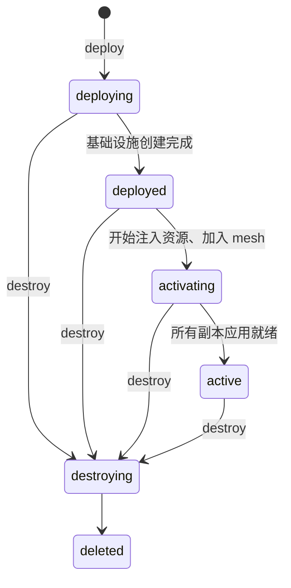

# 运维手册

本文汇总实例部署后的日常操作。所有命令都接受全局参数 `--state-dir`（默认 `~/.confidential-agent`），同一套环境的所有命令应使用同一个状态目录。

## 查看状态与证明结果

```bash
confidential-agent status                    # 本地记录的服务与镜像状态
confidential-agent status --live            # 额外实时查询每个 Guest 守护进程（:8088）
confidential-agent status --service openclaw --live --json
confidential-agent report --include-a2a --json --out ./report.json   # 汇总证明证据与 Rekor 条目
confidential-agent tui                       # 实时面板
```

`status --live` 中的关键字段：

| 字段 | 含义 |
|---|---|
| `phase` | Guest 守护进程阶段，依次为 `waiting-resources`（等待机密注入）→ `resources-applied` → `waiting-mesh`（等待 mesh bundle）→ `starting-app`（应用未就绪）或 `starting-mesh`（应用已就绪、TNG 未就绪）→ `running`；`management-recovery` 表示 Guest 持久状态不可读，已停止业务、只保留管理 SSH 供恢复 |
| `app_ready` | AppSpec 设置了 `service.app_service` 时，表示该 systemd 服务和全部 `service.ports` 已在 Guest 内可连接。**它不代表外部模型调用已成功。** 未设置 `app_service` 时只代表资源和 TNG 已就绪。 |
| `mesh_ready` / `mesh_generation` | 本服务的 TNG mesh 配置是否已应用，以及应用的 mesh bundle 版本 |
| `applied_resources` | 已成功写入的资源及其校验结果 |
| `a2a_peers` | A2A 对端状态（见 [A2A 指南](a2a.md#7-cli-与运行状态)） |

### TUI

```bash
confidential-agent tui
confidential-agent tui --service openclaw --refresh 5 --attestation-refresh 120
```

`--refresh` 是刷新 Guest 状态的间隔，默认 2 秒；`--attestation-refresh` 是重新收集并校验远程证据的间隔，默认 60 秒，设为 0 表示关闭自动校验。界面内常用按键：`j`/`k` 或方向键选择，`/` 过滤，`:` 命令模式，`v` 立即重新校验，`r` 刷新，`?` 帮助，`q` 退出。

面板上的几个标识含义不同，不要混为一谈：

| 标识 | 表示 | 不表示 |
|---|---|---|
| `Evidence VERIFIED` | 本次新采集的证据通过默认证明策略 | — |
| `UKI MATCH` | 证据中的 UKI 度量值等于配置的参考值 | — |
| Rekor entry | 来自本地构建时记录的上传凭证 | 不是一次新的 Rekor 在线查询 |
| `Mesh/TNG READY` | 本服务的 TNG 配置已就绪 | 不表示已经建立过业务连接 |

### 在 Guest 内验证

内置 Agent 都预装了 `tdx-remote-attestation` skill，可以直接让 Agent 验证。也可以自己在 Guest 内执行：

```bash
confidential-agent ssh <service-id> -- cai-pep attest collect-and-verify \
  --aa-url http://localhost:8006 --tee tdx --policy default --claims
```

输出中 `submods.cpu0["ear.trustworthiness-vector"].hardware <= 32` 表示 TDX 硬件验证通过。GPU TEE 场景中，claims 包含 `nvidia_gpu.0` 表示 GPU 证据可被验证。

### 审计 Rekor 记录

使用 `reference_values: rekor` 时，镜像的 SLSA provenance 会写入 Rekor 透明日志：

```bash
find ~/.confidential-agent -name '*.rekor-meta.json' -print      # 找到本次构建的 log index
LOG_INDEX="<log index>"
/usr/libexec/shelter/bin/rekor-cli verify --log-index "$LOG_INDEX" --rekor_server https://rekor.sigstore.dev
/usr/libexec/shelter/bin/rekor-cli loginfo --rekor_server https://rekor.sigstore.dev
```

`verify` 输出的 Computed Root Hash 与 Expected Root Hash 相同时，说明包含性证明（inclusion proof）通过。`loginfo` 首次运行会保存检查点，之后再次运行才能验证新旧检查点之间的一致性。

## 访问实例

### connect 隧道

```bash
# 前台运行（Ctrl-C 结束），覆盖所有暴露 connect 端口的服务
confidential-agent connect --service openclaw

# 后台运行：等待本地端口就绪后写入 ready 文件
confidential-agent connect start --service openclaw --ready-json ./connect.json --log-file ./connect.log --wait-ready 120
confidential-agent connect stop --ready-json ./connect.json
```

- `ready-json` 中的 `client_endpoints[]` 记录实际映射的 `127.0.0.1:<port>`。
- 同时运行多条隧道时，为每条指定不同的 `--ready-json` 和 `--log-file`。
- 多副本服务可用 `--instance-id` 指定某一个副本，用于单节点排障。
- `connect` 只能访问 `service.connect` 中的端口；mesh 端口（包括 MCP 端口）不允许从部署机直连。

### SSH

| 机制 | 适用镜像 | 用法 |
|---|---|---|
| 管理 SSH | release 镜像 + AppSpec `service.ssh: true`（共享镜像默认开启） | `confidential-agent ssh <service-id> -- <command>` |
| 调试 SSH | debug 镜像 | 部署完成后输出的 `ssh -i ... root@<ip>` 命令；或 `confidential-agent ssh <service-id> --identity-file <构建时的私钥> -- <command>` |

```bash
confidential-agent ssh codex-01 -- cai-agent --check          # 非交互命令，保留标准输出和退出码
confidential-agent ssh codex-01 --tty -- cai-agent            # 交互式终端
confidential-agent ssh <id> --instance-id i-xxx -- uptime     # 多副本时指定实例
```

管理 SSH 的密钥由 CA 为每个实例单独生成，经远程证明下发；私钥只保存在部署机状态目录中，不进入镜像或发布包。需要 SSH 时，peering 必须包含 `ssh` scope（operator 默认包含）。

## 网络授权（peering）

实例安全组的入向规则全部由 `<state-dir>/peerings.yaml` 生成，不写在 AppSpec 里。

```bash
confidential-agent peering add --role operator --cidr 203.0.113.10/32 --label ops
confidential-agent peering add --role peer --cidr 198.51.100.20/32 --label partner --scope agent_card,connect
confidential-agent peering list
confidential-agent peering remove partner
confidential-agent peering apply --dry-run    # 预览
confidential-agent peering apply              # 把变更应用到所有活跃服务的安全组
```

**`add` / `remove` 只修改本地文件，需要执行 `apply` 才会更新云上安全组。**

| scope | 开放端口 | 用途 |
|---|---|---|
| `control` | 8006 | challenge 模式下的远程证明与资源注入 |
| `status` | 8088 | Guest 状态查询 |
| `ssh` | 22 | 管理 SSH / 调试 SSH |
| `agent_card` | 8089 | A2A AgentCard 发现 |
| `connect` | `service.connect` 中的端口 | connect 隧道、A2A 调用 |
| `mesh` | mesh 端口 | 默认不授予任何角色；仅在需要从外部 CIDR 访问 mesh 时显式添加 |

| 角色 | 默认 scope |
|---|---|
| `operator` | `control`, `status`, `ssh`, `agent_card`, `connect` |
| `peer` | `agent_card`, `connect` |

`deploy` 会快速检查是否存在包含 `control` 和 `status` 的 operator peering，并尽量确认当前机器出口 IP 在 `control` 范围内。特殊网络环境下可用 `--skip-peering-check`（或 `CA_SKIP_PEERING_CHECK=1`）跳过。部署机公网出口变化后，记得更新 peering 并 `apply`。

旧版 AppSpec 中的 `deploy.security.allowed_cidr` / `a2a_peer_cidrs` 已移除，可用 `confidential-agent migrate <spec>` 迁移为 peering。

## 实例生命周期



- `deployed` / `activating` 中断时，在原路径使用未改动的 AppSpec 执行 `deploy --resume`，跳过基础设施创建，续做资源注入和就绪流程。
- `deploying` 中断时 CLI 不会盲目重放；`status` 会保留资源名和 Terraform 目录，并把云资源状态标为 `unknown`。
- `destroy` 失败会保留精确的资源标识，可直接重试。
- 同一服务的 `build` / `deploy` / `inject` / `destroy` 互斥执行，不同服务可以并行。

### Challenge 模式重启后恢复

Guest 启动时在 initrd 等待部署机重新注入磁盘密钥，内置取密窗口为 210 秒，超时后实例关机。若实例已关机，先在云控制台启动它，再立即从原部署机执行注入。

沿用部署时的状态目录、AppSpec 和资源文件。对于一键部署，状态目录和 AppSpec 路径可从部署摘要的 `state_dir` 和 `spec` 取得。目标 IP 必须是状态目录中记录且部署机可达的物理实例地址。多副本服务可在 `status --live --json` 的 `replicas` 中按实例 ID 查找 `address`，选用对应副本的地址。

```bash
STATE_DIR="$HOME/.confidential-agent"              # 换成部署时的 state_dir
SPEC="$STATE_DIR/one-click/openclaw/instance.yaml"  # 换成部署时的 spec
SERVICE_ID="openclaw"                              # 换成 AppSpec 中的 service.id
TARGET_IP="203.0.113.10"                           # 换成目标实例的实际地址

confidential-agent --state-dir "$STATE_DIR" inject --spec "$SPEC" --target-ip "$TARGET_IP"
confidential-agent --state-dir "$STATE_DIR" status --service "$SERVICE_ID" --live
```

已安装 v0.4.0 的部署机可直接执行 `confidential-agent inject --help` 查看参数。注入命令一次向一个实例交付资源，并等待同一服务的各副本就绪。计划内维护时逐个重启和恢复副本。希望实例每次启动自行取密时，可部署为 [Trustee 模式](trustee.md)。

## 清理资源

镜像和实例分开管理：`image list` 列出本地构建与云端发布，`status` / `tui` 列出实例。

| 命令 | 删除 | 保留 |
|---|---|---|
| `destroy <实例>` | 该实例的 ECS、VPC、安全组等基础设施 | 共享云镜像、本地记录 |
| `forget <服务>` | 已无运行资源、无发布记录的本地管理目录 | 不调用任何云端删除 |
| `image rm <构建服务>` | 本地镜像文件 | 发布记录、构建元数据 |
| `image unpublish <构建服务 \| sha256:manifest>` | 所选发布的云镜像、CA 自己创建的导入快照、残留 OSS 中转对象 | 本地产物、实例记录 |
| `image prune [--dry-run] [--all]` | 当前账号下可清理的旧发布和中转对象 | 默认保留每个 variant 的当前镜像；`--all` 仍保留有实例引用或已导出的镜像 |

推荐的完整清理顺序：

```bash
confidential-agent destroy <service-id>                  # 1. 销毁所有实例
confidential-agent image list                            # 2. 确认镜像已无引用
confidential-agent image unpublish <builder | sha256:...> --region cn-beijing
confidential-agent forget <service-id>                   # 3. 可选：清理本地记录
```

注意：

- 不带 `--force` 时，CLI 发现本状态目录中仍有实例引用该镜像、或镜像曾通过 `image export --image-id` 导出、或镜像是自动发现复用的（非本机导入）时会拒绝删除，并由云平台再做一次引用检查。
- `--force` 会跳过上述本地保护，并以强制方式调用 ECS `DeleteImage`。只在确认本机和其他机器上都没有实例依赖该镜像后使用。
- 部分云端删除失败时命令返回非零退出码，并保留记录供重试。OSS 中转对象清理失败时，可再次执行 `image publish` 触发重试。
- 镜像导入可能产生额外快照。多副本部署还要确认 ALB/NLB、监听、服务器组和 EIP 都已释放。
- 确认所有云资源释放后，才能删除状态目录：`rm -rf ~/.confidential-agent`。**提前删除会丢失 Terraform 状态和磁盘口令，导致资源无法再由 CA 管理。**

## 升级

```bash
confidential-agent upgrade check        # 在替换部署机 CLI 或重启实例前检查现有状态目录的兼容性
```

`a2a.json` 只支持 version 2，新版 CLI 不会自动迁移 version 1。不要让新旧两个版本的 CLI 共用同一个状态目录。

## 本地目录与状态

| 位置 | 内容 |
|---|---|
| `<state-dir>/services/<service-id>/` | 服务的本地状态、构建清单、密钥（`secrets/`）、Shelter/Terraform 工作目录 |
| `<state-dir>/image-publications/` | `image publish` 按 manifest 摘要、账号、地域记录的发布台账 |
| `<state-dir>/peerings.yaml` | 入向网络授权 |
| `<state-dir>/a2a.json`、`a2a-bundle.json` | A2A 出向配置 |
| `<state-dir>/mesh-bundle.json` | 同状态目录下所有活跃服务的 mesh 信息 |
| `<state-dir>/trustee/` | Trustee 配置、管理私钥和同步状态（仅 Trustee 模式） |
| `<state-dir>/operation-locks/` | 并发操作锁 |
| `./confidential-agent-init/<service-id>/` | `init <app>` 默认生成的实例目录（`instance.yaml`、`secrets/`、`NEXT_STEPS.md`），可用 `--output-dir` 修改 |
| `~/.confidential-agent/one-click/` | 一键脚本的工作目录、日志、`connect*.json` 和 token |

## 排错

| 现象 | 常见原因 | 处理 |
|---|---|---|
| `build` 报 TNG RPM 或版本不匹配 | AliLinux 3 源中解析到的 Guest TNG 不是 `2.9.2-1.al8`，或部署机 TNG 版本不对 | 确认 `alinux3-plus` 源中有目标版本，安装 cagent RPM 声明的 TNG 版本 |
| `deploy` 报缺少 operator peering | 没有包含 `control` + `status` 的 operator peering | `peering add --role operator ...` |
| 部署完成后 `inject-resource` 一直超时 | 安全组未放通 8006，或 peering 的 `control` scope 不包含部署机 | `peering list` 检查后 `peering apply` |
| Guest `phase` 长期停在 `waiting-resources` | 某个 `required: true` 资源缺失或 sha256 不符 | `status --live --json` 查看 `applied_resources` |
| Guest `phase` 停在 `starting-mesh` | TNG 未启动，通常是 attestation-agent 还没就绪 | `confidential-agent ssh <id> -- journalctl -u trusted-network-gateway` |
| `connect` 报 `mesh bundle has no reference values` | 服务还没有成功部署过，或参考值文件被删除 | 重新 `deploy` |
| Rekor 注册失败 | 无法访问 `rekor_url`，或 cosign 签名失败 | 检查原生工具、cosign 密钥、SLSA generator 路径和 Rekor 可达性 |
| 实例在 initrd 阶段直接关机 | 在超时时间内（默认 210 秒）未取得磁盘密钥，这是设计上的 fail-closed | challenge：检查注入是否执行、8006 是否可达。Trustee：检查 user-data、KBS 可达性和策略，见 [Trustee 模式](trustee.md#7-启动和重启) |
| `app_ready` 为 true 但对话失败 | `app_ready` 不覆盖外部模型调用 | 检查 API Key、模型名和额度；`ssh <id> -- cai-agent --check` |
| `cai-pep` 拒绝了工具调用 | 命中了策略规则 | `confidential-agent ssh <id> -- journalctl -u cai-pep.service -n 200 --no-pager` |
| 需要持续对比状态变化 | `status --live` 是一次性快照 | 使用 `confidential-agent tui` |

A2A 相关排错见 [A2A 指南](a2a.md#8-排错)，Trustee 相关见 [Trustee 模式](trustee.md#8-销毁与故障恢复)。
