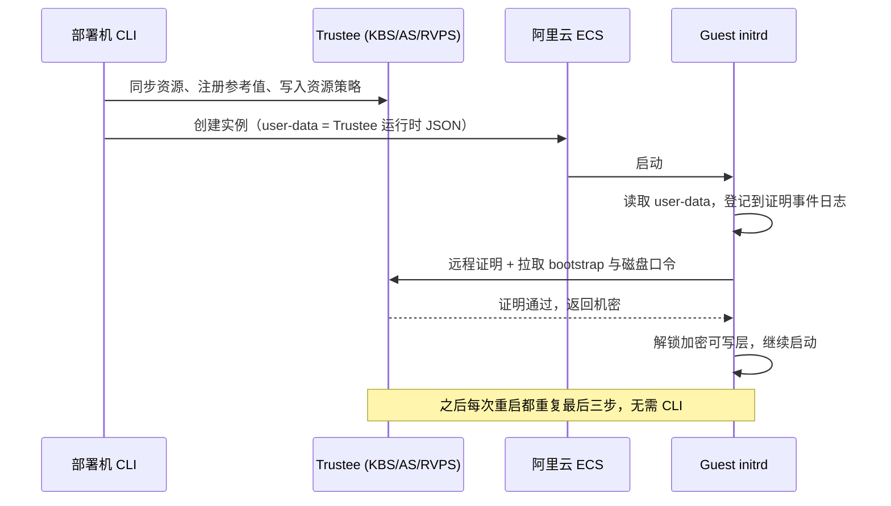

# Trustee 模式

Trustee 模式把参考值、证明策略和机密（磁盘口令、应用资源）存放在一个**独立、长期运行的 Trustee 服务**中。实例每次启动都自己向 Trustee 完成远程证明并取回机密，因此**重启时不需要部署机在线**。

## 1. 什么时候用 Trustee

| | challenge（默认） | Trustee |
|---|---|---|
| 谁下发机密 | 部署机上的 CLI 直接注入到实例 `:8006` | 实例启动时主动向 Trustee（KBS）取 |
| 实例重启后 | 等待部署机重新注入，超时关机 | 自动恢复 |
| 需要额外基础设施 | 无 | 一台独立运维的 Trustee 服务 |
| 部署机到实例 8006 端口 | 需要 | 不需要 |
| 适合 | 开发、短期实例、无法运维额外服务的场景 | 生产、需要无人值守重启的服务 |

两种模式使用**同一个镜像**、同一套资源路径和同一个默认证明策略。镜像中不包含 Trustee URL，是否使用 Trustee 只由部署时的配置决定。

## 2. 工作原理



设计约束：

- 一个状态目录只配置一个 Trustee；AppSpec 只用 `attestation.mode` 选择是否使用它。
- Trustee 的管理私钥只保存在部署机状态目录中，**永远不会发给 Guest**。
- CLI 不负责创建或托管 Trustee；Shelter 也不参与 Trustee 注入，只是在部署阶段把 CA 生成的运行时 JSON 作为 ECS user-data 传入。
- Guest 没有收到 user-data 时进入 challenge 模式；收到非空但非法的 Trustee 运行时 JSON 时直接失败，不会降级为 challenge。
- 部署时 CLI 会保存 mode 快照；后续同步和销毁不重新读取 AppSpec。快照为 Trustee 但本地 Trustee 记录丢失时，同步和销毁都会拒绝执行（fail closed）。

## 3. 部署 Trustee 服务

Trustee 是长期运行的信任基础设施，应单独部署、升级和备份。下面以 AliLinux 3 和经过验证的 `trustee-1.8.7` 为例；升级版本前，请先在隔离环境验证管理 API、KBS claims 和策略的兼容性。

### 3.1 安装

在一台独立 ECS 上执行仓库提供的脚本 [`tools/trustee/bootstrap-trustee-alinux3.sh`](../../tools/trustee/bootstrap-trustee-alinux3.sh)（以 root 运行，或直接作为 ECS UserData），或者手工执行：

```bash
sudo yum install -y trustee jq
sudo systemctl enable --now trustee
```

`trustee.service` 会拉起 KBS、Attestation Service、RVPS 和 gateway。配置位于 `/etc/trustee/`，数据位于 `/opt/trustee/`。脚本只负责安装并等待组件就绪，不配置 URL、TLS、管理公钥或安全组。

| 端口 | 组件 | 暴露范围 |
|---|---|---|
| `8081/tcp` | Trustee gateway（统一入口） | 部署机出口和使用该 Trustee 的 Guest 出口 |
| `22/tcp` | SSH | 运维出口 |
| `8080/tcp` | KBS 原始 HTTP | 仅本机，不加入安全组 |
| `50003`/`50004` | RVPS / Attestation Service gRPC | 仅本机 |

建议把 KBS 监听收紧到本机（`/etc/trustee/kbs-config.toml`）：

```toml
[http_server]
sockets = ["127.0.0.1:8080"]
insecure_http = true
```

### 3.2 管理密钥

管理私钥属于 CLI 控制面，只在部署机生成和保存，Trustee 只安装公钥：

```bash
umask 077
openssl genpkey -algorithm ED25519 -out trustee-admin.key
openssl pkey -in trustee-admin.key -pubout -out trustee-admin.pub

scp trustee-admin.pub root@trustee.example.com:/var/tmp/
ssh root@trustee.example.com \
  'install -m 0644 /var/tmp/trustee-admin.pub /etc/trustee/public.pub && rm -f /var/tmp/trustee-admin.pub'
```

确认 `/etc/trustee/kbs-config.toml` 指向该公钥：

```toml
[admin]
auth_public_key = "/etc/trustee/public.pub"
```

不要把 `trustee-admin.key` 放到 Trustee、Guest、镜像或 Shelter 工作目录里。`trustee configure` 会把它复制为 `<state-dir>/trustee/admin.key`（权限 `0600`），原文件和状态目录备份都应纳入同一套密钥管理与轮换流程。

### 3.3 HTTPS

生产环境应为 gateway 配置正式域名和证书（`/etc/trustee/gateway.yml`）：

```yaml
server:
  host: "0.0.0.0"
  port: 8081
  insecure_http: false
  tls:
    cert_file: "/etc/trustee/tls/server.crt"
    key_file: "/etc/trustee/tls/server.key"
```

```bash
sudo install -d -m 0700 /etc/trustee/tls
# 放入服务器证书和 0600 私钥后：
sudo systemctl restart trustee-gateway
```

使用私有 CA 时保留 CA 证书，之后通过 `trustee configure --ca-cert` 配置；使用公网 WebPKI 证书时不要传 `--ca-cert`。

**安全组不要使用 `0.0.0.0/0`。** 最好让机密实例通过固定的 NAT 出口访问 Trustee，只放行这些稳定 CIDR；没有固定出口时，也应维护受控的地址段。

### 3.4 验证与备份

```bash
systemctl is-active trustee kbs as as-restful rvps trustee-gateway
ss -lntp | grep -E ':(8080|8081|50003|50004)\b'
```

需要把以下两侧视为**一个恢复单元**一起备份：

- 部署机：`<state-dir>/trustee/config.json`、`admin.key`、`state.json`（尤其是其中的 `owner_id`），以及各服务的状态和清单；
- Trustee：`/opt/trustee/kbs/repository`、`/opt/trustee/kbs/policy.rego`、`/opt/trustee/attestation-service/reference_values`、gateway 数据库，以及 `/etc/trustee/` 下的配置、公钥和 TLS 材料。

恢复后先运行 `trustee doctor` 与 `trustee status`，比对 owner、revision、策略摘要和资源命名空间；确认一致之前不要执行 `sync` 或 `destroy`。部署机状态丢失但 Trustee 上仍有资源时，CLI 不会猜测归属或覆盖策略。

## 4. 配置 CLI 并接管

写入 Guest 可访问的 KBS 地址、可选的管理地址和管理私钥：

```bash
confidential-agent trustee configure \
  --url https://trustee.example.com:8081/api \
  --management-url https://trustee-admin.example.com:8081/api \
  --admin-key ./trustee-admin.key \
  --ca-cert ./trustee-ca.pem
```

- `--url`、`--management-url` 都是**不含** `/kbs/v0` 的 base URL；省略 `--management-url` 时复用 `--url`。
- 显式传入 `--ca-cert` 后，该 CA 是唯一的信任根。
- 已有配置时需要 `--force` 才能替换。

配置保存在 `<state-dir>/trustee/{config.json,admin.key,state.json}`。

第一次同步前，必须**显式接管**当前策略基线，避免误覆盖一个已在使用的 Trustee：

```bash
confidential-agent trustee doctor          # 检查连通性、TLS，并输出远端策略摘要
confidential-agent trustee adopt \
  --attestation-policy-sha256 <doctor 输出的摘要> \
  --resource-policy-sha256 <doctor 输出的摘要>
```

生产环境的 `doctor` 必须通过配置的 CA 验证 HTTPS 并成功读取策略摘要。不要为了让检查通过而关闭 TLS 校验。

日常命令：

```bash
confidential-agent trustee show            # 本地配置
confidential-agent trustee status          # 远端与本地状态对比
confidential-agent trustee sync [--service openclaw]
confidential-agent trustee prune           # 预览不再被引用的资源
confidential-agent trustee prune --apply   # 删除它们
```

`prune` 只删除 CA 命名空间中不再被状态引用的资源。RVPS 的写入语义是合并同名摘要，所以旧参考值可能继续留在 RVPS 中；资源策略仍按服务精确绑定当前 UKI，旧参考值不会扩大读取权限。`status` 和 `prune` 会提示这项遗留。

## 5. 在 AppSpec 中启用

只需把 `attestation.mode` 改为 `trustee`，不需要在 AppSpec 中写 URL：

```yaml
attestation:
  tee: tdx
  mode: trustee
  reference_values: rekor
  rekor:
    artifact_id: openclaw-agent-release
    artifact_type: uki
    artifact_version: "20260803"
    rekor_url: https://rekor.sigstore.dev
    rv_name: measurement.uki.SHA-384
    required: true
```

Trustee 模式下 `service.id` 同时是 KBS 仓库名：只允许 ASCII 字母、数字、`_`、`-`，长度不超过 64，且不能是保留名 `default`。

默认证明策略固定读取 `measurement.uki.SHA-384`。Shelter 通常会在最终 Rekor 元数据中补上这个 `rv_name`；CLI 上传前会再次校验，避免名称不匹配的参考值被静默注册。

之后照常执行 `deploy` 即可。

## 6. 部署时发生了什么

`deploy` 在创建 ECS **之前**依次：

1. 读取构建产物、bootstrap、磁盘口令、应用资源和参考值；
2. 确认远端策略仍归当前 CLI 管理；首次接管时先写入拒绝一切的资源策略；
3. 如果已有服务的 UKI 或运行时绑定发生变化，先从资源策略中临时撤销该服务，再上传新机密（短暂牺牲可用性，关闭旧实例的读取窗口）；
4. 上传该服务命名空间下的资源，注册参考值；
5. 写入与 challenge 相同的证明策略 [`tools/policies/trustee-opa-default.rego`](../../tools/policies/trustee-opa-default.rego)；
6. 写入最终资源策略，绑定服务、默认策略、TDX、当前 UKI SHA-384 和运行时配置摘要；
7. 把规范化的运行时 JSON 放入 Shelter 部署配置（构建配置中不包含它）。

ECS user-data 的规范格式：

```json
{"kbs_url":"https://trustee.example.com:8081/api","schema":"confidential-agent/trustee-runtime/v1","service_id":"openclaw"}
```

使用私有 CA 时还会包含按字典序排在最前的 `kbs_ca_cert` 字段。非规范 JSON、未知字段、非法 URL 或服务 ID 都会被 Guest 拒绝。

**资源路径**：AppSpec、bootstrap 和 Guest 内部统一使用 challenge 的逻辑路径，只在与 KBS 交互时映射为物理路径，因此上层资源模型和策略不需要维护两套名称：

| 逻辑路径 | KBS 物理路径 |
|---|---|
| `default/local-resources/cagent_bootstrap_config` | `<service-id>/local-resources/cagent_bootstrap_config` |
| `default/local-resources/disk_passphrase` | `<service-id>/local-resources/disk_passphrase` |
| `default/local-resources/<resource-id>` | `<service-id>/local-resources/<resource-id>` |

Guest 根文件系统中，Trustee 取回的数据写在 `/run/cai/trustee-resources/default/local-resources/*`（目录 `0700`、文件 `0600`），与 challenge 的注入目录相互独立。

## 7. 启动和重启

每次启动都重新建立信任，不依赖部署机：

1. CryptPilot 在 initrd 中先尽力通过 NTP 校准系统时间，再调用 CA 配置的取密程序 `confidential-agentd initrd-fetch`；
2. `initrd-fetch` 使用 ECS IMDSv2 token 读取 user-data（仅为兼容旧元数据服务才尝试无 token 读取）；
3. 有合法运行时 JSON 时，把它的 SHA-384 作为 `cai/runtime-config` 事件登记到证明事件日志（AAEL）；
4. 通过 Trustee 重新证明，拉取 bootstrap 和磁盘口令，临时失败会重试；
5. 磁盘口令只写入 tmpfs 中的 `/run/cai/secrets/disk_key`，只有原始字节经标准输出交给 CryptPilot 解锁可写层，进度日志走标准错误；
6. 切换到根文件系统后，Attestation Agent 再登记一次相同事件（重复登记是安全的，可覆盖 initrd 事件日志未被继承的情况）；
7. 守护进程从 Trustee 刷新 bootstrap、应用资源、mesh 和 A2A 配置。

**超时与 fail-closed**：取密的总截止时间由 `CA_SECRET_WAIT_TIMEOUT_SEC` 控制。守护进程的通用默认值是 600 秒（0 表示无限等待），但 CLI 生成的镜像会在 CryptPilot 中显式设为 **210 秒**，覆盖事件登记、bootstrap 和磁盘口令的全部取回过程。每次 CDH 调用另受 `CA_CDH_ONESHOT_TIMEOUT_SEC`（默认 120 秒）和剩余时间中较小值的限制，重试间隔由 `CA_SECRET_RETRY_INTERVAL_SEC` 控制。

超时后 `initrd-fetch` 以错误退出，CryptPilot 取密失败，Shelter 的 PID 1 对根文件系统激活失败执行 `poweroff -f`，不会进入可交互的 emergency shell。`initrd-fetch` 自身调用关机还受双重门控：设置了 `CA_SKIP_INITRD_POWEROFF` 时永不关机（优先级最高）；否则只有在真实 initrd（存在 `/etc/initrd-release`）或设置了 `CA_FORCE_INITRD_POWEROFF` 时才关机。因此在根文件系统中手工运行它不会关机。

**时钟问题**：CryptPilot 的 NTP 校时是尽力而为的。如果 NTP 不可达且虚拟 RTC 本身有误，TLS 或 KBS 会话校验会失败，实例按 fail-closed 关机。CA 不会通过代理改写 cookie 等方式绕过协议校验。

**实现细节**：CDH 的 KBS 地址不会传给共享 Attestation Agent 的 `GetToken` 接口。因此每次 Trustee 取密时，CA 会在私有 socket 上启动一个临时 AA，只负责向运行时指定的 KBS 获取 token，并使用相同的 KBS CA 证书。这个临时 AA 禁用事件日志初始化和心跳，TDX 证据仍读取共享的事件日志；它不会重启共享 AA，也不会重置度量日志。调用结束或失败时，临时进程和临时文件都会被回收。

## 8. 销毁与故障恢复

`destroy` 以 `<state-dir>/trustee/state.json` 中是否存在该服务为准（而非可能被修改的 AppSpec），并用部署时的 mode 快照检测本地状态是否丢失：

1. 先从资源策略中禁用该服务，并确认远端撤销成功；
2. 再调用 Shelter 删除 ECS 等基础设施；
3. 最后删除该服务 KBS 仓库中的全部资源（包括同步中断、尚未写入本地状态的路径），并从本地 Trustee 状态中移除。

**Trustee 不可用时，`destroy` 会在第 1 步失败，不会删除实例。** 这是有意为之，避免实例被删除后机密仍可读取。

任一步骤中断后都可以直接重跑：

- 策略中的 owner、revision、事务标记和本地摘要用于识别“远端已提交、本地未落盘”的单步崩溃。恢复期间只允许同一服务完成原操作，或按“对账 → 撤销 → 清理”的方向单向收紧；其他服务的变更、mesh/A2A 同步和 `prune` 会停止并提示应重跑的命令。遇到无法解释的策略漂移时，CLI 不会自动覆盖。
- 首次同步在写入远端前，会把待同步资源的摘要记录为本地 `pending_reconcile`。即使参考值注册或策略写入失败，也能重跑原 `deploy`，或用 `destroy <service>` 撤权并清理已上传的资源；尚未创建基础设施时不会调用 Shelter 删除。未完成的同步会阻止替换 Trustee 配置、重新 adopt 和修改其他服务。
- Rekor 注册遇到临时错误时最多尝试三次；跳过重复注册之前，会核对全部预期参考值。
- 首次 `deploy` 在本地服务状态创建之前中断时，请重跑原 `deploy` 命令，而不是单独运行 `trustee sync --service`。
- 旧版本留下的状态缺少待同步记录或事务标记时，新版本不会猜测已上传资源的归属；先用 `trustee doctor` 核对，再由管理员确认或恢复备份（也可参考 `confidential-agent upgrade bind-inputs`）。
- 服务快照记录为 Trustee 但本地 Trustee 记录丢失时，CLI 拒绝删除基础设施。应先恢复状态备份，或由管理员在 Trustee 侧手工撤销后，再恢复一致的本地状态。

## 9. 一次性参考环境

具备阿里云、百炼、Rekor 和构建依赖后，可以用 E2E 用例搭一套完整的一次性环境：

```bash
tools/e2e/run.sh trustee-duo
```

（如果当前 shell 设置了 HTTP 代理，而代理无法访问阿里云 OpenAPI 和软件源，请先 `unset` 相关代理变量再运行。）

它会用本机 `aliyun` CLI 创建一个独立的 Trustee（明文 HTTP `:8081/api`，安全组只放行 operator 和各服务出口 `/32`），再在同一个状态目录下部署 OpenClaw 与 Codex 两个服务并各自完成真实对话。之后依次验证无 CLI 参与的重启恢复、Trustee 离线时 `destroy` fail closed、逐个撤权和资源清理，最后销毁 Trustee。**该用例只用于测试，不是生产安装器。** 详见 [`tools/e2e/cases/trustee-duo/README.md`](../../tools/e2e/cases/trustee-duo/README.md)。
